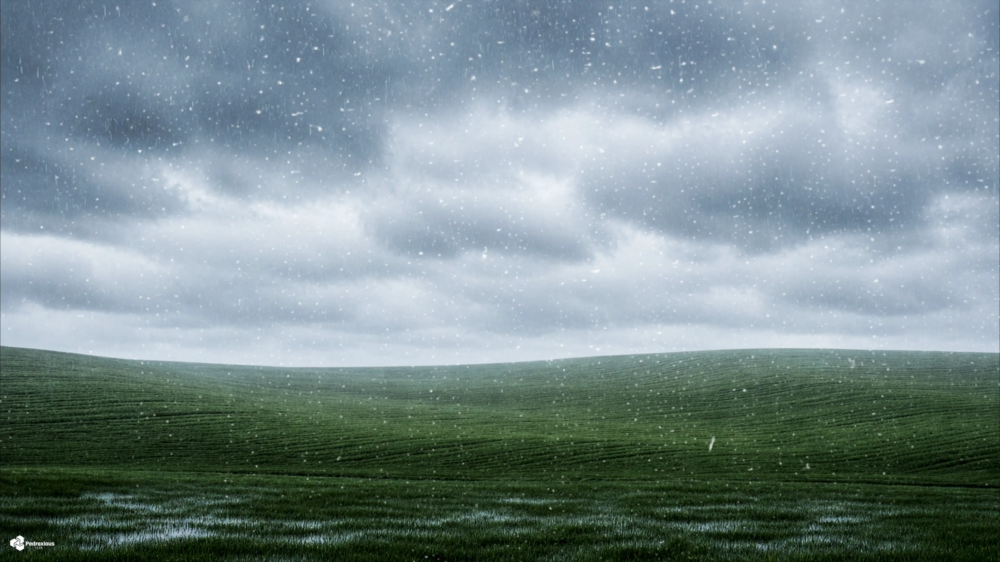

# SkyLog — Global Weather Dashboard

### Monitoramento climático em tempo real de 15 cidades ao redor do mundo

---

### Sync Ativo • Última atualização: 15:58 (BRT)
*Projeto em expansão, operando com automações no GitHub Actions para manter métricas globais atualizadas em tempo real. Consulte o link superior para a versão Web.*

 

## São Paulo, Brasil

<table>
  <tr>
    <td align="center" width="50%">
      
    </td>
    <td align="center" width="50%">
      
    </td>
  </tr>
</table>

| Parâmetro | Medição em Tempo Real |
|:---:|:---:|
| Temperatura | 23.0°C (Sensação: 24.3°C) |
| Variação Diária | 17.0°C — 26.4°C |
| Umidade / Pressão | 73% / 1015.1 hPa |
| Vento / Direção | 9.8 km/h (Direção: 186°) |
| UV / Visibilidade | 6.8 / 5.7 km |
| Condição Atual | Chuvisco |
| Horário Local | 15:58 |

### Previsão para os Próximos Dias

| Dia | Condição | Temperatura | Índice UV Máximo | Precipitação Prevista |
|:---:|:---:|:---:|:---:|:---:|
| Hoje | ⛈️ Tempestade | 17.0°C a 26.4°C | UV: 10 | Precip: 3.8 mm |
| Amanhã | 🌦️ Chuvisco | 17.6°C a 26.6°C | UV: 9 | Precip: 0.2 mm |
| 15/11 | 🌦️ Chuvisco | 16.2°C a 27.3°C | UV: 7 | Precip: 2.5 mm |

 
 

## Rio de Janeiro, Brasil

<table>
  <tr>
    <td align="center" width="50%">
      
    </td>
    <td align="center" width="50%">
      
    </td>
  </tr>
</table>

| Parâmetro | Medição em Tempo Real |
|:---:|:---:|
| Temperatura | 24.9°C (Sensação: 27.9°C) |
| Variação Diária | 22.2°C — 28.6°C |
| Umidade / Pressão | 82% / 1014.8 hPa |
| Vento / Direção | 11.5 km/h (Direção: 245°) |
| UV / Visibilidade | 6.1 / 8.8 km |
| Condição Atual | Chuvisco |
| Horário Local | 15:58 |

### Previsão para os Próximos Dias

| Dia | Condição | Temperatura | Índice UV Máximo | Precipitação Prevista |
|:---:|:---:|:---:|:---:|:---:|
| Hoje | 🌦️ Chuvisco | 22.2°C a 28.6°C | UV: 9 | Precip: 0.5 mm |
| Amanhã | 🌦️ Chuvisco | 21.5°C a 25.8°C | UV: 7 | Precip: 0.9 mm |
| 15/11 | ⛈️ Tempestade | 21.0°C a 26.7°C | UV: 8 | Precip: 19.2 mm |

 
 

## Buenos Aires, Argentina

<table>
  <tr>
    <td align="center" width="50%">
      
    </td>
    <td align="center" width="50%">
      
    </td>
  </tr>
</table>

| Parâmetro | Medição em Tempo Real |
|:---:|:---:|
| Temperatura | 27.4°C (Sensação: 27.8°C) |
| Variação Diária | 21.5°C — 27.5°C |
| Umidade / Pressão | 47% / 1014.0 hPa |
| Vento / Direção | 13.1 km/h (Direção: 82°) |
| UV / Visibilidade | 6.7 / 59.1 km |
| Condição Atual | Parcialmente nublado |
| Horário Local | 15:58 |

### Previsão para os Próximos Dias

| Dia | Condição | Temperatura | Índice UV Máximo | Precipitação Prevista |
|:---:|:---:|:---:|:---:|:---:|
| Hoje | ☁️ Nublado | 21.5°C a 27.5°C | UV: 7 | Precip: 0.0 mm |
| Amanhã | ⛈️ Tempestade | 20.3°C a 27.5°C | UV: 8 | Precip: 19.1 mm |
| 15/11 | 🌦️ Chuvisco | 17.0°C a 24.1°C | UV: 7 | Precip: 0.2 mm |

 
 

## Mexico City, México

<table>
  <tr>
    <td align="center" width="50%">
      
    </td>
    <td align="center" width="50%">
      
    </td>
  </tr>
</table>

| Parâmetro | Medição em Tempo Real |
|:---:|:---:|
| Temperatura | 17.3°C (Sensação: 17.5°C) |
| Variação Diária | 11.8°C — 18.1°C |
| Umidade / Pressão | 67% / 1015.7 hPa |
| Vento / Direção | 4.9 km/h (Direção: 208°) |
| UV / Visibilidade | 6.9 / 9.5 km |
| Condição Atual | Parcialmente nublado |
| Horário Local | 12:58 |

### Previsão para os Próximos Dias

| Dia | Condição | Temperatura | Índice UV Máximo | Precipitação Prevista |
|:---:|:---:|:---:|:---:|:---:|
| Hoje | 🌦️ Chuvisco | 11.8°C a 18.1°C | UV: 7 | Precip: 1.8 mm |
| Amanhã | 🌦️ Chuvisco | 10.2°C a 20.1°C | UV: 7 | Precip: 0.3 mm |
| 15/11 | 🌫️ Neblina | 9.1°C a 20.4°C | UV: 7 | Precip: 0.0 mm |

 
 

## Havana, Cuba

<table>
  <tr>
    <td align="center" width="50%">
      
    </td>
    <td align="center" width="50%">
      
    </td>
  </tr>
</table>

| Parâmetro | Medição em Tempo Real |
|:---:|:---:|
| Temperatura | 27.4°C (Sensação: 30.4°C) |
| Variação Diária | 22.5°C — 27.5°C |
| Umidade / Pressão | 65% / 1009.7 hPa |
| Vento / Direção | 11.9 km/h (Direção: 322°) |
| UV / Visibilidade | 5.3 / 51.2 km |
| Condição Atual | Céu limpo |
| Horário Local | 14:58 |

### Previsão para os Próximos Dias

| Dia | Condição | Temperatura | Índice UV Máximo | Precipitação Prevista |
|:---:|:---:|:---:|:---:|:---:|
| Hoje | 🌦️ Chuvisco | 22.5°C a 27.5°C | UV: 6 | Precip: 1.3 mm |
| Amanhã | ☁️ Nublado | 22.0°C a 26.5°C | UV: 6 | Precip: 0.0 mm |
| 15/11 | ☁️ Nublado | 21.9°C a 27.5°C | UV: 6 | Precip: 0.0 mm |

 
 

## Miami, EUA

<table>
  <tr>
    <td align="center" width="50%">
      
    </td>
    <td align="center" width="50%">
      
    </td>
  </tr>
</table>

| Parâmetro | Medição em Tempo Real |
|:---:|:---:|
| Temperatura | 22.9°C (Sensação: 26.5°C) |
| Variação Diária | 17.0°C — 26.2°C |
| Umidade / Pressão | 90% / 1008.6 hPa |
| Vento / Direção | 5.9 km/h (Direção: 328°) |
| UV / Visibilidade | 5.4 / 2.0 km |
| Condição Atual | Chuva |
| Horário Local | 13:58 |

### Previsão para os Próximos Dias

| Dia | Condição | Temperatura | Índice UV Máximo | Precipitação Prevista |
|:---:|:---:|:---:|:---:|:---:|
| Hoje | 🌧️ Chuva | 17.0°C a 26.2°C | UV: 5 | Precip: 9.0 mm |
| Amanhã | ☁️ Nublado | 12.7°C a 20.5°C | UV: 6 | Precip: 0.0 mm |
| 15/11 | ☁️ Nublado | 12.5°C a 24.1°C | UV: 6 | Precip: 0.0 mm |

 
 

## New York, EUA

<table>
  <tr>
    <td align="center" width="50%">
      
    </td>
    <td align="center" width="50%">
      
    </td>
  </tr>
</table>

| Parâmetro | Medição em Tempo Real |
|:---:|:---:|
| Temperatura | 4.2°C (Sensação: 0.2°C) |
| Variação Diária | 2.3°C — 8.7°C |
| Umidade / Pressão | 91% / 1003.8 hPa |
| Vento / Direção | 16.1 km/h (Direção: 355°) |
| UV / Visibilidade | 0.2 / 14.4 km |
| Condição Atual | Nublado |
| Horário Local | 13:58 |

### Previsão para os Próximos Dias

| Dia | Condição | Temperatura | Índice UV Máximo | Precipitação Prevista |
|:---:|:---:|:---:|:---:|:---:|
| Hoje | 🌨️ Neve | 2.3°C a 8.7°C | UV: 0 | Precip: 8.1 mm |
| Amanhã | ☁️ Nublado | 1.2°C a 6.0°C | UV: 3 | Precip: 0.0 mm |
| 15/11 | ☁️ Nublado | 2.8°C a 9.4°C | UV: 3 | Precip: 0.0 mm |

 
 

## London, Reino Unido

<table>
  <tr>
    <td align="center" width="50%">
      
    </td>
    <td align="center" width="50%">
      
    </td>
  </tr>
</table>

| Parâmetro | Medição em Tempo Real |
|:---:|:---:|
| Temperatura | 5.1°C (Sensação: 2.3°C) |
| Variação Diária | 1.6°C — 8.4°C |
| Umidade / Pressão | 60% / 1019.6 hPa |
| Vento / Direção | 2.9 km/h (Direção: 264°) |
| UV / Visibilidade | 0.0 / 6.1 km |
| Condição Atual | Céu limpo |
| Horário Local | 18:58 |

### Previsão para os Próximos Dias

| Dia | Condição | Temperatura | Índice UV Máximo | Precipitação Prevista |
|:---:|:---:|:---:|:---:|:---:|
| Hoje | ☁️ Nublado | 1.6°C a 8.4°C | UV: 1 | Precip: 0.0 mm |
| Amanhã | ☁️ Nublado | 1.1°C a 9.7°C | UV: 1 | Precip: 0.0 mm |
| 15/11 | 🌧️ Chuva | 5.2°C a 12.3°C | UV: 1 | Precip: 4.6 mm |

 
 

## Paris, França

<table>
  <tr>
    <td align="center" width="50%">
      
    </td>
    <td align="center" width="50%">
      
    </td>
  </tr>
</table>

| Parâmetro | Medição em Tempo Real |
|:---:|:---:|
| Temperatura | 7.5°C (Sensação: 5.1°C) |
| Variação Diária | 4.0°C — 10.9°C |
| Umidade / Pressão | 78% / 1019.0 hPa |
| Vento / Direção | 6.2 km/h (Direção: 21°) |
| UV / Visibilidade | 0.0 / 33.2 km |
| Condição Atual | Céu limpo |
| Horário Local | 19:58 |

### Previsão para os Próximos Dias

| Dia | Condição | Temperatura | Índice UV Máximo | Precipitação Prevista |
|:---:|:---:|:---:|:---:|:---:|
| Hoje | ☁️ Nublado | 4.0°C a 10.9°C | UV: 2 | Precip: 0.0 mm |
| Amanhã | ☁️ Nublado | 2.8°C a 10.6°C | UV: 2 | Precip: 0.0 mm |
| 15/11 | 🌧️ Chuva | 5.2°C a 13.6°C | UV: 2 | Precip: 16.9 mm |

 
 

## Moscow, Rússia

<table>
  <tr>
    <td align="center" width="50%">
      
    </td>
    <td align="center" width="50%">
      
    </td>
  </tr>
</table>

| Parâmetro | Medição em Tempo Real |
|:---:|:---:|
| Temperatura | 3.9°C (Sensação: 0.2°C) |
| Variação Diária | 1.3°C — 5.1°C |
| Umidade / Pressão | 93% / 994.5 hPa |
| Vento / Direção | 14.3 km/h (Direção: 135°) |
| UV / Visibilidade | 0.0 / 16.1 km |
| Condição Atual | Chuva |
| Horário Local | 21:58 |

### Previsão para os Próximos Dias

| Dia | Condição | Temperatura | Índice UV Máximo | Precipitação Prevista |
|:---:|:---:|:---:|:---:|:---:|
| Hoje | 🌧️ Chuva | 1.3°C a 5.1°C | UV: 1 | Precip: 7.2 mm |
| Amanhã | 🌧️ Chuva | 1.9°C a 5.2°C | UV: 0 | Precip: 5.7 mm |
| 15/11 | 🌧️ Chuva | 1.9°C a 3.4°C | UV: 1 | Precip: 0.2 mm |

 
 

## Bangkok, Tailândia

<table>
  <tr>
    <td align="center" width="50%">
      
    </td>
    <td align="center" width="50%">
      
    </td>
  </tr>
</table>

| Parâmetro | Medição em Tempo Real |
|:---:|:---:|
| Temperatura | 26.9°C (Sensação: 32.3°C) |
| Variação Diária | 25.2°C — 33.3°C |
| Umidade / Pressão | 82% / 1013.4 hPa |
| Vento / Direção | 3.1 km/h (Direção: 62°) |
| UV / Visibilidade | 0.0 / 18.2 km |
| Condição Atual | Nublado |
| Horário Local | 01:58 |

### Previsão para os Próximos Dias

| Dia | Condição | Temperatura | Índice UV Máximo | Precipitação Prevista |
|:---:|:---:|:---:|:---:|:---:|
| Hoje | 🌦️ Chuvisco | 25.2°C a 33.3°C | UV: 7 | Precip: 1.5 mm |
| Amanhã | 🌦️ Chuvisco | 25.4°C a 32.9°C | UV: 7 | Precip: 1.1 mm |
| 16/11 | 🌧️ Chuva | 26.0°C a 33.9°C | UV: 7 | Precip: 3.3 mm |

 
 

## Tokyo, Japão

<table>
  <tr>
    <td align="center" width="50%">
      
    </td>
    <td align="center" width="50%">
      
    </td>
  </tr>
</table>

| Parâmetro | Medição em Tempo Real |
|:---:|:---:|
| Temperatura | 10.8°C (Sensação: 9.5°C) |
| Variação Diária | 10.8°C — 18.2°C |
| Umidade / Pressão | 77% / 1021.1 hPa |
| Vento / Direção | 3.6 km/h (Direção: 354°) |
| UV / Visibilidade | 0.0 / 32.7 km |
| Condição Atual | Principalmente limpo |
| Horário Local | 03:58 |

### Previsão para os Próximos Dias

| Dia | Condição | Temperatura | Índice UV Máximo | Precipitação Prevista |
|:---:|:---:|:---:|:---:|:---:|
| Hoje | ☁️ Nublado | 10.8°C a 18.2°C | UV: 4 | Precip: 0.0 mm |
| Amanhã | 🌧️ Chuva | 11.5°C a 13.3°C | UV: 2 | Precip: 10.6 mm |
| 16/11 | ☁️ Nublado | 12.0°C a 19.1°C | UV: 3 | Precip: 0.0 mm |

 
 

## Dubai, Emirados Árabes

<table>
  <tr>
    <td align="center" width="50%">
      
    </td>
    <td align="center" width="50%">
      
    </td>
  </tr>
</table>

| Parâmetro | Medição em Tempo Real |
|:---:|:---:|
| Temperatura | 26.6°C (Sensação: 27.3°C) |
| Variação Diária | 26.3°C — 28.5°C |
| Umidade / Pressão | 58% / 1019.2 hPa |
| Vento / Direção | 14.2 km/h (Direção: 277°) |
| UV / Visibilidade | 0.0 / 26.5 km |
| Condição Atual | Céu limpo |
| Horário Local | 22:58 |

### Previsão para os Próximos Dias

| Dia | Condição | Temperatura | Índice UV Máximo | Precipitação Prevista |
|:---:|:---:|:---:|:---:|:---:|
| Hoje | ☀️ Céu limpo | 26.3°C a 28.5°C | UV: 6 | Precip: 0.0 mm |
| Amanhã | ☀️ Céu limpo | 26.2°C a 28.2°C | UV: 6 | Precip: 0.0 mm |
| 15/11 | ☀️ Céu limpo | 25.1°C a 29.2°C | UV: 6 | Precip: 0.0 mm |

 
 

## Cairo, Egito

<table>
  <tr>
    <td align="center" width="50%">
      
    </td>
    <td align="center" width="50%">
      
    </td>
  </tr>
</table>

| Parâmetro | Medição em Tempo Real |
|:---:|:---:|
| Temperatura | 21.5°C (Sensação: 22.5°C) |
| Variação Diária | 15.1°C — 27.6°C |
| Umidade / Pressão | 72% / 1022.1 hPa |
| Vento / Direção | 8.1 km/h (Direção: 32°) |
| UV / Visibilidade | 0.0 / 35.6 km |
| Condição Atual | Céu limpo |
| Horário Local | 20:58 |

### Previsão para os Próximos Dias

| Dia | Condição | Temperatura | Índice UV Máximo | Precipitação Prevista |
|:---:|:---:|:---:|:---:|:---:|
| Hoje | 🌤️ Principalmente limpo | 15.1°C a 27.6°C | UV: 4 | Precip: 0.0 mm |
| Amanhã | 🌫️ Neblina | 15.8°C a 28.3°C | UV: 4 | Precip: 0.0 mm |
| 15/11 | ☁️ Nublado | 17.5°C a 27.2°C | UV: 4 | Precip: 0.0 mm |

 
 

## Sydney, Austrália

<table>
  <tr>
    <td align="center" width="50%">
      
    </td>
    <td align="center" width="50%">
      
    </td>
  </tr>
</table>

| Parâmetro | Medição em Tempo Real |
|:---:|:---:|
| Temperatura | 19.7°C (Sensação: 20.5°C) |
| Variação Diária | 19.7°C — 29.5°C |
| Umidade / Pressão | 83% / 1010.3 hPa |
| Vento / Direção | 10.7 km/h (Direção: 306°) |
| UV / Visibilidade | 0.0 / 31.2 km |
| Condição Atual | Principalmente limpo |
| Horário Local | 05:58 |

### Previsão para os Próximos Dias

| Dia | Condição | Temperatura | Índice UV Máximo | Precipitação Prevista |
|:---:|:---:|:---:|:---:|:---:|
| Hoje | 🌦️ Chuvisco | 19.7°C a 29.5°C | UV: 8 | Precip: 3.0 mm |
| Amanhã | 🌧️ Chuva | 16.9°C a 20.8°C | UV: 4 | Precip: 3.7 mm |
| 16/11 | ⛈️ Tempestade | 15.6°C a 17.5°C | UV: 2 | Precip: 20.6 mm |

 
 

## Histórico de Dados

| Estatística | Valor |
|:---:|:---:|
| Total de registros | 20196 |
| Primeiro registro | `datetime` |
| Último registro | `2026-11-14 05:58` |
| Temperatura mais alta | **46.1°C** — Dubai |
| Temperatura mais baixa | **-0.2°C** — Moscow |

📂 <a href="data/history.csv">Ver histórico completo (history.csv)</a>

---

### Informações Técnicas

| Item | Detalhe |
|:---:|:---:|
| Fonte de dados | <a href="https://open-meteo.com/">Open-Meteo API</a> (gratuita) |
| Frequência | 24× ao dia (a cada hora) |
| Automação | GitHub Actions — <a href=".github/workflows/weather.yml">ver workflow</a> |
| Script | `update_weather.py` (requests e pytz) |
| Cidades Monitoradas | 15 cidades globais |

---

**Feito com amor por [Pedroxious](https://github.com/Pedroxious) · Dados: [Open-Meteo](https://open-meteo.com/)**

