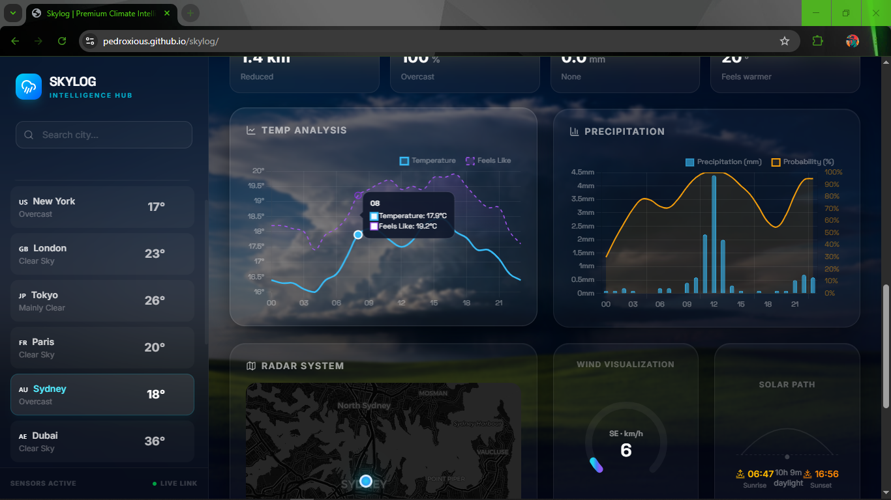

# SkyLog — Global Weather Dashboard

### Monitoramento climático em tempo real de 15 cidades ao redor do mundo

---

### Sync Ativo • Última atualização: 11:10 (BRT)
*Projeto em expansão, operando com automações no GitHub Actions para manter métricas globais atualizadas em tempo real. Consulte o link superior para a versão Web.*

 

## São Paulo, Brasil

<table>
  <tr>
    <td align="center" width="50%">
      
    </td>
    <td align="center" width="50%">
      
    </td>
  </tr>
</table>

| Parâmetro | Medição em Tempo Real |
|:---:|:---:|
| Temperatura | 24.6°C (Sensação: 25.9°C) |
| Variação Diária | 17.1°C — 25.0°C |
| Umidade / Pressão | 67% / 1013.6 hPa |
| Vento / Direção | 12.0 km/h (Direção: 314°) |
| UV / Visibilidade | 7.2 / 30.6 km |
| Condição Atual | Nublado |
| Horário Local | 11:09 |

### Previsão para os Próximos Dias

| Dia | Condição | Temperatura | Índice UV Máximo | Precipitação Prevista |
|:---:|:---:|:---:|:---:|:---:|
| Hoje | 🌦️ Chuvisco | 17.1°C a 25.0°C | UV: 7 | Precip: 1.5 mm |
| Amanhã | ⛈️ Tempestade | 15.6°C a 23.1°C | UV: 1 | Precip: 42.8 mm |
| 26/10 | 🌦️ Chuvisco | 12.6°C a 19.4°C | UV: 8 | Precip: 0.5 mm |

 
 

## Rio de Janeiro, Brasil

<table>
  <tr>
    <td align="center" width="50%">
      
    </td>
    <td align="center" width="50%">
      
    </td>
  </tr>
</table>

| Parâmetro | Medição em Tempo Real |
|:---:|:---:|
| Temperatura | 28.2°C (Sensação: 35.3°C) |
| Variação Diária | 21.1°C — 28.4°C |
| Umidade / Pressão | 75% / 1011.6 hPa |
| Vento / Direção | 8.3 km/h (Direção: 158°) |
| UV / Visibilidade | 8.6 / 29.2 km |
| Condição Atual | Principalmente limpo |
| Horário Local | 11:09 |

### Previsão para os Próximos Dias

| Dia | Condição | Temperatura | Índice UV Máximo | Precipitação Prevista |
|:---:|:---:|:---:|:---:|:---:|
| Hoje | 🌫️ Neblina | 21.1°C a 28.4°C | UV: 9 | Precip: 0.0 mm |
| Amanhã | ⛈️ Tempestade | 22.1°C a 28.0°C | UV: 8 | Precip: 25.0 mm |
| 26/10 | 🌧️ Chuva | 19.5°C a 22.1°C | UV: 1 | Precip: 9.4 mm |

 
 

## Buenos Aires, Argentina

<table>
  <tr>
    <td align="center" width="50%">
      
    </td>
    <td align="center" width="50%">
      
    </td>
  </tr>
</table>

| Parâmetro | Medição em Tempo Real |
|:---:|:---:|
| Temperatura | 15.6°C (Sensação: 14.1°C) |
| Variação Diária | 12.9°C — 17.0°C |
| Umidade / Pressão | 71% / 1015.0 hPa |
| Vento / Direção | 10.2 km/h (Direção: 154°) |
| UV / Visibilidade | 2.1 / 13.2 km |
| Condição Atual | Nublado |
| Horário Local | 11:09 |

### Previsão para os Próximos Dias

| Dia | Condição | Temperatura | Índice UV Máximo | Precipitação Prevista |
|:---:|:---:|:---:|:---:|:---:|
| Hoje | 🌦️ Chuvisco | 12.9°C a 17.0°C | UV: 5 | Precip: 3.6 mm |
| Amanhã | 🌦️ Chuvisco | 10.7°C a 16.0°C | UV: 6 | Precip: 0.2 mm |
| 26/10 | ☁️ Nublado | 8.5°C a 15.3°C | UV: 8 | Precip: 0.0 mm |

 
 

## Mexico City, México

<table>
  <tr>
    <td align="center" width="50%">
      
    </td>
    <td align="center" width="50%">
      
    </td>
  </tr>
</table>

| Parâmetro | Medição em Tempo Real |
|:---:|:---:|
| Temperatura | 12.1°C (Sensação: 11.4°C) |
| Variação Diária | 11.3°C — 20.5°C |
| Umidade / Pressão | 86% / 1021.8 hPa |
| Vento / Direção | 4.4 km/h (Direção: 328°) |
| UV / Visibilidade | 0.8 / 29.8 km |
| Condição Atual | Nublado |
| Horário Local | 08:10 |

### Previsão para os Próximos Dias

| Dia | Condição | Temperatura | Índice UV Máximo | Precipitação Prevista |
|:---:|:---:|:---:|:---:|:---:|
| Hoje | ☁️ Nublado | 11.3°C a 20.5°C | UV: 6 | Precip: 0.0 mm |
| Amanhã | ☁️ Nublado | 12.0°C a 20.0°C | UV: 4 | Precip: 0.0 mm |
| 26/10 | 🌧️ Chuva | 11.9°C a 22.0°C | UV: 8 | Precip: 5.7 mm |

 
 

## Havana, Cuba

<table>
  <tr>
    <td align="center" width="50%">
      
    </td>
    <td align="center" width="50%">
      
    </td>
  </tr>
</table>

| Parâmetro | Medição em Tempo Real |
|:---:|:---:|
| Temperatura | 24.2°C (Sensação: 25.9°C) |
| Variação Diária | 20.2°C — 26.5°C |
| Umidade / Pressão | 79% / 1015.9 hPa |
| Vento / Direção | 15.6 km/h (Direção: 49°) |
| UV / Visibilidade | 2.5 / 21.1 km |
| Condição Atual | Principalmente limpo |
| Horário Local | 10:10 |

### Previsão para os Próximos Dias

| Dia | Condição | Temperatura | Índice UV Máximo | Precipitação Prevista |
|:---:|:---:|:---:|:---:|:---:|
| Hoje | 🌦️ Chuvisco | 20.2°C a 26.5°C | UV: 7 | Precip: 4.9 mm |
| Amanhã | 🌦️ Chuvisco | 23.4°C a 26.8°C | UV: 7 | Precip: 0.9 mm |
| 26/10 | 🌦️ Chuvisco | 22.5°C a 27.0°C | UV: 7 | Precip: 6.1 mm |

 
 

## Miami, EUA

<table>
  <tr>
    <td align="center" width="50%">
      
    </td>
    <td align="center" width="50%">
      
    </td>
  </tr>
</table>

| Parâmetro | Medição em Tempo Real |
|:---:|:---:|
| Temperatura | 25.0°C (Sensação: 27.1°C) |
| Variação Diária | 20.3°C — 28.9°C |
| Umidade / Pressão | 76% / 1016.9 hPa |
| Vento / Direção | 14.1 km/h (Direção: 5°) |
| UV / Visibilidade | 2.5 / 20.6 km |
| Condição Atual | Nublado |
| Horário Local | 10:10 |

### Previsão para os Próximos Dias

| Dia | Condição | Temperatura | Índice UV Máximo | Precipitação Prevista |
|:---:|:---:|:---:|:---:|:---:|
| Hoje | ☁️ Nublado | 20.3°C a 28.9°C | UV: 7 | Precip: 0.0 mm |
| Amanhã | ⛈️ Tempestade | 19.8°C a 25.8°C | UV: 7 | Precip: 8.9 mm |
| 26/10 | 🌧️ Chuva | 22.0°C a 27.0°C | UV: 6 | Precip: 10.2 mm |

 
 

## New York, EUA

<table>
  <tr>
    <td align="center" width="50%">
      
    </td>
    <td align="center" width="50%">
      
    </td>
  </tr>
</table>

| Parâmetro | Medição em Tempo Real |
|:---:|:---:|
| Temperatura | 9.1°C (Sensação: 6.2°C) |
| Variação Diária | 4.7°C — 15.8°C |
| Umidade / Pressão | 63% / 1033.8 hPa |
| Vento / Direção | 8.0 km/h (Direção: 4°) |
| UV / Visibilidade | 1.7 / 29.5 km |
| Condição Atual | Nublado |
| Horário Local | 10:10 |

### Previsão para os Próximos Dias

| Dia | Condição | Temperatura | Índice UV Máximo | Precipitação Prevista |
|:---:|:---:|:---:|:---:|:---:|
| Hoje | ☁️ Nublado | 4.7°C a 15.8°C | UV: 4 | Precip: 0.0 mm |
| Amanhã | ☀️ Céu limpo | 3.3°C a 18.5°C | UV: 4 | Precip: 0.0 mm |
| 26/10 | ☀️ Céu limpo | 7.1°C a 20.9°C | UV: 4 | Precip: 0.0 mm |

 
 

## London, Reino Unido

<table>
  <tr>
    <td align="center" width="50%">
      
    </td>
    <td align="center" width="50%">
      
    </td>
  </tr>
</table>

| Parâmetro | Medição em Tempo Real |
|:---:|:---:|
| Temperatura | 11.4°C (Sensação: 8.7°C) |
| Variação Diária | 7.3°C — 15.5°C |
| Umidade / Pressão | 92% / 1001.5 hPa |
| Vento / Direção | 19.4 km/h (Direção: 196°) |
| UV / Visibilidade | 0.1 / 9.8 km |
| Condição Atual | Chuva |
| Horário Local | 15:10 |

### Previsão para os Próximos Dias

| Dia | Condição | Temperatura | Índice UV Máximo | Precipitação Prevista |
|:---:|:---:|:---:|:---:|:---:|
| Hoje | 🌧️ Chuva | 7.3°C a 15.5°C | UV: 0 | Precip: 20.9 mm |
| Amanhã | 🌦️ Chuvisco | 9.2°C a 13.5°C | UV: 1 | Precip: 0.1 mm |
| 26/10 | 🌦️ Chuvisco | 8.7°C a 16.3°C | UV: 0 | Precip: 4.2 mm |

 
 

## Paris, França

<table>
  <tr>
    <td align="center" width="50%">
      
    </td>
    <td align="center" width="50%">
      
    </td>
  </tr>
</table>

| Parâmetro | Medição em Tempo Real |
|:---:|:---:|
| Temperatura | 12.5°C (Sensação: 9.7°C) |
| Variação Diária | 8.9°C — 13.4°C |
| Umidade / Pressão | 74% / 1015.1 hPa |
| Vento / Direção | 15.6 km/h (Direção: 209°) |
| UV / Visibilidade | 0.8 / 35.0 km |
| Condição Atual | Chuva |
| Horário Local | 16:10 |

### Previsão para os Próximos Dias

| Dia | Condição | Temperatura | Índice UV Máximo | Precipitação Prevista |
|:---:|:---:|:---:|:---:|:---:|
| Hoje | 🌧️ Chuva | 8.9°C a 13.4°C | UV: 2 | Precip: 10.1 mm |
| Amanhã | 🌧️ Chuva | 10.9°C a 16.7°C | UV: 3 | Precip: 8.5 mm |
| 26/10 | 🌧️ Chuva | 9.0°C a 13.7°C | UV: 2 | Precip: 0.6 mm |

 
 

## Moscow, Rússia

<table>
  <tr>
    <td align="center" width="50%">
      
    </td>
    <td align="center" width="50%">
      
    </td>
  </tr>
</table>

| Parâmetro | Medição em Tempo Real |
|:---:|:---:|
| Temperatura | 11.9°C (Sensação: 9.3°C) |
| Variação Diária | 6.5°C — 12.7°C |
| Umidade / Pressão | 54% / 1029.2 hPa |
| Vento / Direção | 6.3 km/h (Direção: 121°) |
| UV / Visibilidade | 0.1 / 41.2 km |
| Condição Atual | Nublado |
| Horário Local | 17:10 |

### Previsão para os Próximos Dias

| Dia | Condição | Temperatura | Índice UV Máximo | Precipitação Prevista |
|:---:|:---:|:---:|:---:|:---:|
| Hoje | ☁️ Nublado | 6.5°C a 12.7°C | UV: 2 | Precip: 0.0 mm |
| Amanhã | ⛅ Parcialmente nublado | 4.5°C a 12.3°C | UV: 2 | Precip: 0.0 mm |
| 26/10 | ☁️ Nublado | 2.8°C a 10.3°C | UV: 2 | Precip: 0.0 mm |

 
 

## Bangkok, Tailândia

<table>
  <tr>
    <td align="center" width="50%">
      
    </td>
    <td align="center" width="50%">
      
    </td>
  </tr>
</table>

| Parâmetro | Medição em Tempo Real |
|:---:|:---:|
| Temperatura | 28.9°C (Sensação: 34.7°C) |
| Variação Diária | 24.9°C — 33.2°C |
| Umidade / Pressão | 78% / 1009.4 hPa |
| Vento / Direção | 5.1 km/h (Direção: 170°) |
| UV / Visibilidade | 0.0 / 20.3 km |
| Condição Atual | Nublado |
| Horário Local | 21:10 |

### Previsão para os Próximos Dias

| Dia | Condição | Temperatura | Índice UV Máximo | Precipitação Prevista |
|:---:|:---:|:---:|:---:|:---:|
| Hoje | ⛈️ Tempestade | 24.9°C a 33.2°C | UV: 8 | Precip: 5.8 mm |
| Amanhã | 🌧️ Chuva | 23.0°C a 32.0°C | UV: 8 | Precip: 6.1 mm |
| 26/10 | 🌧️ Chuva | 24.3°C a 32.4°C | UV: 7 | Precip: 5.5 mm |

 
 

## Tokyo, Japão

<table>
  <tr>
    <td align="center" width="50%">
      
    </td>
    <td align="center" width="50%">
      
    </td>
  </tr>
</table>

| Parâmetro | Medição em Tempo Real |
|:---:|:---:|
| Temperatura | 15.7°C (Sensação: 17.1°C) |
| Variação Diária | 14.1°C — 15.8°C |
| Umidade / Pressão | 98% / 1019.9 hPa |
| Vento / Direção | 3.4 km/h (Direção: 328°) |
| UV / Visibilidade | 0.0 / 23.0 km |
| Condição Atual | Parcialmente nublado |
| Horário Local | 23:10 |

### Previsão para os Próximos Dias

| Dia | Condição | Temperatura | Índice UV Máximo | Precipitação Prevista |
|:---:|:---:|:---:|:---:|:---:|
| Hoje | 🌧️ Chuva | 14.1°C a 15.8°C | UV: 3 | Precip: 20.7 mm |
| Amanhã | 🌧️ Chuva | 15.4°C a 25.1°C | UV: 3 | Precip: 7.4 mm |
| 26/10 | 🌧️ Chuva | 16.9°C a 18.4°C | UV: 1 | Precip: 37.9 mm |

 
 

## Dubai, Emirados Árabes

<table>
  <tr>
    <td align="center" width="50%">
      
    </td>
    <td align="center" width="50%">
      
    </td>
  </tr>
</table>

| Parâmetro | Medição em Tempo Real |
|:---:|:---:|
| Temperatura | 31.0°C (Sensação: 36.1°C) |
| Variação Diária | 28.8°C — 32.4°C |
| Umidade / Pressão | 71% / 1010.1 hPa |
| Vento / Direção | 11.6 km/h (Direção: 292°) |
| UV / Visibilidade | 0.1 / 20.7 km |
| Condição Atual | Céu limpo |
| Horário Local | 18:10 |

### Previsão para os Próximos Dias

| Dia | Condição | Temperatura | Índice UV Máximo | Precipitação Prevista |
|:---:|:---:|:---:|:---:|:---:|
| Hoje | ☀️ Céu limpo | 28.8°C a 32.4°C | UV: 7 | Precip: 0.0 mm |
| Amanhã | ☀️ Céu limpo | 29.3°C a 33.2°C | UV: 7 | Precip: 0.0 mm |
| 26/10 | ☀️ Céu limpo | 27.6°C a 32.7°C | UV: 6 | Precip: 0.0 mm |

 
 

## Cairo, Egito

<table>
  <tr>
    <td align="center" width="50%">
      
    </td>
    <td align="center" width="50%">
      
    </td>
  </tr>
</table>

| Parâmetro | Medição em Tempo Real |
|:---:|:---:|
| Temperatura | 30.1°C (Sensação: 30.1°C) |
| Variação Diária | 20.0°C — 30.6°C |
| Umidade / Pressão | 41% / 1011.8 hPa |
| Vento / Direção | 12.6 km/h (Direção: 27°) |
| UV / Visibilidade | 1.5 / 42.7 km |
| Condição Atual | Principalmente limpo |
| Horário Local | 17:10 |

### Previsão para os Próximos Dias

| Dia | Condição | Temperatura | Índice UV Máximo | Precipitação Prevista |
|:---:|:---:|:---:|:---:|:---:|
| Hoje | ⛅ Parcialmente nublado | 20.0°C a 30.6°C | UV: 5 | Precip: 0.0 mm |
| Amanhã | ⛅ Parcialmente nublado | 19.4°C a 28.8°C | UV: 5 | Precip: 0.0 mm |
| 26/10 | ☁️ Nublado | 19.0°C a 26.4°C | UV: 4 | Precip: 0.0 mm |

 
 

## Sydney, Austrália

<table>
  <tr>
    <td align="center" width="50%">
      
    </td>
    <td align="center" width="50%">
      
    </td>
  </tr>
</table>

| Parâmetro | Medição em Tempo Real |
|:---:|:---:|
| Temperatura | 20.1°C (Sensação: 21.8°C) |
| Variação Diária | 19.5°C — 30.5°C |
| Umidade / Pressão | 89% / 1012.1 hPa |
| Vento / Direção | 8.7 km/h (Direção: 18°) |
| UV / Visibilidade | 0.0 / 27.2 km |
| Condição Atual | Céu limpo |
| Horário Local | 01:10 |

### Previsão para os Próximos Dias

| Dia | Condição | Temperatura | Índice UV Máximo | Precipitação Prevista |
|:---:|:---:|:---:|:---:|:---:|
| Hoje | ⛈️ Tempestade | 19.5°C a 30.5°C | UV: 8 | Precip: 9.2 mm |
| Amanhã | ⛈️ Tempestade | 16.4°C a 21.0°C | UV: 3 | Precip: 6.1 mm |
| 27/10 | 🌦️ Chuvisco | 14.1°C a 19.1°C | UV: 8 | Precip: 4.9 mm |

 
 

## Histórico de Dados

| Estatística | Valor |
|:---:|:---:|
| Total de registros | 19003 |
| Primeiro registro | `datetime` |
| Último registro | `2026-10-25 01:10` |
| Temperatura mais alta | **46.1°C** — Dubai |
| Temperatura mais baixa | **0.7°C** — Buenos Aires |

📂 <a href="data/history.csv">Ver histórico completo (history.csv)</a>

---

### Informações Técnicas

| Item | Detalhe |
|:---:|:---:|
| Fonte de dados | <a href="https://open-meteo.com/">Open-Meteo API</a> (gratuita) |
| Frequência | 24× ao dia (a cada hora) |
| Automação | GitHub Actions — <a href=".github/workflows/weather.yml">ver workflow</a> |
| Script | `update_weather.py` (requests e pytz) |
| Cidades Monitoradas | 15 cidades globais |

---

**Feito com amor por [Pedroxious](https://github.com/Pedroxious) · Dados: [Open-Meteo](https://open-meteo.com/)**

