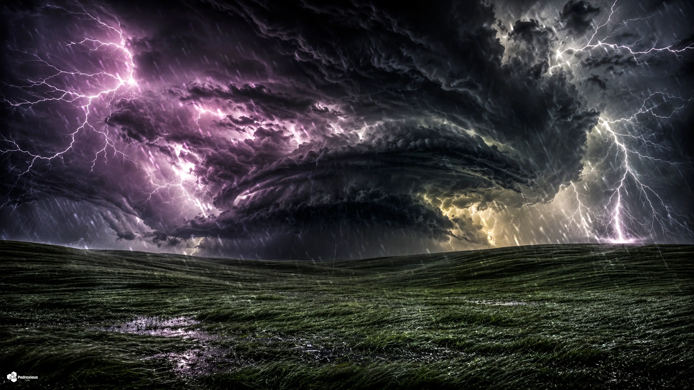

# SkyLog — Global Weather Dashboard

### Monitoramento climático em tempo real de 15 cidades ao redor do mundo

---

### Sync Ativo • Última atualização: 07:26 (BRT)
*Projeto em expansão, operando com automações no GitHub Actions para manter métricas globais atualizadas em tempo real. Consulte o link superior para a versão Web.*

 

## São Paulo, Brasil

<table>
  <tr>
    <td align="center" width="50%">
      
    </td>
    <td align="center" width="50%">
      
    </td>
  </tr>
</table>

| Parâmetro | Medição em Tempo Real |
|:---:|:---:|
| Temperatura | 20.2°C (Sensação: 21.1°C) |
| Variação Diária | 16.1°C — 21.0°C |
| Umidade / Pressão | 94% / 1008.1 hPa |
| Vento / Direção | 18.1 km/h (Direção: 253°) |
| UV / Visibilidade | 0.2 / 2.0 km |
| Condição Atual | Tempestade |
| Horário Local | 07:25 |

### Previsão para os Próximos Dias

| Dia | Condição | Temperatura | Índice UV Máximo | Precipitação Prevista |
|:---:|:---:|:---:|:---:|:---:|
| Hoje | ⛈️ Tempestade | 16.1°C a 21.0°C | UV: 2 | Precip: 56.8 mm |
| Amanhã | 🌦️ Chuvisco | 12.5°C a 18.5°C | UV: 7 | Precip: 1.7 mm |
| 27/10 | 🌦️ Chuvisco | 11.7°C a 21.3°C | UV: 6 | Precip: 0.1 mm |

 
 

## Rio de Janeiro, Brasil

<table>
  <tr>
    <td align="center" width="50%">
      
    </td>
    <td align="center" width="50%">
      
    </td>
  </tr>
</table>

| Parâmetro | Medição em Tempo Real |
|:---:|:---:|
| Temperatura | 22.9°C (Sensação: 27.7°C) |
| Variação Diária | 21.7°C — 24.1°C |
| Umidade / Pressão | 99% / 1004.9 hPa |
| Vento / Direção | 3.8 km/h (Direção: 87°) |
| UV / Visibilidade | 0.1 / 3.5 km |
| Condição Atual | Chuvisco |
| Horário Local | 07:25 |

### Previsão para os Próximos Dias

| Dia | Condição | Temperatura | Índice UV Máximo | Precipitação Prevista |
|:---:|:---:|:---:|:---:|:---:|
| Hoje | ⛈️ Tempestade | 21.7°C a 24.1°C | UV: 1 | Precip: 39.3 mm |
| Amanhã | 🌦️ Chuvisco | 19.5°C a 21.8°C | UV: 1 | Precip: 7.8 mm |
| 27/10 | 🌦️ Chuvisco | 18.5°C a 22.9°C | UV: 8 | Precip: 1.4 mm |

 
 

## Buenos Aires, Argentina

<table>
  <tr>
    <td align="center" width="50%">
      
    </td>
    <td align="center" width="50%">
      
    </td>
  </tr>
</table>

| Parâmetro | Medição em Tempo Real |
|:---:|:---:|
| Temperatura | 11.8°C (Sensação: 9.8°C) |
| Variação Diária | 11.1°C — 17.5°C |
| Umidade / Pressão | 86% / 1021.7 hPa |
| Vento / Direção | 12.8 km/h (Direção: 174°) |
| UV / Visibilidade | 0.1 / 19.3 km |
| Condição Atual | Nublado |
| Horário Local | 07:25 |

### Previsão para os Próximos Dias

| Dia | Condição | Temperatura | Índice UV Máximo | Precipitação Prevista |
|:---:|:---:|:---:|:---:|:---:|
| Hoje | 🌦️ Chuvisco | 11.1°C a 17.5°C | UV: 8 | Precip: 0.3 mm |
| Amanhã | ☁️ Nublado | 8.5°C a 16.6°C | UV: 8 | Precip: 0.0 mm |
| 27/10 | 🌦️ Chuvisco | 11.1°C a 17.8°C | UV: 8 | Precip: 0.2 mm |

 
 

## Mexico City, México

<table>
  <tr>
    <td align="center" width="50%">
      
    </td>
    <td align="center" width="50%">
      
    </td>
  </tr>
</table>

| Parâmetro | Medição em Tempo Real |
|:---:|:---:|
| Temperatura | 12.3°C (Sensação: 11.3°C) |
| Variação Diária | 12.2°C — 19.8°C |
| Umidade / Pressão | 87% / 1020.9 hPa |
| Vento / Direção | 7.1 km/h (Direção: 315°) |
| UV / Visibilidade | 0.0 / 20.2 km |
| Condição Atual | Nublado |
| Horário Local | 04:25 |

### Previsão para os Próximos Dias

| Dia | Condição | Temperatura | Índice UV Máximo | Precipitação Prevista |
|:---:|:---:|:---:|:---:|:---:|
| Hoje | 🌦️ Chuvisco | 12.2°C a 19.8°C | UV: 6 | Precip: 0.1 mm |
| Amanhã | 🌦️ Chuvisco | 12.3°C a 22.7°C | UV: 7 | Precip: 0.3 mm |
| 27/10 | 🌦️ Chuvisco | 11.4°C a 23.4°C | UV: 8 | Precip: 0.9 mm |

 
 

## Havana, Cuba

<table>
  <tr>
    <td align="center" width="50%">
      
    </td>
    <td align="center" width="50%">
      
    </td>
  </tr>
</table>

| Parâmetro | Medição em Tempo Real |
|:---:|:---:|
| Temperatura | 23.7°C (Sensação: 24.7°C) |
| Variação Diária | 23.1°C — 27.1°C |
| Umidade / Pressão | 72% / 1014.3 hPa |
| Vento / Direção | 13.5 km/h (Direção: 23°) |
| UV / Visibilidade | 0.0 / 14.3 km |
| Condição Atual | Principalmente limpo |
| Horário Local | 06:25 |

### Previsão para os Próximos Dias

| Dia | Condição | Temperatura | Índice UV Máximo | Precipitação Prevista |
|:---:|:---:|:---:|:---:|:---:|
| Hoje | 🌦️ Chuvisco | 23.1°C a 27.1°C | UV: 7 | Precip: 3.0 mm |
| Amanhã | ⛈️ Tempestade | 22.3°C a 27.2°C | UV: 6 | Precip: 13.9 mm |
| 27/10 | 🌦️ Chuvisco | 23.6°C a 27.4°C | UV: 6 | Precip: 2.9 mm |

 
 

## Miami, EUA

<table>
  <tr>
    <td align="center" width="50%">
      
    </td>
    <td align="center" width="50%">
      
    </td>
  </tr>
</table>

| Parâmetro | Medição em Tempo Real |
|:---:|:---:|
| Temperatura | 21.1°C (Sensação: 23.8°C) |
| Variação Diária | 20.7°C — 27.1°C |
| Umidade / Pressão | 92% / 1013.8 hPa |
| Vento / Direção | 7.4 km/h (Direção: 324°) |
| UV / Visibilidade | 0.0 / 12.6 km |
| Condição Atual | Nublado |
| Horário Local | 06:25 |

### Previsão para os Próximos Dias

| Dia | Condição | Temperatura | Índice UV Máximo | Precipitação Prevista |
|:---:|:---:|:---:|:---:|:---:|
| Hoje | ⛈️ Tempestade | 20.7°C a 27.1°C | UV: 6 | Precip: 46.1 mm |
| Amanhã | 🌧️ Chuva | 21.7°C a 27.1°C | UV: 6 | Precip: 31.0 mm |
| 27/10 | 🌧️ Chuva | 23.7°C a 27.0°C | UV: 6 | Precip: 23.1 mm |

 
 

## New York, EUA

<table>
  <tr>
    <td align="center" width="50%">
      
    </td>
    <td align="center" width="50%">
      
    </td>
  </tr>
</table>

| Parâmetro | Medição em Tempo Real |
|:---:|:---:|
| Temperatura | 3.6°C (Sensação: 0.9°C) |
| Variação Diária | 2.8°C — 17.8°C |
| Umidade / Pressão | 66% / 1034.6 hPa |
| Vento / Direção | 2.3 km/h (Direção: 356°) |
| UV / Visibilidade | 0.0 / 25.6 km |
| Condição Atual | Céu limpo |
| Horário Local | 06:25 |

### Previsão para os Próximos Dias

| Dia | Condição | Temperatura | Índice UV Máximo | Precipitação Prevista |
|:---:|:---:|:---:|:---:|:---:|
| Hoje | 🌤️ Principalmente limpo | 2.8°C a 17.8°C | UV: 4 | Precip: 0.0 mm |
| Amanhã | ☀️ Céu limpo | 6.0°C a 21.8°C | UV: 4 | Precip: 0.0 mm |
| 27/10 | ☁️ Nublado | 11.2°C a 15.8°C | UV: 4 | Precip: 0.0 mm |

 
 

## London, Reino Unido

<table>
  <tr>
    <td align="center" width="50%">
      
    </td>
    <td align="center" width="50%">
      
    </td>
  </tr>
</table>

| Parâmetro | Medição em Tempo Real |
|:---:|:---:|
| Temperatura | 12.6°C (Sensação: 7.0°C) |
| Variação Diária | 9.2°C — 13.5°C |
| Umidade / Pressão | 50% / 1000.3 hPa |
| Vento / Direção | 26.3 km/h (Direção: 268°) |
| UV / Visibilidade | 0.9 / 22.3 km |
| Condição Atual | Parcialmente nublado |
| Horário Local | 10:25 |

### Previsão para os Próximos Dias

| Dia | Condição | Temperatura | Índice UV Máximo | Precipitação Prevista |
|:---:|:---:|:---:|:---:|:---:|
| Hoje | 🌦️ Chuvisco | 9.2°C a 13.5°C | UV: 1 | Precip: 0.4 mm |
| Amanhã | 🌧️ Chuva | 9.2°C a 16.1°C | UV: 0 | Precip: 3.4 mm |
| 27/10 | 🌧️ Chuva | 10.4°C a 16.5°C | UV: 1 | Precip: 5.2 mm |

 
 

## Paris, França

<table>
  <tr>
    <td align="center" width="50%">
      
    </td>
    <td align="center" width="50%">
      
    </td>
  </tr>
</table>

| Parâmetro | Medição em Tempo Real |
|:---:|:---:|
| Temperatura | 14.4°C (Sensação: 10.6°C) |
| Variação Diária | 10.0°C — 16.1°C |
| Umidade / Pressão | 63% / 1007.3 hPa |
| Vento / Direção | 21.7 km/h (Direção: 277°) |
| UV / Visibilidade | 2.1 / 39.2 km |
| Condição Atual | Parcialmente nublado |
| Horário Local | 11:25 |

### Previsão para os Próximos Dias

| Dia | Condição | Temperatura | Índice UV Máximo | Precipitação Prevista |
|:---:|:---:|:---:|:---:|:---:|
| Hoje | 🌧️ Chuva | 10.0°C a 16.1°C | UV: 3 | Precip: 10.1 mm |
| Amanhã | 🌧️ Chuva | 9.3°C a 12.9°C | UV: 1 | Precip: 0.2 mm |
| 27/10 | ☁️ Nublado | 10.5°C a 18.1°C | UV: 2 | Precip: 0.2 mm |

 
 

## Moscow, Rússia

<table>
  <tr>
    <td align="center" width="50%">
      
    </td>
    <td align="center" width="50%">
      
    </td>
  </tr>
</table>

| Parâmetro | Medição em Tempo Real |
|:---:|:---:|
| Temperatura | 11.1°C (Sensação: 7.3°C) |
| Variação Diária | 4.3°C — 11.9°C |
| Umidade / Pressão | 45% / 1028.7 hPa |
| Vento / Direção | 10.9 km/h (Direção: 136°) |
| UV / Visibilidade | 1.9 / 42.0 km |
| Condição Atual | Céu limpo |
| Horário Local | 13:25 |

### Previsão para os Próximos Dias

| Dia | Condição | Temperatura | Índice UV Máximo | Precipitação Prevista |
|:---:|:---:|:---:|:---:|:---:|
| Hoje | 🌤️ Principalmente limpo | 4.3°C a 11.9°C | UV: 2 | Precip: 0.0 mm |
| Amanhã | ☁️ Nublado | 2.7°C a 10.5°C | UV: 2 | Precip: 0.0 mm |
| 27/10 | ☁️ Nublado | 2.3°C a 9.1°C | UV: 2 | Precip: 0.0 mm |

 
 

## Bangkok, Tailândia

<table>
  <tr>
    <td align="center" width="50%">
      
    </td>
    <td align="center" width="50%">
      
    </td>
  </tr>
</table>

| Parâmetro | Medição em Tempo Real |
|:---:|:---:|
| Temperatura | 30.9°C (Sensação: 35.2°C) |
| Variação Diária | 25.9°C — 33.7°C |
| Umidade / Pressão | 63% / 1007.9 hPa |
| Vento / Direção | 8.8 km/h (Direção: 180°) |
| UV / Visibilidade | 1.2 / 20.4 km |
| Condição Atual | Principalmente limpo |
| Horário Local | 17:25 |

### Previsão para os Próximos Dias

| Dia | Condição | Temperatura | Índice UV Máximo | Precipitação Prevista |
|:---:|:---:|:---:|:---:|:---:|
| Hoje | 🌦️ Chuvisco | 25.9°C a 33.7°C | UV: 8 | Precip: 2.0 mm |
| Amanhã | ⛈️ Tempestade | 25.1°C a 32.6°C | UV: 8 | Precip: 16.1 mm |
| 27/10 | 🌦️ Chuvisco | 24.0°C a 31.3°C | UV: 8 | Precip: 1.7 mm |

 
 

## Tokyo, Japão

<table>
  <tr>
    <td align="center" width="50%">
      
    </td>
    <td align="center" width="50%">
      
    </td>
  </tr>
</table>

| Parâmetro | Medição em Tempo Real |
|:---:|:---:|
| Temperatura | 19.0°C (Sensação: 21.8°C) |
| Variação Diária | 16.1°C — 27.1°C |
| Umidade / Pressão | 96% / 1015.9 hPa |
| Vento / Direção | 2.6 km/h (Direção: 56°) |
| UV / Visibilidade | 0.0 / 24.3 km |
| Condição Atual | Chuvisco |
| Horário Local | 19:25 |

### Previsão para os Próximos Dias

| Dia | Condição | Temperatura | Índice UV Máximo | Precipitação Prevista |
|:---:|:---:|:---:|:---:|:---:|
| Hoje | 🌧️ Chuva | 16.1°C a 27.1°C | UV: 4 | Precip: 6.6 mm |
| Amanhã | 🌧️ Chuva | 14.1°C a 18.5°C | UV: 0 | Precip: 45.2 mm |
| 27/10 | 🌧️ Chuva | 14.5°C a 23.8°C | UV: 1 | Precip: 5.3 mm |

 
 

## Dubai, Emirados Árabes

<table>
  <tr>
    <td align="center" width="50%">
      
    </td>
    <td align="center" width="50%">
      
    </td>
  </tr>
</table>

| Parâmetro | Medição em Tempo Real |
|:---:|:---:|
| Temperatura | 32.8°C (Sensação: 37.7°C) |
| Variação Diária | 29.1°C — 33.1°C |
| Umidade / Pressão | 62% / 1010.3 hPa |
| Vento / Direção | 13.0 km/h (Direção: 276°) |
| UV / Visibilidade | 5.8 / 24.8 km |
| Condição Atual | Céu limpo |
| Horário Local | 14:25 |

### Previsão para os Próximos Dias

| Dia | Condição | Temperatura | Índice UV Máximo | Precipitação Prevista |
|:---:|:---:|:---:|:---:|:---:|
| Hoje | ☀️ Céu limpo | 29.1°C a 33.1°C | UV: 7 | Precip: 0.0 mm |
| Amanhã | ☀️ Céu limpo | 28.3°C a 32.7°C | UV: 6 | Precip: 0.0 mm |
| 27/10 | ☀️ Céu limpo | 27.7°C a 32.4°C | UV: 6 | Precip: 0.0 mm |

 
 

## Histórico de Dados

| Estatística | Valor |
|:---:|:---:|
| Total de registros | 19089 |
| Primeiro registro | `datetime` |
| Último registro | `2026-10-25 14:25` |
| Temperatura mais alta | **46.1°C** — Dubai |
| Temperatura mais baixa | **0.7°C** — Buenos Aires |

📂 <a href="data/history.csv">Ver histórico completo (history.csv)</a>

---

### Informações Técnicas

| Item | Detalhe |
|:---:|:---:|
| Fonte de dados | <a href="https://open-meteo.com/">Open-Meteo API</a> (gratuita) |
| Frequência | 24× ao dia (a cada hora) |
| Automação | GitHub Actions — <a href=".github/workflows/weather.yml">ver workflow</a> |
| Script | `update_weather.py` (requests e pytz) |
| Cidades Monitoradas | 15 cidades globais |

---

**Feito com amor por [Pedroxious](https://github.com/Pedroxious) · Dados: [Open-Meteo](https://open-meteo.com/)**

