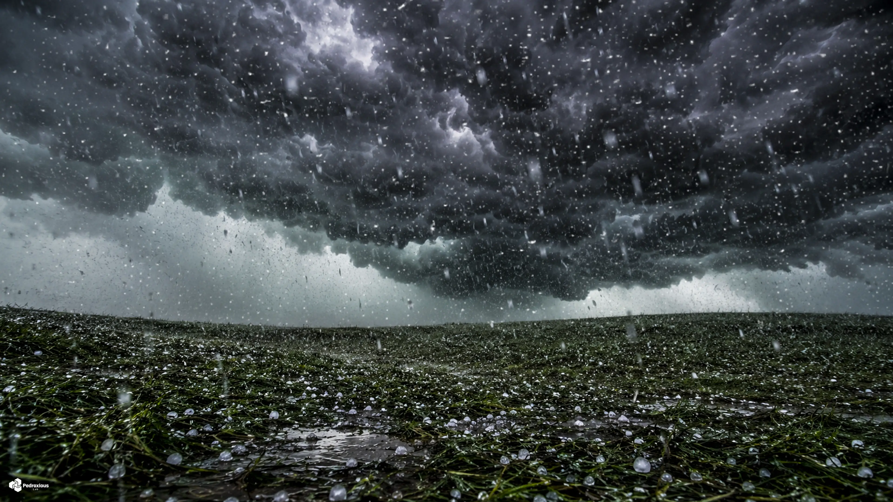

# SkyLog — Global Weather Dashboard

### Monitoramento climático em tempo real de 15 cidades ao redor do mundo

---

### Sync Ativo • Última atualização: 14:39 (BRT)
*Projeto em expansão, operando com automações no GitHub Actions para manter métricas globais atualizadas em tempo real. Consulte o link superior para a versão Web.*

 

## São Paulo, Brasil

<table>
  <tr>
    <td align="center" width="50%">
      
    </td>
    <td align="center" width="50%">
      
    </td>
  </tr>
</table>

| Parâmetro | Medição em Tempo Real |
|:---:|:---:|
| Temperatura | 21.1°C (Sensação: 22.8°C) |
| Variação Diária | 15.6°C — 21.7°C |
| Umidade / Pressão | 69% / 1009.9 hPa |
| Vento / Direção | 6.7 km/h (Direção: 200°) |
| UV / Visibilidade | 4.2 / 4.6 km |
| Condição Atual | Chuvisco |
| Horário Local | 14:38 |

### Previsão para os Próximos Dias

| Dia | Condição | Temperatura | Índice UV Máximo | Precipitação Prevista |
|:---:|:---:|:---:|:---:|:---:|
| Hoje | 🌧️ Chuva | 15.6°C a 21.7°C | UV: 5 | Precip: 6.7 mm |
| Amanhã | 🌦️ Chuvisco | 14.5°C a 24.0°C | UV: 8 | Precip: 0.4 mm |
| 19/10 | 🌦️ Chuvisco | 13.1°C a 22.0°C | UV: 8 | Precip: 0.2 mm |

 
 

## Rio de Janeiro, Brasil

<table>
  <tr>
    <td align="center" width="50%">
      
    </td>
    <td align="center" width="50%">
      
    </td>
  </tr>
</table>

| Parâmetro | Medição em Tempo Real |
|:---:|:---:|
| Temperatura | 22.9°C (Sensação: 22.9°C) |
| Variação Diária | 20.5°C — 23.5°C |
| Umidade / Pressão | 73% / 1010.0 hPa |
| Vento / Direção | 19.2 km/h (Direção: 220°) |
| UV / Visibilidade | 2.6 / 28.4 km |
| Condição Atual | Nublado |
| Horário Local | 14:38 |

### Previsão para os Próximos Dias

| Dia | Condição | Temperatura | Índice UV Máximo | Precipitação Prevista |
|:---:|:---:|:---:|:---:|:---:|
| Hoje | ⛈️ Tempestade | 20.5°C a 23.5°C | UV: 3 | Precip: 25.6 mm |
| Amanhã | 🌦️ Chuvisco | 19.9°C a 24.8°C | UV: 7 | Precip: 1.6 mm |
| 19/10 | 🌦️ Chuvisco | 19.7°C a 22.6°C | UV: 3 | Precip: 3.5 mm |

 
 

## Buenos Aires, Argentina

<table>
  <tr>
    <td align="center" width="50%">
      
    </td>
    <td align="center" width="50%">
      
    </td>
  </tr>
</table>

| Parâmetro | Medição em Tempo Real |
|:---:|:---:|
| Temperatura | 12.8°C (Sensação: 9.8°C) |
| Variação Diária | 8.1°C — 13.1°C |
| Umidade / Pressão | 58% / 1022.2 hPa |
| Vento / Direção | 12.1 km/h (Direção: 182°) |
| UV / Visibilidade | 3.8 / 17.8 km |
| Condição Atual | Nublado |
| Horário Local | 14:38 |

### Previsão para os Próximos Dias

| Dia | Condição | Temperatura | Índice UV Máximo | Precipitação Prevista |
|:---:|:---:|:---:|:---:|:---:|
| Hoje | 🌦️ Chuvisco | 8.1°C a 13.1°C | UV: 5 | Precip: 0.2 mm |
| Amanhã | ☁️ Nublado | 6.6°C a 15.0°C | UV: 8 | Precip: 0.0 mm |
| 19/10 | ☁️ Nublado | 9.0°C a 15.5°C | UV: 7 | Precip: 0.0 mm |

 
 

## Mexico City, México

<table>
  <tr>
    <td align="center" width="50%">
      
    </td>
    <td align="center" width="50%">
      
    </td>
  </tr>
</table>

| Parâmetro | Medição em Tempo Real |
|:---:|:---:|
| Temperatura | 13.5°C (Sensação: 11.9°C) |
| Variação Diária | 11.4°C — 16.6°C |
| Umidade / Pressão | 70% / 1025.6 hPa |
| Vento / Direção | 8.0 km/h (Direção: 351°) |
| UV / Visibilidade | 1.9 / 41.6 km |
| Condição Atual | Nublado |
| Horário Local | 11:38 |

### Previsão para os Próximos Dias

| Dia | Condição | Temperatura | Índice UV Máximo | Precipitação Prevista |
|:---:|:---:|:---:|:---:|:---:|
| Hoje | 🌦️ Chuvisco | 11.4°C a 16.6°C | UV: 2 | Precip: 2.2 mm |
| Amanhã | 🌦️ Chuvisco | 11.7°C a 21.4°C | UV: 8 | Precip: 2.6 mm |
| 19/10 | 🌦️ Chuvisco | 11.3°C a 23.0°C | UV: 8 | Precip: 0.8 mm |

 
 

## Havana, Cuba

<table>
  <tr>
    <td align="center" width="50%">
      
    </td>
    <td align="center" width="50%">
      
    </td>
  </tr>
</table>

| Parâmetro | Medição em Tempo Real |
|:---:|:---:|
| Temperatura | 29.6°C (Sensação: 36.1°C) |
| Variação Diária | 24.7°C — 30.6°C |
| Umidade / Pressão | 74% / 1013.9 hPa |
| Vento / Direção | 8.8 km/h (Direção: 358°) |
| UV / Visibilidade | 7.0 / 10.6 km |
| Condição Atual | Granizo |
| Horário Local | 13:38 |

### Previsão para os Próximos Dias

| Dia | Condição | Temperatura | Índice UV Máximo | Precipitação Prevista |
|:---:|:---:|:---:|:---:|:---:|
| Hoje | 🌨️ Granizo | 24.7°C a 30.6°C | UV: 7 | Precip: 9.2 mm |
| Amanhã | ⛈️ Tempestade | 24.7°C a 29.3°C | UV: 3 | Precip: 7.5 mm |
| 19/10 | ⛈️ Tempestade | 23.2°C a 27.8°C | UV: 7 | Precip: 9.1 mm |

 
 

## Miami, EUA

<table>
  <tr>
    <td align="center" width="50%">
      
    </td>
    <td align="center" width="50%">
      
    </td>
  </tr>
</table>

| Parâmetro | Medição em Tempo Real |
|:---:|:---:|
| Temperatura | 29.5°C (Sensação: 33.7°C) |
| Variação Diária | 23.5°C — 30.3°C |
| Umidade / Pressão | 69% / 1013.7 hPa |
| Vento / Direção | 9.8 km/h (Direção: 155°) |
| UV / Visibilidade | 6.6 / 21.5 km |
| Condição Atual | Céu limpo |
| Horário Local | 13:38 |

### Previsão para os Próximos Dias

| Dia | Condição | Temperatura | Índice UV Máximo | Precipitação Prevista |
|:---:|:---:|:---:|:---:|:---:|
| Hoje | ⛈️ Tempestade | 23.5°C a 30.3°C | UV: 7 | Precip: 5.2 mm |
| Amanhã | ⛈️ Tempestade | 23.0°C a 26.6°C | UV: 5 | Precip: 30.2 mm |
| 19/10 | 🌦️ Chuvisco | 23.4°C a 28.0°C | UV: 7 | Precip: 0.4 mm |

 
 

## New York, EUA

<table>
  <tr>
    <td align="center" width="50%">
      
    </td>
    <td align="center" width="50%">
      
    </td>
  </tr>
</table>

| Parâmetro | Medição em Tempo Real |
|:---:|:---:|
| Temperatura | 12.1°C (Sensação: 7.0°C) |
| Variação Diária | 4.5°C — 17.4°C |
| Umidade / Pressão | 45% / 1022.5 hPa |
| Vento / Direção | 22.3 km/h (Direção: 352°) |
| UV / Visibilidade | 2.9 / 42.4 km |
| Condição Atual | Nublado |
| Horário Local | 13:38 |

### Previsão para os Próximos Dias

| Dia | Condição | Temperatura | Índice UV Máximo | Precipitação Prevista |
|:---:|:---:|:---:|:---:|:---:|
| Hoje | 🌦️ Chuvisco | 4.5°C a 17.4°C | UV: 3 | Precip: 0.8 mm |
| Amanhã | ☀️ Céu limpo | 2.1°C a 14.3°C | UV: 4 | Precip: 0.0 mm |
| 19/10 | ☁️ Nublado | 4.2°C a 17.0°C | UV: 4 | Precip: 0.0 mm |

 
 

## London, Reino Unido

<table>
  <tr>
    <td align="center" width="50%">
      
    </td>
    <td align="center" width="50%">
      
    </td>
  </tr>
</table>

| Parâmetro | Medição em Tempo Real |
|:---:|:---:|
| Temperatura | 12.3°C (Sensação: 8.6°C) |
| Variação Diária | 7.4°C — 13.8°C |
| Umidade / Pressão | 66% / 1033.4 hPa |
| Vento / Direção | 18.7 km/h (Direção: 17°) |
| UV / Visibilidade | 0.0 / 21.4 km |
| Condição Atual | Nublado |
| Horário Local | 18:38 |

### Previsão para os Próximos Dias

| Dia | Condição | Temperatura | Índice UV Máximo | Precipitação Prevista |
|:---:|:---:|:---:|:---:|:---:|
| Hoje | ☁️ Nublado | 7.4°C a 13.8°C | UV: 2 | Precip: 0.0 mm |
| Amanhã | 🌧️ Chuva | 8.4°C a 14.3°C | UV: 2 | Precip: 3.3 mm |
| 19/10 | 🌦️ Chuvisco | 10.4°C a 14.4°C | UV: 1 | Precip: 0.1 mm |

 
 

## Paris, França

<table>
  <tr>
    <td align="center" width="50%">
      
    </td>
    <td align="center" width="50%">
      
    </td>
  </tr>
</table>

| Parâmetro | Medição em Tempo Real |
|:---:|:---:|
| Temperatura | 13.7°C (Sensação: 10.4°C) |
| Variação Diária | 9.4°C — 15.7°C |
| Umidade / Pressão | 57% / 1027.3 hPa |
| Vento / Direção | 14.6 km/h (Direção: 9°) |
| UV / Visibilidade | 0.1 / 40.4 km |
| Condição Atual | Parcialmente nublado |
| Horário Local | 19:38 |

### Previsão para os Próximos Dias

| Dia | Condição | Temperatura | Índice UV Máximo | Precipitação Prevista |
|:---:|:---:|:---:|:---:|:---:|
| Hoje | 🌧️ Chuva | 9.4°C a 15.7°C | UV: 3 | Precip: 0.0 mm |
| Amanhã | ⛅ Parcialmente nublado | 7.4°C a 13.8°C | UV: 3 | Precip: 0.0 mm |
| 19/10 | 🌧️ Chuva | 5.9°C a 11.9°C | UV: 2 | Precip: 3.7 mm |

 
 

## Moscow, Rússia

<table>
  <tr>
    <td align="center" width="50%">
      
    </td>
    <td align="center" width="50%">
      
    </td>
  </tr>
</table>

| Parâmetro | Medição em Tempo Real |
|:---:|:---:|
| Temperatura | 12.1°C (Sensação: 11.6°C) |
| Variação Diária | 8.7°C — 15.4°C |
| Umidade / Pressão | 87% / 1019.3 hPa |
| Vento / Direção | 3.7 km/h (Direção: 119°) |
| UV / Visibilidade | 0.0 / 28.8 km |
| Condição Atual | Parcialmente nublado |
| Horário Local | 20:38 |

### Previsão para os Próximos Dias

| Dia | Condição | Temperatura | Índice UV Máximo | Precipitação Prevista |
|:---:|:---:|:---:|:---:|:---:|
| Hoje | 🌫️ Neblina | 8.7°C a 15.4°C | UV: 2 | Precip: 0.0 mm |
| Amanhã | 🌫️ Neblina | 8.2°C a 12.3°C | UV: 2 | Precip: 0.0 mm |
| 19/10 | ☁️ Nublado | 2.1°C a 9.4°C | UV: 2 | Precip: 0.0 mm |

 
 

## Histórico de Dados

| Estatística | Valor |
|:---:|:---:|
| Total de registros | 18522 |
| Primeiro registro | `datetime` |
| Último registro | `2026-10-17 20:38` |
| Temperatura mais alta | **46.1°C** — Dubai |
| Temperatura mais baixa | **0.7°C** — Buenos Aires |

📂 <a href="data/history.csv">Ver histórico completo (history.csv)</a>

---

### Informações Técnicas

| Item | Detalhe |
|:---:|:---:|
| Fonte de dados | <a href="https://open-meteo.com/">Open-Meteo API</a> (gratuita) |
| Frequência | 24× ao dia (a cada hora) |
| Automação | GitHub Actions — <a href=".github/workflows/weather.yml">ver workflow</a> |
| Script | `update_weather.py` (requests e pytz) |
| Cidades Monitoradas | 15 cidades globais |

---

**Feito com amor por [Pedroxious](https://github.com/Pedroxious) · Dados: [Open-Meteo](https://open-meteo.com/)**

