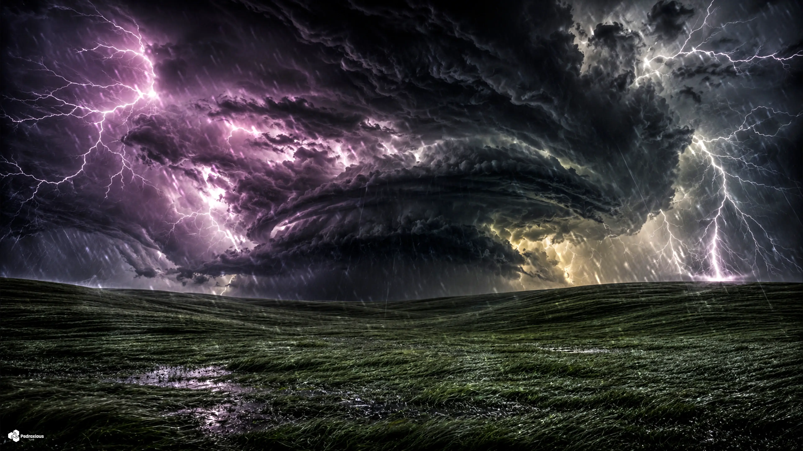

# SkyLog — Global Weather Dashboard

### Monitoramento climático em tempo real de 15 cidades ao redor do mundo

---

### Sync Ativo • Última atualização: 22:48 (BRT)
*Projeto em expansão, operando com automações no GitHub Actions para manter métricas globais atualizadas em tempo real. Consulte o link superior para a versão Web.*

 

## São Paulo, Brasil

<table>
  <tr>
    <td align="center" width="50%">
      
    </td>
    <td align="center" width="50%">
      
    </td>
  </tr>
</table>

| Parâmetro | Medição em Tempo Real |
|:---:|:---:|
| Temperatura | 22.7°C (Sensação: 26.5°C) |
| Variação Diária | 20.3°C — 31.0°C |
| Umidade / Pressão | 88% / 1011.4 hPa |
| Vento / Direção | 2.6 km/h (Direção: 344°) |
| UV / Visibilidade | 0.0 / 9.3 km |
| Condição Atual | Chuvisco |
| Horário Local | 22:48 |

### Previsão para os Próximos Dias

| Dia | Condição | Temperatura | Índice UV Máximo | Precipitação Prevista |
|:---:|:---:|:---:|:---:|:---:|
| Hoje | ⛈️ Tempestade | 20.3°C a 31.0°C | UV: 10 | Precip: 10.2 mm |
| Amanhã | ⛈️ Tempestade | 20.2°C a 30.4°C | UV: 10 | Precip: 3.4 mm |
| 23/11 | 🌨️ Granizo | 21.7°C a 28.7°C | UV: 10 | Precip: 7.9 mm |

 
 

## Rio de Janeiro, Brasil

<table>
  <tr>
    <td align="center" width="50%">
      
    </td>
    <td align="center" width="50%">
      
    </td>
  </tr>
</table>

| Parâmetro | Medição em Tempo Real |
|:---:|:---:|
| Temperatura | 25.6°C (Sensação: 31.8°C) |
| Variação Diária | 24.8°C — 33.4°C |
| Umidade / Pressão | 95% / 1009.5 hPa |
| Vento / Direção | 2.3 km/h (Direção: 328°) |
| UV / Visibilidade | 0.0 / 17.5 km |
| Condição Atual | Nublado |
| Horário Local | 22:48 |

### Previsão para os Próximos Dias

| Dia | Condição | Temperatura | Índice UV Máximo | Precipitação Prevista |
|:---:|:---:|:---:|:---:|:---:|
| Hoje | 🌨️ Granizo | 24.8°C a 33.4°C | UV: 9 | Precip: 2.8 mm |
| Amanhã | 🌧️ Chuva | 24.2°C a 29.8°C | UV: 9 | Precip: 3.4 mm |
| 23/11 | 🌦️ Chuvisco | 24.3°C a 32.3°C | UV: 9 | Precip: 0.4 mm |

 
 

## Buenos Aires, Argentina

<table>
  <tr>
    <td align="center" width="50%">
      
    </td>
    <td align="center" width="50%">
      
    </td>
  </tr>
</table>

| Parâmetro | Medição em Tempo Real |
|:---:|:---:|
| Temperatura | 22.8°C (Sensação: 20.3°C) |
| Variação Diária | 17.3°C — 28.7°C |
| Umidade / Pressão | 42% / 1009.8 hPa |
| Vento / Direção | 15.6 km/h (Direção: 243°) |
| UV / Visibilidade | 0.0 / 58.5 km |
| Condição Atual | Parcialmente nublado |
| Horário Local | 22:48 |

### Previsão para os Próximos Dias

| Dia | Condição | Temperatura | Índice UV Máximo | Precipitação Prevista |
|:---:|:---:|:---:|:---:|:---:|
| Hoje | ☁️ Nublado | 17.3°C a 28.7°C | UV: 8 | Precip: 0.0 mm |
| Amanhã | ⛅ Parcialmente nublado | 17.3°C a 28.4°C | UV: 9 | Precip: 0.0 mm |
| 23/11 | ☁️ Nublado | 18.4°C a 29.3°C | UV: 8 | Precip: 0.0 mm |

 
 

## Mexico City, México

<table>
  <tr>
    <td align="center" width="50%">
      
    </td>
    <td align="center" width="50%">
      
    </td>
  </tr>
</table>

| Parâmetro | Medição em Tempo Real |
|:---:|:---:|
| Temperatura | 20.1°C (Sensação: 19.0°C) |
| Variação Diária | 11.5°C — 24.5°C |
| Umidade / Pressão | 46% / 1014.5 hPa |
| Vento / Direção | 3.9 km/h (Direção: 133°) |
| UV / Visibilidade | 0.0 / 25.5 km |
| Condição Atual | Principalmente limpo |
| Horário Local | 19:48 |

### Previsão para os Próximos Dias

| Dia | Condição | Temperatura | Índice UV Máximo | Precipitação Prevista |
|:---:|:---:|:---:|:---:|:---:|
| Hoje | ☁️ Nublado | 11.5°C a 24.5°C | UV: 6 | Precip: 0.0 mm |
| Amanhã | 🌦️ Chuvisco | 13.0°C a 23.8°C | UV: 7 | Precip: 0.8 mm |
| 23/11 | 🌦️ Chuvisco | 12.4°C a 22.6°C | UV: 7 | Precip: 0.9 mm |

 
 

## Havana, Cuba

<table>
  <tr>
    <td align="center" width="50%">
      
    </td>
    <td align="center" width="50%">
      
    </td>
  </tr>
</table>

| Parâmetro | Medição em Tempo Real |
|:---:|:---:|
| Temperatura | 23.8°C (Sensação: 27.7°C) |
| Variação Diária | 23.0°C — 28.7°C |
| Umidade / Pressão | 93% / 1014.4 hPa |
| Vento / Direção | 8.9 km/h (Direção: 171°) |
| UV / Visibilidade | 0.0 / 30.8 km |
| Condição Atual | Nublado |
| Horário Local | 21:48 |

### Previsão para os Próximos Dias

| Dia | Condição | Temperatura | Índice UV Máximo | Precipitação Prevista |
|:---:|:---:|:---:|:---:|:---:|
| Hoje | 🌦️ Chuvisco | 23.0°C a 28.7°C | UV: 6 | Precip: 3.6 mm |
| Amanhã | 🌦️ Chuvisco | 22.2°C a 28.2°C | UV: 6 | Precip: 1.2 mm |
| 23/11 | 🌦️ Chuvisco | 23.5°C a 27.2°C | UV: 5 | Precip: 0.9 mm |

 
 

## Miami, EUA

<table>
  <tr>
    <td align="center" width="50%">
      
    </td>
    <td align="center" width="50%">
      
    </td>
  </tr>
</table>

| Parâmetro | Medição em Tempo Real |
|:---:|:---:|
| Temperatura | 24.4°C (Sensação: 27.3°C) |
| Variação Diária | 20.8°C — 26.5°C |
| Umidade / Pressão | 85% / 1013.7 hPa |
| Vento / Direção | 13.3 km/h (Direção: 194°) |
| UV / Visibilidade | 0.0 / 5.3 km |
| Condição Atual | Tempestade |
| Horário Local | 20:48 |

### Previsão para os Próximos Dias

| Dia | Condição | Temperatura | Índice UV Máximo | Precipitação Prevista |
|:---:|:---:|:---:|:---:|:---:|
| Hoje | 🌦️ Chuvisco | 20.8°C a 26.5°C | UV: 5 | Precip: 2.9 mm |
| Amanhã | 🌧️ Chuva | 20.3°C a 26.9°C | UV: 5 | Precip: 2.4 mm |
| 23/11 | ☁️ Nublado | 18.6°C a 26.1°C | UV: 5 | Precip: 0.0 mm |

 
 

## New York, EUA

<table>
  <tr>
    <td align="center" width="50%">
      
    </td>
    <td align="center" width="50%">
      
    </td>
  </tr>
</table>

| Parâmetro | Medição em Tempo Real |
|:---:|:---:|
| Temperatura | 11.7°C (Sensação: 10.7°C) |
| Variação Diária | 7.4°C — 19.1°C |
| Umidade / Pressão | 90% / 1026.3 hPa |
| Vento / Direção | 6.8 km/h (Direção: 123°) |
| UV / Visibilidade | 0.0 / 15.3 km |
| Condição Atual | Nublado |
| Horário Local | 20:48 |

### Previsão para os Próximos Dias

| Dia | Condição | Temperatura | Índice UV Máximo | Precipitação Prevista |
|:---:|:---:|:---:|:---:|:---:|
| Hoje | ☁️ Nublado | 7.4°C a 19.1°C | UV: 3 | Precip: 0.0 mm |
| Amanhã | 🌧️ Chuva | 10.4°C a 18.4°C | UV: 2 | Precip: 14.4 mm |
| 23/11 | 🌧️ Chuva | 8.3°C a 16.7°C | UV: 3 | Precip: 5.9 mm |

 
 

## London, Reino Unido

<table>
  <tr>
    <td align="center" width="50%">
      
    </td>
    <td align="center" width="50%">
      
    </td>
  </tr>
</table>

| Parâmetro | Medição em Tempo Real |
|:---:|:---:|
| Temperatura | 6.1°C (Sensação: 2.6°C) |
| Variação Diária | 5.3°C — 9.1°C |
| Umidade / Pressão | 82% / 1011.3 hPa |
| Vento / Direção | 13.3 km/h (Direção: 89°) |
| UV / Visibilidade | 0.0 / 24.0 km |
| Condição Atual | Nublado |
| Horário Local | 01:48 |

### Previsão para os Próximos Dias

| Dia | Condição | Temperatura | Índice UV Máximo | Precipitação Prevista |
|:---:|:---:|:---:|:---:|:---:|
| Hoje | ☁️ Nublado | 5.3°C a 9.1°C | UV: 0 | Precip: 0.0 mm |
| Amanhã | ☁️ Nublado | 4.0°C a 7.8°C | UV: 0 | Precip: 0.0 mm |
| 24/11 | 🌦️ Chuvisco | 3.9°C a 9.8°C | UV: 1 | Precip: 10.5 mm |

 
 

## Paris, França

<table>
  <tr>
    <td align="center" width="50%">
      
    </td>
    <td align="center" width="50%">
      
    </td>
  </tr>
</table>

| Parâmetro | Medição em Tempo Real |
|:---:|:---:|
| Temperatura | 8.8°C (Sensação: 6.8°C) |
| Variação Diária | 7.9°C — 9.0°C |
| Umidade / Pressão | 90% / 1009.6 hPa |
| Vento / Direção | 8.8 km/h (Direção: 102°) |
| UV / Visibilidade | 0.0 / 19.0 km |
| Condição Atual | Nublado |
| Horário Local | 02:48 |

### Previsão para os Próximos Dias

| Dia | Condição | Temperatura | Índice UV Máximo | Precipitação Prevista |
|:---:|:---:|:---:|:---:|:---:|
| Hoje | 🌧️ Chuva | 7.9°C a 9.0°C | UV: 0 | Precip: 4.8 mm |
| Amanhã | 🌧️ Chuva | 2.8°C a 8.3°C | UV: 2 | Precip: 8.5 mm |
| 24/11 | 🌧️ Chuva | 0.9°C a 4.7°C | UV: 2 | Precip: 0.0 mm |

 
 

## Moscow, Rússia

<table>
  <tr>
    <td align="center" width="50%">
      
    </td>
    <td align="center" width="50%">
      
    </td>
  </tr>
</table>

| Parâmetro | Medição em Tempo Real |
|:---:|:---:|
| Temperatura | 0.2°C (Sensação: -3.0°C) |
| Variação Diária | -0.0°C — 1.3°C |
| Umidade / Pressão | 86% / 1002.5 hPa |
| Vento / Direção | 5.9 km/h (Direção: 223°) |
| UV / Visibilidade | 0.0 / 26.9 km |
| Condição Atual | Nublado |
| Horário Local | 04:48 |

### Previsão para os Próximos Dias

| Dia | Condição | Temperatura | Índice UV Máximo | Precipitação Prevista |
|:---:|:---:|:---:|:---:|:---:|
| Hoje | 🌨️ Neve | -0.0°C a 1.3°C | UV: 1 | Precip: 0.6 mm |
| Amanhã | 🌨️ Neve | -0.3°C a 0.7°C | UV: 1 | Precip: 1.0 mm |
| 24/11 | 🌨️ Neve | -1.4°C a -0.2°C | UV: 1 | Precip: 3.0 mm |

 
 

## Bangkok, Tailândia

<table>
  <tr>
    <td align="center" width="50%">
      
    </td>
    <td align="center" width="50%">
      
    </td>
  </tr>
</table>

| Parâmetro | Medição em Tempo Real |
|:---:|:---:|
| Temperatura | 28.5°C (Sensação: 31.8°C) |
| Variação Diária | 26.0°C — 34.1°C |
| Umidade / Pressão | 61% / 1017.2 hPa |
| Vento / Direção | 4.1 km/h (Direção: 41°) |
| UV / Visibilidade | 1.1 / 22.5 km |
| Condição Atual | Nublado |
| Horário Local | 08:48 |

### Previsão para os Próximos Dias

| Dia | Condição | Temperatura | Índice UV Máximo | Precipitação Prevista |
|:---:|:---:|:---:|:---:|:---:|
| Hoje | ☁️ Nublado | 26.0°C a 34.1°C | UV: 7 | Precip: 0.0 mm |
| Amanhã | ☁️ Nublado | 25.9°C a 35.7°C | UV: 7 | Precip: 0.0 mm |
| 24/11 | ☁️ Nublado | 25.9°C a 36.5°C | UV: 7 | Precip: 0.0 mm |

 
 

## Tokyo, Japão

<table>
  <tr>
    <td align="center" width="50%">
      
    </td>
    <td align="center" width="50%">
      
    </td>
  </tr>
</table>

| Parâmetro | Medição em Tempo Real |
|:---:|:---:|
| Temperatura | 10.9°C (Sensação: 8.2°C) |
| Variação Diária | 4.4°C — 13.1°C |
| Umidade / Pressão | 44% / 1022.6 hPa |
| Vento / Direção | 4.1 km/h (Direção: 322°) |
| UV / Visibilidade | 2.6 / 46.8 km |
| Condição Atual | Céu limpo |
| Horário Local | 10:48 |

### Previsão para os Próximos Dias

| Dia | Condição | Temperatura | Índice UV Máximo | Precipitação Prevista |
|:---:|:---:|:---:|:---:|:---:|
| Hoje | ⛅ Parcialmente nublado | 4.4°C a 13.1°C | UV: 4 | Precip: 0.0 mm |
| Amanhã | 🌤️ Principalmente limpo | 3.9°C a 13.1°C | UV: 4 | Precip: 0.0 mm |
| 24/11 | 🌧️ Chuva | 6.7°C a 17.8°C | UV: 3 | Precip: 5.9 mm |

 
 

## Dubai, Emirados Árabes

<table>
  <tr>
    <td align="center" width="50%">
      
    </td>
    <td align="center" width="50%">
      
    </td>
  </tr>
</table>

| Parâmetro | Medição em Tempo Real |
|:---:|:---:|
| Temperatura | 24.4°C (Sensação: 27.3°C) |
| Variação Diária | 23.9°C — 30.1°C |
| Umidade / Pressão | 77% / 1016.5 hPa |
| Vento / Direção | 6.8 km/h (Direção: 148°) |
| UV / Visibilidade | 0.0 / 17.8 km |
| Condição Atual | Céu limpo |
| Horário Local | 05:48 |

### Previsão para os Próximos Dias

| Dia | Condição | Temperatura | Índice UV Máximo | Precipitação Prevista |
|:---:|:---:|:---:|:---:|:---:|
| Hoje | ☀️ Céu limpo | 23.9°C a 30.1°C | UV: 5 | Precip: 0.0 mm |
| Amanhã | ☀️ Céu limpo | 24.5°C a 31.1°C | UV: 5 | Precip: 0.0 mm |
| 24/11 | ☀️ Céu limpo | 23.8°C a 29.2°C | UV: 5 | Precip: 0.0 mm |

 
 

## Cairo, Egito

<table>
  <tr>
    <td align="center" width="50%">
      
    </td>
    <td align="center" width="50%">
      
    </td>
  </tr>
</table>

| Parâmetro | Medição em Tempo Real |
|:---:|:---:|
| Temperatura | 16.4°C (Sensação: 16.6°C) |
| Variação Diária | 16.3°C — 26.8°C |
| Umidade / Pressão | 76% / 1019.0 hPa |
| Vento / Direção | 3.7 km/h (Direção: 11°) |
| UV / Visibilidade | 0.0 / 35.3 km |
| Condição Atual | Nublado |
| Horário Local | 03:48 |

### Previsão para os Próximos Dias

| Dia | Condição | Temperatura | Índice UV Máximo | Precipitação Prevista |
|:---:|:---:|:---:|:---:|:---:|
| Hoje | ☁️ Nublado | 16.3°C a 26.8°C | UV: 4 | Precip: 0.0 mm |
| Amanhã | ☁️ Nublado | 14.4°C a 24.2°C | UV: 4 | Precip: 0.0 mm |
| 24/11 | 🌫️ Neblina | 13.6°C a 24.5°C | UV: 4 | Precip: 0.0 mm |

 
 

## Sydney, Austrália

<table>
  <tr>
    <td align="center" width="50%">
      
    </td>
    <td align="center" width="50%">
      
    </td>
  </tr>
</table>

| Parâmetro | Medição em Tempo Real |
|:---:|:---:|
| Temperatura | 30.8°C (Sensação: 35.4°C) |
| Variação Diária | 20.4°C — 30.9°C |
| Umidade / Pressão | 55% / 1013.7 hPa |
| Vento / Direção | 12.9 km/h (Direção: 47°) |
| UV / Visibilidade | 8.3 / 7.3 km |
| Condição Atual | Chuvisco |
| Horário Local | 12:48 |

### Previsão para os Próximos Dias

| Dia | Condição | Temperatura | Índice UV Máximo | Precipitação Prevista |
|:---:|:---:|:---:|:---:|:---:|
| Hoje | 🌦️ Chuvisco | 20.4°C a 30.9°C | UV: 8 | Precip: 1.0 mm |
| Amanhã | 🌧️ Chuva | 22.4°C a 31.4°C | UV: 6 | Precip: 2.7 mm |
| 24/11 | 🌧️ Chuva | 17.5°C a 22.3°C | UV: 6 | Precip: 3.9 mm |

 
 

## Histórico de Dados

| Estatística | Valor |
|:---:|:---:|
| Total de registros | 20556 |
| Primeiro registro | `datetime` |
| Último registro | `2026-11-22 12:48` |
| Temperatura mais alta | **46.1°C** — Dubai |
| Temperatura mais baixa | **-0.2°C** — Moscow |

📂 <a href="data/history.csv">Ver histórico completo (history.csv)</a>

---

### Informações Técnicas

| Item | Detalhe |
|:---:|:---:|
| Fonte de dados | <a href="https://open-meteo.com/">Open-Meteo API</a> (gratuita) |
| Frequência | 24× ao dia (a cada hora) |
| Automação | GitHub Actions — <a href=".github/workflows/weather.yml">ver workflow</a> |
| Script | `update_weather.py` (requests e pytz) |
| Cidades Monitoradas | 15 cidades globais |

---

**Feito com amor por [Pedroxious](https://github.com/Pedroxious) · Dados: [Open-Meteo](https://open-meteo.com/)**

