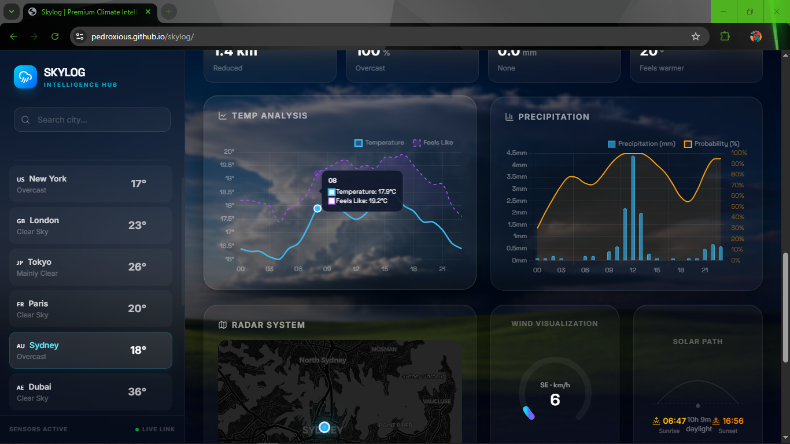

# SkyLog — Global Weather Dashboard

### Monitoramento climático em tempo real de 15 cidades ao redor do mundo

---

### Sync Ativo • Última atualização: 23:23 (BRT)
*Projeto em expansão, operando com automações no GitHub Actions para manter métricas globais atualizadas em tempo real. Consulte o link superior para a versão Web.*

 

## São Paulo, Brasil

<table>
  <tr>
    <td align="center" width="50%">
      
    </td>
    <td align="center" width="50%">
      
    </td>
  </tr>
</table>

| Parâmetro | Medição em Tempo Real |
|:---:|:---:|
| Temperatura | 17.8°C (Sensação: 19.3°C) |
| Variação Diária | 16.6°C — 23.3°C |
| Umidade / Pressão | 93% / 1017.0 hPa |
| Vento / Direção | 5.9 km/h (Direção: 102°) |
| UV / Visibilidade | 0.0 / 16.9 km |
| Condição Atual | Nublado |
| Horário Local | 23:23 |

### Previsão para os Próximos Dias

| Dia | Condição | Temperatura | Índice UV Máximo | Precipitação Prevista |
|:---:|:---:|:---:|:---:|:---:|
| Hoje | 🌦️ Chuvisco | 16.6°C a 23.3°C | UV: 5 | Precip: 2.3 mm |
| Amanhã | ⛈️ Tempestade | 16.6°C a 23.1°C | UV: 2 | Precip: 43.7 mm |
| 29/11 | 🌦️ Chuvisco | 18.0°C a 23.7°C | UV: 6 | Precip: 0.6 mm |

 
 

## Rio de Janeiro, Brasil

<table>
  <tr>
    <td align="center" width="50%">
      
    </td>
    <td align="center" width="50%">
      
    </td>
  </tr>
</table>

| Parâmetro | Medição em Tempo Real |
|:---:|:---:|
| Temperatura | 21.0°C (Sensação: 22.5°C) |
| Variação Diária | 20.9°C — 25.4°C |
| Umidade / Pressão | 81% / 1017.4 hPa |
| Vento / Direção | 8.8 km/h (Direção: 73°) |
| UV / Visibilidade | 0.0 / 22.5 km |
| Condição Atual | Nublado |
| Horário Local | 23:23 |

### Previsão para os Próximos Dias

| Dia | Condição | Temperatura | Índice UV Máximo | Precipitação Prevista |
|:---:|:---:|:---:|:---:|:---:|
| Hoje | 🌦️ Chuvisco | 20.9°C a 25.4°C | UV: 5 | Precip: 1.8 mm |
| Amanhã | ⛈️ Tempestade | 20.5°C a 26.4°C | UV: 8 | Precip: 12.8 mm |
| 29/11 | ⛈️ Tempestade | 22.8°C a 24.6°C | UV: 3 | Precip: 23.6 mm |

 
 

## Buenos Aires, Argentina

<table>
  <tr>
    <td align="center" width="50%">
      
    </td>
    <td align="center" width="50%">
      
    </td>
  </tr>
</table>

| Parâmetro | Medição em Tempo Real |
|:---:|:---:|
| Temperatura | 25.5°C (Sensação: 24.9°C) |
| Variação Diária | 19.5°C — 29.8°C |
| Umidade / Pressão | 46% / 1015.2 hPa |
| Vento / Direção | 10.8 km/h (Direção: 5°) |
| UV / Visibilidade | 0.0 / 57.9 km |
| Condição Atual | Céu limpo |
| Horário Local | 23:23 |

### Previsão para os Próximos Dias

| Dia | Condição | Temperatura | Índice UV Máximo | Precipitação Prevista |
|:---:|:---:|:---:|:---:|:---:|
| Hoje | ☀️ Céu limpo | 19.5°C a 29.8°C | UV: 9 | Precip: 0.0 mm |
| Amanhã | ☀️ Céu limpo | 21.6°C a 31.3°C | UV: 9 | Precip: 0.0 mm |
| 29/11 | ☁️ Nublado | 22.8°C a 32.3°C | UV: 9 | Precip: 0.0 mm |

 
 

## Mexico City, México

<table>
  <tr>
    <td align="center" width="50%">
      
    </td>
    <td align="center" width="50%">
      
    </td>
  </tr>
</table>

| Parâmetro | Medição em Tempo Real |
|:---:|:---:|
| Temperatura | 8.2°C (Sensação: 6.3°C) |
| Variação Diária | 7.7°C — 11.5°C |
| Umidade / Pressão | 96% / 1024.3 hPa |
| Vento / Direção | 8.2 km/h (Direção: 311°) |
| UV / Visibilidade | 0.0 / 2.9 km |
| Condição Atual | Chuvisco |
| Horário Local | 20:23 |

### Previsão para os Próximos Dias

| Dia | Condição | Temperatura | Índice UV Máximo | Precipitação Prevista |
|:---:|:---:|:---:|:---:|:---:|
| Hoje | 🌧️ Chuva | 7.7°C a 11.5°C | UV: 3 | Precip: 13.3 mm |
| Amanhã | 🌧️ Chuva | 6.3°C a 8.9°C | UV: 1 | Precip: 49.0 mm |
| 29/11 | 🌦️ Chuvisco | 6.7°C a 18.6°C | UV: 7 | Precip: 1.3 mm |

 
 

## Havana, Cuba

<table>
  <tr>
    <td align="center" width="50%">
      
    </td>
    <td align="center" width="50%">
      
    </td>
  </tr>
</table>

| Parâmetro | Medição em Tempo Real |
|:---:|:---:|
| Temperatura | 21.8°C (Sensação: 22.2°C) |
| Variação Diária | 21.3°C — 24.6°C |
| Umidade / Pressão | 68% / 1020.2 hPa |
| Vento / Direção | 10.0 km/h (Direção: 7°) |
| UV / Visibilidade | 0.0 / 50.6 km |
| Condição Atual | Nublado |
| Horário Local | 22:23 |

### Previsão para os Próximos Dias

| Dia | Condição | Temperatura | Índice UV Máximo | Precipitação Prevista |
|:---:|:---:|:---:|:---:|:---:|
| Hoje | 🌦️ Chuvisco | 21.3°C a 24.6°C | UV: 6 | Precip: 0.1 mm |
| Amanhã | ☁️ Nublado | 20.8°C a 25.5°C | UV: 5 | Precip: 0.0 mm |
| 29/11 | 🌦️ Chuvisco | 21.8°C a 29.9°C | UV: 6 | Precip: 0.7 mm |

 
 

## Miami, EUA

<table>
  <tr>
    <td align="center" width="50%">
      
    </td>
    <td align="center" width="50%">
      
    </td>
  </tr>
</table>

| Parâmetro | Medição em Tempo Real |
|:---:|:---:|
| Temperatura | 18.7°C (Sensação: 18.5°C) |
| Variação Diária | 15.7°C — 23.0°C |
| Umidade / Pressão | 70% / 1020.1 hPa |
| Vento / Direção | 7.7 km/h (Direção: 243°) |
| UV / Visibilidade | 0.0 / 24.3 km |
| Condição Atual | Nublado |
| Horário Local | 21:23 |

### Previsão para os Próximos Dias

| Dia | Condição | Temperatura | Índice UV Máximo | Precipitação Prevista |
|:---:|:---:|:---:|:---:|:---:|
| Hoje | ☁️ Nublado | 15.7°C a 23.0°C | UV: 5 | Precip: 0.0 mm |
| Amanhã | ☁️ Nublado | 15.5°C a 21.0°C | UV: 5 | Precip: 0.0 mm |
| 29/11 | ☁️ Nublado | 15.0°C a 25.0°C | UV: 3 | Precip: 0.0 mm |

 
 

## New York, EUA

<table>
  <tr>
    <td align="center" width="50%">
      
    </td>
    <td align="center" width="50%">
      
    </td>
  </tr>
</table>

| Parâmetro | Medição em Tempo Real |
|:---:|:---:|
| Temperatura | 6.4°C (Sensação: 0.9°C) |
| Variação Diária | 5.4°C — 13.9°C |
| Umidade / Pressão | 74% / 1000.7 hPa |
| Vento / Direção | 25.7 km/h (Direção: 248°) |
| UV / Visibilidade | 0.0 / 22.3 km |
| Condição Atual | Nublado |
| Horário Local | 21:23 |

### Previsão para os Próximos Dias

| Dia | Condição | Temperatura | Índice UV Máximo | Precipitação Prevista |
|:---:|:---:|:---:|:---:|:---:|
| Hoje | 🌦️ Chuvisco | 5.4°C a 13.9°C | UV: 2 | Precip: 0.5 mm |
| Amanhã | ☁️ Nublado | 3.6°C a 8.3°C | UV: 2 | Precip: 0.0 mm |
| 29/11 | ☁️ Nublado | 2.6°C a 12.3°C | UV: 2 | Precip: 0.0 mm |

 
 

## London, Reino Unido

<table>
  <tr>
    <td align="center" width="50%">
      
    </td>
    <td align="center" width="50%">
      
    </td>
  </tr>
</table>

| Parâmetro | Medição em Tempo Real |
|:---:|:---:|
| Temperatura | 5.6°C (Sensação: 2.5°C) |
| Variação Diária | 5.1°C — 11.0°C |
| Umidade / Pressão | 86% / 1021.8 hPa |
| Vento / Direção | 11.2 km/h (Direção: 125°) |
| UV / Visibilidade | 0.0 / 26.6 km |
| Condição Atual | Nublado |
| Horário Local | 02:23 |

### Previsão para os Próximos Dias

| Dia | Condição | Temperatura | Índice UV Máximo | Precipitação Prevista |
|:---:|:---:|:---:|:---:|:---:|
| Hoje | 🌧️ Chuva | 5.1°C a 11.0°C | UV: 0 | Precip: 10.6 mm |
| Amanhã | 🌧️ Chuva | 6.2°C a 11.0°C | UV: 0 | Precip: 4.9 mm |
| 30/11 | 🌦️ Chuvisco | 7.6°C a 12.4°C | UV: 1 | Precip: 1.8 mm |

 
 

## Paris, França

<table>
  <tr>
    <td align="center" width="50%">
      
    </td>
    <td align="center" width="50%">
      
    </td>
  </tr>
</table>

| Parâmetro | Medição em Tempo Real |
|:---:|:---:|
| Temperatura | -0.1°C (Sensação: -4.3°C) |
| Variação Diária | -0.8°C — 4.4°C |
| Umidade / Pressão | 78% / 1025.6 hPa |
| Vento / Direção | 10.8 km/h (Direção: 127°) |
| UV / Visibilidade | 0.0 / 31.5 km |
| Condição Atual | Céu limpo |
| Horário Local | 03:23 |

### Previsão para os Próximos Dias

| Dia | Condição | Temperatura | Índice UV Máximo | Precipitação Prevista |
|:---:|:---:|:---:|:---:|:---:|
| Hoje | ☁️ Nublado | -0.8°C a 4.4°C | UV: 2 | Precip: 0.0 mm |
| Amanhã | 🌧️ Chuva | 3.3°C a 10.1°C | UV: 0 | Precip: 16.6 mm |
| 30/11 | 🌫️ Neblina | 0.6°C a 7.6°C | UV: 2 | Precip: 0.0 mm |

 
 

## Moscow, Rússia

<table>
  <tr>
    <td align="center" width="50%">
      
    </td>
    <td align="center" width="50%">
      
    </td>
  </tr>
</table>

| Parâmetro | Medição em Tempo Real |
|:---:|:---:|
| Temperatura | -2.9°C (Sensação: -7.1°C) |
| Variação Diária | -4.7°C — -2.0°C |
| Umidade / Pressão | 82% / 1030.0 hPa |
| Vento / Direção | 9.3 km/h (Direção: 344°) |
| UV / Visibilidade | 0.0 / 29.3 km |
| Condição Atual | Parcialmente nublado |
| Horário Local | 05:23 |

### Previsão para os Próximos Dias

| Dia | Condição | Temperatura | Índice UV Máximo | Precipitação Prevista |
|:---:|:---:|:---:|:---:|:---:|
| Hoje | 🌨️ Neve | -4.7°C a -2.0°C | UV: 1 | Precip: 0.7 mm |
| Amanhã | 🌨️ Neve | -5.7°C a -3.0°C | UV: 1 | Precip: 0.1 mm |
| 30/11 | ☁️ Nublado | -6.8°C a -4.5°C | UV: 1 | Precip: 0.0 mm |

 
 

## Bangkok, Tailândia

<table>
  <tr>
    <td align="center" width="50%">
      
    </td>
    <td align="center" width="50%">
      
    </td>
  </tr>
</table>

| Parâmetro | Medição em Tempo Real |
|:---:|:---:|
| Temperatura | 29.0°C (Sensação: 32.5°C) |
| Variação Diária | 26.0°C — 32.8°C |
| Umidade / Pressão | 62% / 1016.6 hPa |
| Vento / Direção | 5.7 km/h (Direção: 37°) |
| UV / Visibilidade | 2.8 / 22.8 km |
| Condição Atual | Nublado |
| Horário Local | 09:23 |

### Previsão para os Próximos Dias

| Dia | Condição | Temperatura | Índice UV Máximo | Precipitação Prevista |
|:---:|:---:|:---:|:---:|:---:|
| Hoje | ☁️ Nublado | 26.0°C a 32.8°C | UV: 7 | Precip: 0.0 mm |
| Amanhã | ☁️ Nublado | 24.7°C a 33.3°C | UV: 7 | Precip: 0.0 mm |
| 30/11 | 🌧️ Chuva | 25.3°C a 32.9°C | UV: 6 | Precip: 5.4 mm |

 
 

## Tokyo, Japão

<table>
  <tr>
    <td align="center" width="50%">
      
    </td>
    <td align="center" width="50%">
      
    </td>
  </tr>
</table>

| Parâmetro | Medição em Tempo Real |
|:---:|:---:|
| Temperatura | 11.3°C (Sensação: 10.4°C) |
| Variação Diária | 7.5°C — 18.8°C |
| Umidade / Pressão | 83% / 1003.1 hPa |
| Vento / Direção | 3.7 km/h (Direção: 331°) |
| UV / Visibilidade | 0.2 / 34.4 km |
| Condição Atual | Principalmente limpo |
| Horário Local | 11:23 |

### Previsão para os Próximos Dias

| Dia | Condição | Temperatura | Índice UV Máximo | Precipitação Prevista |
|:---:|:---:|:---:|:---:|:---:|
| Hoje | 🌧️ Chuva | 7.5°C a 18.8°C | UV: 2 | Precip: 11.6 mm |
| Amanhã | ⛅ Parcialmente nublado | 6.2°C a 13.1°C | UV: 3 | Precip: 0.0 mm |
| 30/11 | ☀️ Céu limpo | 4.3°C a 14.7°C | UV: 4 | Precip: 0.0 mm |

 
 

## Dubai, Emirados Árabes

<table>
  <tr>
    <td align="center" width="50%">
      
    </td>
    <td align="center" width="50%">
      
    </td>
  </tr>
</table>

| Parâmetro | Medição em Tempo Real |
|:---:|:---:|
| Temperatura | 21.9°C (Sensação: 24.5°C) |
| Variação Diária | 21.9°C — 27.3°C |
| Umidade / Pressão | 83% / 1018.0 hPa |
| Vento / Direção | 5.5 km/h (Direção: 157°) |
| UV / Visibilidade | 0.0 / 22.9 km |
| Condição Atual | Céu limpo |
| Horário Local | 06:23 |

### Previsão para os Próximos Dias

| Dia | Condição | Temperatura | Índice UV Máximo | Precipitação Prevista |
|:---:|:---:|:---:|:---:|:---:|
| Hoje | ☀️ Céu limpo | 21.9°C a 27.3°C | UV: 5 | Precip: 0.0 mm |
| Amanhã | ☀️ Céu limpo | 23.3°C a 28.7°C | UV: 5 | Precip: 0.0 mm |
| 30/11 | ☀️ Céu limpo | 24.2°C a 29.2°C | UV: 4 | Precip: 0.0 mm |

 
 

## Cairo, Egito

<table>
  <tr>
    <td align="center" width="50%">
      
    </td>
    <td align="center" width="50%">
      
    </td>
  </tr>
</table>

| Parâmetro | Medição em Tempo Real |
|:---:|:---:|
| Temperatura | 15.2°C (Sensação: 16.1°C) |
| Variação Diária | 14.8°C — 23.9°C |
| Umidade / Pressão | 96% / 1015.3 hPa |
| Vento / Direção | 4.3 km/h (Direção: 355°) |
| UV / Visibilidade | 0.0 / 10.3 km |
| Condição Atual | Nublado |
| Horário Local | 04:23 |

### Previsão para os Próximos Dias

| Dia | Condição | Temperatura | Índice UV Máximo | Precipitação Prevista |
|:---:|:---:|:---:|:---:|:---:|
| Hoje | 🌫️ Neblina | 14.8°C a 23.9°C | UV: 3 | Precip: 0.0 mm |
| Amanhã | ☁️ Nublado | 14.2°C a 23.9°C | UV: 4 | Precip: 0.0 mm |
| 30/11 | ☁️ Nublado | 15.0°C a 22.6°C | UV: 4 | Precip: 0.0 mm |

 
 

## Sydney, Austrália

<table>
  <tr>
    <td align="center" width="50%">
      
    </td>
    <td align="center" width="50%">
      
    </td>
  </tr>
</table>

| Parâmetro | Medição em Tempo Real |
|:---:|:---:|
| Temperatura | 25.7°C (Sensação: 27.8°C) |
| Variação Diária | 20.6°C — 26.4°C |
| Umidade / Pressão | 74% / 1009.5 hPa |
| Vento / Direção | 24.4 km/h (Direção: 45°) |
| UV / Visibilidade | 3.0 / 12.0 km |
| Condição Atual | Chuvisco |
| Horário Local | 13:23 |

### Previsão para os Próximos Dias

| Dia | Condição | Temperatura | Índice UV Máximo | Precipitação Prevista |
|:---:|:---:|:---:|:---:|:---:|
| Hoje | ⛈️ Tempestade | 20.6°C a 26.4°C | UV: 7 | Precip: 13.9 mm |
| Amanhã | 🌦️ Chuvisco | 19.2°C a 24.3°C | UV: 9 | Precip: 2.0 mm |
| 30/11 | 🌦️ Chuvisco | 16.8°C a 20.1°C | UV: 8 | Precip: 1.4 mm |

 
 

## Histórico de Dados

| Estatística | Valor |
|:---:|:---:|
| Total de registros | 20756 |
| Primeiro registro | `datetime` |
| Último registro | `2026-11-28 13:23` |
| Temperatura mais alta | **46.1°C** — Dubai |
| Temperatura mais baixa | **-4.1°C** — Moscow |

📂 <a href="data/history.csv">Ver histórico completo (history.csv)</a>

---

### Informações Técnicas

| Item | Detalhe |
|:---:|:---:|
| Fonte de dados | <a href="https://open-meteo.com/">Open-Meteo API</a> (gratuita) |
| Frequência | 24× ao dia (a cada hora) |
| Automação | GitHub Actions — <a href=".github/workflows/weather.yml">ver workflow</a> |
| Script | `update_weather.py` (requests e pytz) |
| Cidades Monitoradas | 15 cidades globais |

---

**Feito com amor por [Pedroxious](https://github.com/Pedroxious) · Dados: [Open-Meteo](https://open-meteo.com/)**

