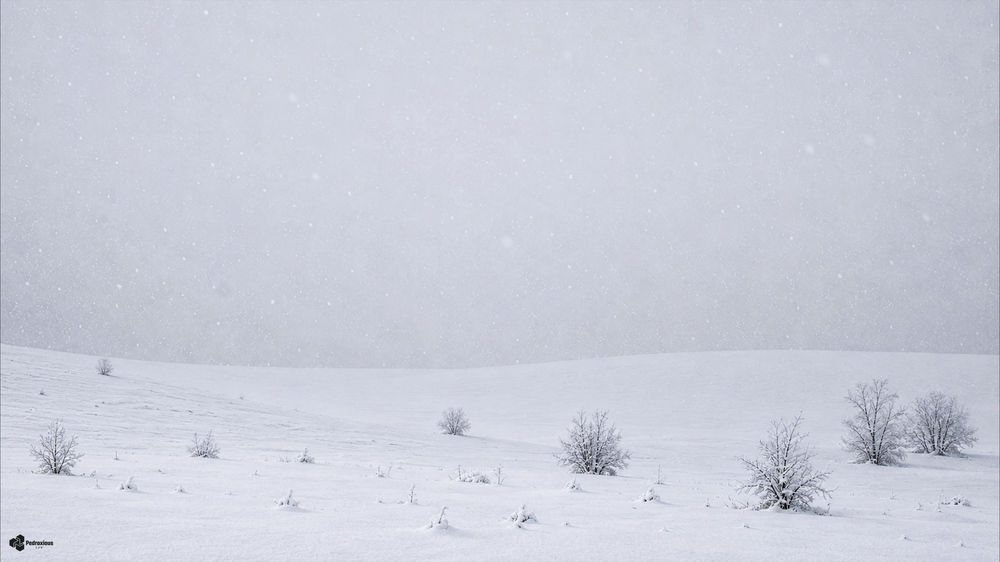

# SkyLog — Global Weather Dashboard

### Monitoramento climático em tempo real de 15 cidades ao redor do mundo

---

### Sync Ativo • Última atualização: 05:45 (BRT)
*Projeto em expansão, operando com automações no GitHub Actions para manter métricas globais atualizadas em tempo real. Consulte o link superior para a versão Web.*

 

## São Paulo, Brasil

<table>
  <tr>
    <td align="center" width="50%">
      
    </td>
    <td align="center" width="50%">
      
    </td>
  </tr>
</table>

| Parâmetro | Medição em Tempo Real |
|:---:|:---:|
| Temperatura | 21.4°C (Sensação: 23.0°C) |
| Variação Diária | 20.7°C — 28.6°C |
| Umidade / Pressão | 80% / 1009.2 hPa |
| Vento / Direção | 8.2 km/h (Direção: 341°) |
| UV / Visibilidade | 0.0 / 29.9 km |
| Condição Atual | Nublado |
| Horário Local | 05:45 |

### Previsão para os Próximos Dias

| Dia | Condição | Temperatura | Índice UV Máximo | Precipitação Prevista |
|:---:|:---:|:---:|:---:|:---:|
| Hoje | ⛈️ Tempestade | 20.7°C a 28.6°C | UV: 4 | Precip: 9.6 mm |
| Amanhã | 🌦️ Chuvisco | 19.1°C a 25.2°C | UV: 5 | Precip: 2.8 mm |
| 07/11 | ⛈️ Tempestade | 18.7°C a 29.9°C | UV: 9 | Precip: 1.0 mm |

 
 

## Rio de Janeiro, Brasil

<table>
  <tr>
    <td align="center" width="50%">
      
    </td>
    <td align="center" width="50%">
      
    </td>
  </tr>
</table>

| Parâmetro | Medição em Tempo Real |
|:---:|:---:|
| Temperatura | 23.7°C (Sensação: 27.2°C) |
| Variação Diária | 23.1°C — 33.0°C |
| Umidade / Pressão | 93% / 1006.2 hPa |
| Vento / Direção | 11.7 km/h (Direção: 356°) |
| UV / Visibilidade | 0.0 / 20.2 km |
| Condição Atual | Nublado |
| Horário Local | 05:45 |

### Previsão para os Próximos Dias

| Dia | Condição | Temperatura | Índice UV Máximo | Precipitação Prevista |
|:---:|:---:|:---:|:---:|:---:|
| Hoje | 🌧️ Chuva | 23.1°C a 33.0°C | UV: 9 | Precip: 2.7 mm |
| Amanhã | 🌦️ Chuvisco | 22.5°C a 26.1°C | UV: 7 | Precip: 1.2 mm |
| 07/11 | 🌦️ Chuvisco | 22.0°C a 29.9°C | UV: 9 | Precip: 0.8 mm |

 
 

## Buenos Aires, Argentina

<table>
  <tr>
    <td align="center" width="50%">
      
    </td>
    <td align="center" width="50%">
      
    </td>
  </tr>
</table>

| Parâmetro | Medição em Tempo Real |
|:---:|:---:|
| Temperatura | 13.5°C (Sensação: 12.0°C) |
| Variação Diária | 13.5°C — 26.1°C |
| Umidade / Pressão | 73% / 1012.1 hPa |
| Vento / Direção | 8.3 km/h (Direção: 266°) |
| UV / Visibilidade | 0.0 / 47.8 km |
| Condição Atual | Céu limpo |
| Horário Local | 05:45 |

### Previsão para os Próximos Dias

| Dia | Condição | Temperatura | Índice UV Máximo | Precipitação Prevista |
|:---:|:---:|:---:|:---:|:---:|
| Hoje | ☁️ Nublado | 13.5°C a 26.1°C | UV: 9 | Precip: 0.0 mm |
| Amanhã | 🌦️ Chuvisco | 16.1°C a 24.5°C | UV: 8 | Precip: 0.6 mm |
| 07/11 | ☁️ Nublado | 12.0°C a 18.6°C | UV: 8 | Precip: 0.0 mm |

 
 

## Mexico City, México

<table>
  <tr>
    <td align="center" width="50%">
      
    </td>
    <td align="center" width="50%">
      
    </td>
  </tr>
</table>

| Parâmetro | Medição em Tempo Real |
|:---:|:---:|
| Temperatura | 15.0°C (Sensação: 15.2°C) |
| Variação Diária | 13.1°C — 25.7°C |
| Umidade / Pressão | 78% / 1016.2 hPa |
| Vento / Direção | 0.9 km/h (Direção: 53°) |
| UV / Visibilidade | 0.0 / 37.4 km |
| Condição Atual | Nublado |
| Horário Local | 02:45 |

### Previsão para os Próximos Dias

| Dia | Condição | Temperatura | Índice UV Máximo | Precipitação Prevista |
|:---:|:---:|:---:|:---:|:---:|
| Hoje | 🌧️ Chuva | 13.1°C a 25.7°C | UV: 8 | Precip: 3.0 mm |
| Amanhã | 🌦️ Chuvisco | 11.6°C a 23.7°C | UV: 8 | Precip: 0.1 mm |
| 07/11 | 🌦️ Chuvisco | 11.7°C a 23.4°C | UV: 7 | Precip: 0.5 mm |

 
 

## Havana, Cuba

<table>
  <tr>
    <td align="center" width="50%">
      
    </td>
    <td align="center" width="50%">
      
    </td>
  </tr>
</table>

| Parâmetro | Medição em Tempo Real |
|:---:|:---:|
| Temperatura | 23.9°C (Sensação: 28.4°C) |
| Variação Diária | 23.7°C — 28.9°C |
| Umidade / Pressão | 92% / 1010.6 hPa |
| Vento / Direção | 4.3 km/h (Direção: 90°) |
| UV / Visibilidade | 0.0 / 32.7 km |
| Condição Atual | Parcialmente nublado |
| Horário Local | 04:45 |

### Previsão para os Próximos Dias

| Dia | Condição | Temperatura | Índice UV Máximo | Precipitação Prevista |
|:---:|:---:|:---:|:---:|:---:|
| Hoje | 🌦️ Chuvisco | 23.7°C a 28.9°C | UV: 7 | Precip: 0.8 mm |
| Amanhã | 🌦️ Chuvisco | 24.3°C a 28.6°C | UV: 7 | Precip: 0.3 mm |
| 07/11 | 🌦️ Chuvisco | 23.7°C a 28.5°C | UV: 6 | Precip: 0.8 mm |

 
 

## Miami, EUA

<table>
  <tr>
    <td align="center" width="50%">
      
    </td>
    <td align="center" width="50%">
      
    </td>
  </tr>
</table>

| Parâmetro | Medição em Tempo Real |
|:---:|:---:|
| Temperatura | 23.0°C (Sensação: 26.1°C) |
| Variação Diária | 21.9°C — 27.9°C |
| Umidade / Pressão | 85% / 1012.1 hPa |
| Vento / Direção | 6.6 km/h (Direção: 20°) |
| UV / Visibilidade | 0.0 / 14.5 km |
| Condição Atual | Céu limpo |
| Horário Local | 03:45 |

### Previsão para os Próximos Dias

| Dia | Condição | Temperatura | Índice UV Máximo | Precipitação Prevista |
|:---:|:---:|:---:|:---:|:---:|
| Hoje | ☁️ Nublado | 21.9°C a 27.9°C | UV: 6 | Precip: 0.0 mm |
| Amanhã | ⛅ Parcialmente nublado | 20.5°C a 27.4°C | UV: 5 | Precip: 0.0 mm |
| 07/11 | 🌦️ Chuvisco | 25.0°C a 28.3°C | UV: 6 | Precip: 0.6 mm |

 
 

## New York, EUA

<table>
  <tr>
    <td align="center" width="50%">
      
    </td>
    <td align="center" width="50%">
      
    </td>
  </tr>
</table>

| Parâmetro | Medição em Tempo Real |
|:---:|:---:|
| Temperatura | 16.9°C (Sensação: 17.7°C) |
| Variação Diária | 16.3°C — 22.5°C |
| Umidade / Pressão | 94% / 1015.1 hPa |
| Vento / Direção | 8.6 km/h (Direção: 197°) |
| UV / Visibilidade | 0.0 / 12.3 km |
| Condição Atual | Nublado |
| Horário Local | 03:45 |

### Previsão para os Próximos Dias

| Dia | Condição | Temperatura | Índice UV Máximo | Precipitação Prevista |
|:---:|:---:|:---:|:---:|:---:|
| Hoje | 🌦️ Chuvisco | 16.3°C a 22.5°C | UV: 2 | Precip: 0.2 mm |
| Amanhã | 🌧️ Chuva | 15.2°C a 18.6°C | UV: 0 | Precip: 12.9 mm |
| 07/11 | 🌦️ Chuvisco | 11.6°C a 16.5°C | UV: 3 | Precip: 2.0 mm |

 
 

## London, Reino Unido

<table>
  <tr>
    <td align="center" width="50%">
      
    </td>
    <td align="center" width="50%">
      
    </td>
  </tr>
</table>

| Parâmetro | Medição em Tempo Real |
|:---:|:---:|
| Temperatura | 9.8°C (Sensação: 6.2°C) |
| Variação Diária | 9.3°C — 10.5°C |
| Umidade / Pressão | 69% / 1026.1 hPa |
| Vento / Direção | 15.1 km/h (Direção: 69°) |
| UV / Visibilidade | 0.0 / 17.7 km |
| Condição Atual | Nublado |
| Horário Local | 08:45 |

### Previsão para os Próximos Dias

| Dia | Condição | Temperatura | Índice UV Máximo | Precipitação Prevista |
|:---:|:---:|:---:|:---:|:---:|
| Hoje | ☁️ Nublado | 9.3°C a 10.5°C | UV: 0 | Precip: 0.0 mm |
| Amanhã | 🌦️ Chuvisco | 9.4°C a 10.8°C | UV: 0 | Precip: 1.4 mm |
| 07/11 | 🌦️ Chuvisco | 7.1°C a 10.1°C | UV: 2 | Precip: 0.6 mm |

 
 

## Paris, França

<table>
  <tr>
    <td align="center" width="50%">
      
    </td>
    <td align="center" width="50%">
      
    </td>
  </tr>
</table>

| Parâmetro | Medição em Tempo Real |
|:---:|:---:|
| Temperatura | 5.8°C (Sensação: 2.6°C) |
| Variação Diária | 5.2°C — 11.8°C |
| Umidade / Pressão | 73% / 1023.4 hPa |
| Vento / Direção | 8.8 km/h (Direção: 102°) |
| UV / Visibilidade | 0.3 / 34.4 km |
| Condição Atual | Nublado |
| Horário Local | 09:45 |

### Previsão para os Próximos Dias

| Dia | Condição | Temperatura | Índice UV Máximo | Precipitação Prevista |
|:---:|:---:|:---:|:---:|:---:|
| Hoje | 🌧️ Chuva | 5.2°C a 11.8°C | UV: 2 | Precip: 0.6 mm |
| Amanhã | ☁️ Nublado | 7.2°C a 12.9°C | UV: 2 | Precip: 0.0 mm |
| 07/11 | 🌫️ Neblina | 4.3°C a 8.6°C | UV: 2 | Precip: 0.0 mm |

 
 

## Moscow, Rússia

<table>
  <tr>
    <td align="center" width="50%">
      
    </td>
    <td align="center" width="50%">
      
    </td>
  </tr>
</table>

| Parâmetro | Medição em Tempo Real |
|:---:|:---:|
| Temperatura | 1.1°C (Sensação: -2.5°C) |
| Variação Diária | -0.1°C — 4.0°C |
| Umidade / Pressão | 94% / 1008.7 hPa |
| Vento / Direção | 9.8 km/h (Direção: 262°) |
| UV / Visibilidade | 0.1 / 9.5 km |
| Condição Atual | Neve |
| Horário Local | 11:45 |

### Previsão para os Próximos Dias

| Dia | Condição | Temperatura | Índice UV Máximo | Precipitação Prevista |
|:---:|:---:|:---:|:---:|:---:|
| Hoje | 🌧️ Chuva | -0.1°C a 4.0°C | UV: 0 | Precip: 2.0 mm |
| Amanhã | 🌧️ Chuva | 0.3°C a 2.5°C | UV: 1 | Precip: 1.8 mm |
| 07/11 | 🌨️ Neve | -1.5°C a 0.3°C | UV: 1 | Precip: 0.5 mm |

 
 

## Bangkok, Tailândia

<table>
  <tr>
    <td align="center" width="50%">
      
    </td>
    <td align="center" width="50%">
      
    </td>
  </tr>
</table>

| Parâmetro | Medição em Tempo Real |
|:---:|:---:|
| Temperatura | 31.4°C (Sensação: 35.7°C) |
| Variação Diária | 26.0°C — 33.3°C |
| Umidade / Pressão | 58% / 1010.1 hPa |
| Vento / Direção | 4.4 km/h (Direção: 199°) |
| UV / Visibilidade | 5.1 / 13.2 km |
| Condição Atual | Nublado |
| Horário Local | 15:45 |

### Previsão para os Próximos Dias

| Dia | Condição | Temperatura | Índice UV Máximo | Precipitação Prevista |
|:---:|:---:|:---:|:---:|:---:|
| Hoje | 🌦️ Chuvisco | 26.0°C a 33.3°C | UV: 8 | Precip: 2.8 mm |
| Amanhã | 🌦️ Chuvisco | 25.9°C a 31.8°C | UV: 8 | Precip: 3.7 mm |
| 07/11 | 🌧️ Chuva | 25.0°C a 31.7°C | UV: 7 | Precip: 5.8 mm |

 
 

## Tokyo, Japão

<table>
  <tr>
    <td align="center" width="50%">
      
    </td>
    <td align="center" width="50%">
      
    </td>
  </tr>
</table>

| Parâmetro | Medição em Tempo Real |
|:---:|:---:|
| Temperatura | 15.2°C (Sensação: 15.8°C) |
| Variação Diária | 10.9°C — 16.1°C |
| Umidade / Pressão | 88% / 1009.5 hPa |
| Vento / Direção | 3.1 km/h (Direção: 324°) |
| UV / Visibilidade | 0.1 / 31.2 km |
| Condição Atual | Parcialmente nublado |
| Horário Local | 17:45 |

### Previsão para os Próximos Dias

| Dia | Condição | Temperatura | Índice UV Máximo | Precipitação Prevista |
|:---:|:---:|:---:|:---:|:---:|
| Hoje | 🌧️ Chuva | 10.9°C a 16.1°C | UV: 2 | Precip: 32.8 mm |
| Amanhã | ☁️ Nublado | 12.8°C a 23.7°C | UV: 4 | Precip: 0.0 mm |
| 07/11 | ☀️ Céu limpo | 10.1°C a 19.3°C | UV: 4 | Precip: 0.0 mm |

 
 

## Dubai, Emirados Árabes

<table>
  <tr>
    <td align="center" width="50%">
      
    </td>
    <td align="center" width="50%">
      
    </td>
  </tr>
</table>

| Parâmetro | Medição em Tempo Real |
|:---:|:---:|
| Temperatura | 31.7°C (Sensação: 36.0°C) |
| Variação Diária | 27.5°C — 31.7°C |
| Umidade / Pressão | 52% / 1014.8 hPa |
| Vento / Direção | 6.8 km/h (Direção: 295°) |
| UV / Visibilidade | 6.1 / 27.5 km |
| Condição Atual | Céu limpo |
| Horário Local | 12:45 |

### Previsão para os Próximos Dias

| Dia | Condição | Temperatura | Índice UV Máximo | Precipitação Prevista |
|:---:|:---:|:---:|:---:|:---:|
| Hoje | ☀️ Céu limpo | 27.5°C a 31.7°C | UV: 6 | Precip: 0.0 mm |
| Amanhã | ☀️ Céu limpo | 26.6°C a 33.5°C | UV: 6 | Precip: 0.0 mm |
| 07/11 | ☀️ Céu limpo | 27.0°C a 34.5°C | UV: 6 | Precip: 0.0 mm |

 
 

## Cairo, Egito

<table>
  <tr>
    <td align="center" width="50%">
      
    </td>
    <td align="center" width="50%">
      
    </td>
  </tr>
</table>

| Parâmetro | Medição em Tempo Real |
|:---:|:---:|
| Temperatura | 24.5°C (Sensação: 25.3°C) |
| Variação Diária | 18.2°C — 27.0°C |
| Umidade / Pressão | 60% / 1016.6 hPa |
| Vento / Direção | 9.1 km/h (Direção: 7°) |
| UV / Visibilidade | 3.2 / 38.7 km |
| Condição Atual | Nublado |
| Horário Local | 10:45 |

### Previsão para os Próximos Dias

| Dia | Condição | Temperatura | Índice UV Máximo | Precipitação Prevista |
|:---:|:---:|:---:|:---:|:---:|
| Hoje | ☁️ Nublado | 18.2°C a 27.0°C | UV: 4 | Precip: 0.0 mm |
| Amanhã | ☁️ Nublado | 17.4°C a 23.9°C | UV: 4 | Precip: 0.1 mm |
| 07/11 | ☁️ Nublado | 15.5°C a 24.1°C | UV: 4 | Precip: 0.0 mm |

 
 

## Sydney, Austrália

<table>
  <tr>
    <td align="center" width="50%">
      
    </td>
    <td align="center" width="50%">
      
    </td>
  </tr>
</table>

| Parâmetro | Medição em Tempo Real |
|:---:|:---:|
| Temperatura | 17.8°C (Sensação: 16.7°C) |
| Variação Diária | 16.4°C — 20.5°C |
| Umidade / Pressão | 62% / 1014.2 hPa |
| Vento / Direção | 8.2 km/h (Direção: 188°) |
| UV / Visibilidade | 0.7 / 37.1 km |
| Condição Atual | Céu limpo |
| Horário Local | 19:45 |

### Previsão para os Próximos Dias

| Dia | Condição | Temperatura | Índice UV Máximo | Precipitação Prevista |
|:---:|:---:|:---:|:---:|:---:|
| Hoje | 🌦️ Chuvisco | 16.4°C a 20.5°C | UV: 9 | Precip: 0.8 mm |
| Amanhã | ☁️ Nublado | 14.2°C a 21.7°C | UV: 9 | Precip: 0.0 mm |
| 07/11 | ⛈️ Tempestade | 12.5°C a 28.3°C | UV: 8 | Precip: 11.5 mm |

 
 

## Histórico de Dados

| Estatística | Valor |
|:---:|:---:|
| Total de registros | 19773 |
| Primeiro registro | `datetime` |
| Último registro | `2026-11-05 19:45` |
| Temperatura mais alta | **46.1°C** — Dubai |
| Temperatura mais baixa | **-0.2°C** — Moscow |

📂 <a href="data/history.csv">Ver histórico completo (history.csv)</a>

---

### Informações Técnicas

| Item | Detalhe |
|:---:|:---:|
| Fonte de dados | <a href="https://open-meteo.com/">Open-Meteo API</a> (gratuita) |
| Frequência | 24× ao dia (a cada hora) |
| Automação | GitHub Actions — <a href=".github/workflows/weather.yml">ver workflow</a> |
| Script | `update_weather.py` (requests e pytz) |
| Cidades Monitoradas | 15 cidades globais |

---

**Feito com amor por [Pedroxious](https://github.com/Pedroxious) · Dados: [Open-Meteo](https://open-meteo.com/)**

