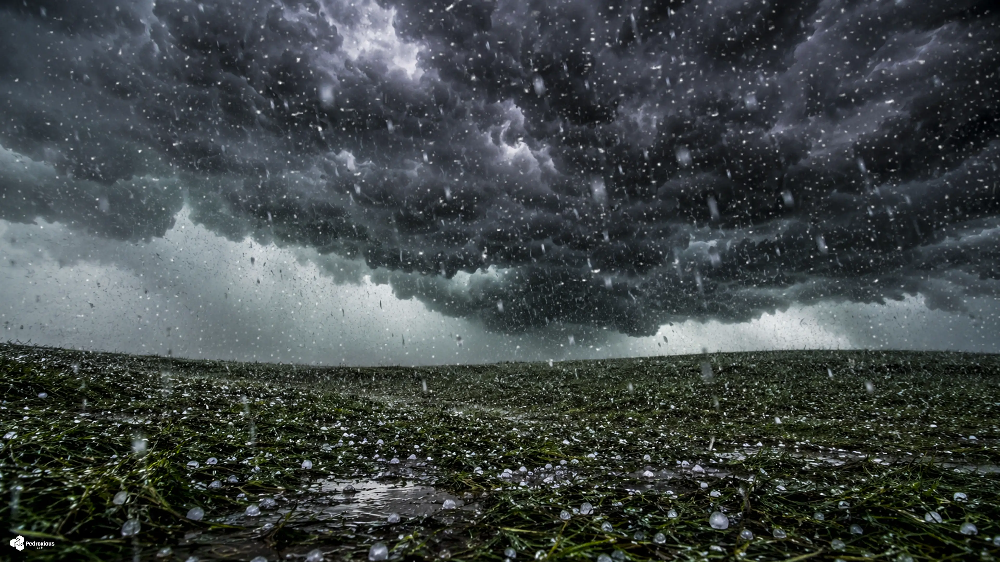

# SkyLog — Global Weather Dashboard

### Monitoramento climático em tempo real de 15 cidades ao redor do mundo

---

### Sync Ativo • Última atualização: 09:39 (BRT)
*Projeto em expansão, operando com automações no GitHub Actions para manter métricas globais atualizadas em tempo real. Consulte o link superior para a versão Web.*

 

## São Paulo, Brasil

<table>
  <tr>
    <td align="center" width="50%">
      
    </td>
    <td align="center" width="50%">
      
    </td>
  </tr>
</table>

| Parâmetro | Medição em Tempo Real |
|:---:|:---:|
| Temperatura | 25.0°C (Sensação: 27.4°C) |
| Variação Diária | 18.0°C — 29.1°C |
| Umidade / Pressão | 65% / 1011.0 hPa |
| Vento / Direção | 2.9 km/h (Direção: 277°) |
| UV / Visibilidade | 5.4 / 38.1 km |
| Condição Atual | Nublado |
| Horário Local | 09:39 |

### Previsão para os Próximos Dias

| Dia | Condição | Temperatura | Índice UV Máximo | Precipitação Prevista |
|:---:|:---:|:---:|:---:|:---:|
| Hoje | 🌦️ Chuvisco | 18.0°C a 29.1°C | UV: 10 | Precip: 2.2 mm |
| Amanhã | 🌦️ Chuvisco | 20.2°C a 30.3°C | UV: 9 | Precip: 0.5 mm |
| 20/11 | 🌦️ Chuvisco | 20.8°C a 32.8°C | UV: 9 | Precip: 1.2 mm |

 
 

## Rio de Janeiro, Brasil

<table>
  <tr>
    <td align="center" width="50%">
      
    </td>
    <td align="center" width="50%">
      
    </td>
  </tr>
</table>

| Parâmetro | Medição em Tempo Real |
|:---:|:---:|
| Temperatura | 27.5°C (Sensação: 32.9°C) |
| Variação Diária | 22.1°C — 27.7°C |
| Umidade / Pressão | 69% / 1010.2 hPa |
| Vento / Direção | 5.3 km/h (Direção: 108°) |
| UV / Visibilidade | 5.7 / 22.9 km |
| Condição Atual | Principalmente limpo |
| Horário Local | 09:39 |

### Previsão para os Próximos Dias

| Dia | Condição | Temperatura | Índice UV Máximo | Precipitação Prevista |
|:---:|:---:|:---:|:---:|:---:|
| Hoje | 🌦️ Chuvisco | 22.1°C a 27.7°C | UV: 9 | Precip: 0.7 mm |
| Amanhã | ☁️ Nublado | 23.1°C a 30.7°C | UV: 9 | Precip: 0.0 mm |
| 20/11 | 🌦️ Chuvisco | 24.9°C a 31.1°C | UV: 9 | Precip: 0.4 mm |

 
 

## Buenos Aires, Argentina

<table>
  <tr>
    <td align="center" width="50%">
      
    </td>
    <td align="center" width="50%">
      
    </td>
  </tr>
</table>

| Parâmetro | Medição em Tempo Real |
|:---:|:---:|
| Temperatura | 23.3°C (Sensação: 25.2°C) |
| Variação Diária | 17.8°C — 25.4°C |
| Umidade / Pressão | 65% / 1006.3 hPa |
| Vento / Direção | 8.2 km/h (Direção: 230°) |
| UV / Visibilidade | 3.7 / 50.4 km |
| Condição Atual | Principalmente limpo |
| Horário Local | 09:39 |

### Previsão para os Próximos Dias

| Dia | Condição | Temperatura | Índice UV Máximo | Precipitação Prevista |
|:---:|:---:|:---:|:---:|:---:|
| Hoje | 🌧️ Chuva | 17.8°C a 25.4°C | UV: 7 | Precip: 2.2 mm |
| Amanhã | ☁️ Nublado | 16.4°C a 26.1°C | UV: 9 | Precip: 0.0 mm |
| 20/11 | ⛈️ Tempestade | 18.9°C a 26.7°C | UV: 8 | Precip: 7.4 mm |

 
 

## Mexico City, México

<table>
  <tr>
    <td align="center" width="50%">
      
    </td>
    <td align="center" width="50%">
      
    </td>
  </tr>
</table>

| Parâmetro | Medição em Tempo Real |
|:---:|:---:|
| Temperatura | 12.0°C (Sensação: 11.5°C) |
| Variação Diária | 11.8°C — 22.8°C |
| Umidade / Pressão | 83% / 1021.7 hPa |
| Vento / Direção | 1.6 km/h (Direção: 354°) |
| UV / Visibilidade | 0.0 / 31.0 km |
| Condição Atual | Nublado |
| Horário Local | 06:39 |

### Previsão para os Próximos Dias

| Dia | Condição | Temperatura | Índice UV Máximo | Precipitação Prevista |
|:---:|:---:|:---:|:---:|:---:|
| Hoje | 🌦️ Chuvisco | 11.8°C a 22.8°C | UV: 7 | Precip: 0.2 mm |
| Amanhã | ☁️ Nublado | 11.9°C a 21.4°C | UV: 7 | Precip: 0.0 mm |
| 20/11 | ☁️ Nublado | 9.7°C a 23.4°C | UV: 7 | Precip: 0.0 mm |

 
 

## Havana, Cuba

<table>
  <tr>
    <td align="center" width="50%">
      
    </td>
    <td align="center" width="50%">
      
    </td>
  </tr>
</table>

| Parâmetro | Medição em Tempo Real |
|:---:|:---:|
| Temperatura | 23.3°C (Sensação: 26.0°C) |
| Variação Diária | 22.4°C — 26.8°C |
| Umidade / Pressão | 90% / 1014.5 hPa |
| Vento / Direção | 12.6 km/h (Direção: 166°) |
| UV / Visibilidade | 0.5 / 34.9 km |
| Condição Atual | Parcialmente nublado |
| Horário Local | 08:39 |

### Previsão para os Próximos Dias

| Dia | Condição | Temperatura | Índice UV Máximo | Precipitação Prevista |
|:---:|:---:|:---:|:---:|:---:|
| Hoje | ⛈️ Tempestade | 22.4°C a 26.8°C | UV: 6 | Precip: 5.0 mm |
| Amanhã | 🌦️ Chuvisco | 20.8°C a 28.1°C | UV: 6 | Precip: 0.1 mm |
| 20/11 | ⛈️ Tempestade | 21.9°C a 28.2°C | UV: 6 | Precip: 8.6 mm |

 
 

## Miami, EUA

<table>
  <tr>
    <td align="center" width="50%">
      
    </td>
    <td align="center" width="50%">
      
    </td>
  </tr>
</table>

| Parâmetro | Medição em Tempo Real |
|:---:|:---:|
| Temperatura | 22.7°C (Sensação: 22.6°C) |
| Variação Diária | 21.2°C — 23.5°C |
| Umidade / Pressão | 85% / 1018.3 hPa |
| Vento / Direção | 26.8 km/h (Direção: 65°) |
| UV / Visibilidade | 0.0 / 11.7 km |
| Condição Atual | Chuvisco |
| Horário Local | 07:39 |

### Previsão para os Próximos Dias

| Dia | Condição | Temperatura | Índice UV Máximo | Precipitação Prevista |
|:---:|:---:|:---:|:---:|:---:|
| Hoje | ⛈️ Tempestade | 21.2°C a 23.5°C | UV: 1 | Precip: 70.0 mm |
| Amanhã | 🌧️ Chuva | 21.6°C a 24.8°C | UV: 5 | Precip: 2.1 mm |
| 20/11 | 🌧️ Chuva | 23.5°C a 26.7°C | UV: 5 | Precip: 7.5 mm |

 
 

## New York, EUA

<table>
  <tr>
    <td align="center" width="50%">
      
    </td>
    <td align="center" width="50%">
      
    </td>
  </tr>
</table>

| Parâmetro | Medição em Tempo Real |
|:---:|:---:|
| Temperatura | 4.6°C (Sensação: 1.6°C) |
| Variação Diária | 4.3°C — 17.6°C |
| Umidade / Pressão | 79% / 1032.0 hPa |
| Vento / Direção | 7.2 km/h (Direção: 285°) |
| UV / Visibilidade | 0.0 / 19.4 km |
| Condição Atual | Céu limpo |
| Horário Local | 07:39 |

### Previsão para os Próximos Dias

| Dia | Condição | Temperatura | Índice UV Máximo | Precipitação Prevista |
|:---:|:---:|:---:|:---:|:---:|
| Hoje | ☀️ Céu limpo | 4.3°C a 17.6°C | UV: 3 | Precip: 0.0 mm |
| Amanhã | ☀️ Céu limpo | 3.7°C a 17.2°C | UV: 3 | Precip: 0.0 mm |
| 20/11 | ☁️ Nublado | 9.8°C a 17.5°C | UV: 3 | Precip: 0.0 mm |

 
 

## London, Reino Unido

<table>
  <tr>
    <td align="center" width="50%">
      
    </td>
    <td align="center" width="50%">
      
    </td>
  </tr>
</table>

| Parâmetro | Medição em Tempo Real |
|:---:|:---:|
| Temperatura | 11.4°C (Sensação: 8.5°C) |
| Variação Diária | 9.2°C — 11.6°C |
| Umidade / Pressão | 79% / 987.0 hPa |
| Vento / Direção | 15.8 km/h (Direção: 248°) |
| UV / Visibilidade | 0.4 / 12.6 km |
| Condição Atual | Nublado |
| Horário Local | 12:39 |

### Previsão para os Próximos Dias

| Dia | Condição | Temperatura | Índice UV Máximo | Precipitação Prevista |
|:---:|:---:|:---:|:---:|:---:|
| Hoje | 🌦️ Chuvisco | 9.2°C a 11.6°C | UV: 0 | Precip: 1.2 mm |
| Amanhã | 🌧️ Chuva | 7.7°C a 9.7°C | UV: 0 | Precip: 4.3 mm |
| 20/11 | 🌧️ Chuva | 6.4°C a 9.0°C | UV: 0 | Precip: 10.6 mm |

 
 

## Paris, França

<table>
  <tr>
    <td align="center" width="50%">
      
    </td>
    <td align="center" width="50%">
      
    </td>
  </tr>
</table>

| Parâmetro | Medição em Tempo Real |
|:---:|:---:|
| Temperatura | 15.4°C (Sensação: 11.7°C) |
| Variação Diária | 11.6°C — 15.4°C |
| Umidade / Pressão | 59% / 993.9 hPa |
| Vento / Direção | 20.6 km/h (Direção: 241°) |
| UV / Visibilidade | 1.9 / 40.3 km |
| Condição Atual | Principalmente limpo |
| Horário Local | 13:39 |

### Previsão para os Próximos Dias

| Dia | Condição | Temperatura | Índice UV Máximo | Precipitação Prevista |
|:---:|:---:|:---:|:---:|:---:|
| Hoje | ☁️ Nublado | 11.6°C a 15.4°C | UV: 2 | Precip: 0.0 mm |
| Amanhã | 🌧️ Chuva | 10.8°C a 13.9°C | UV: 1 | Precip: 3.7 mm |
| 20/11 | 🌧️ Chuva | 9.7°C a 13.2°C | UV: 1 | Precip: 0.6 mm |

 
 

## Moscow, Rússia

<table>
  <tr>
    <td align="center" width="50%">
      
    </td>
    <td align="center" width="50%">
      
    </td>
  </tr>
</table>

| Parâmetro | Medição em Tempo Real |
|:---:|:---:|
| Temperatura | 0.3°C (Sensação: -3.1°C) |
| Variação Diária | -0.4°C — 0.6°C |
| Umidade / Pressão | 94% / 998.4 hPa |
| Vento / Direção | 7.7 km/h (Direção: 131°) |
| UV / Visibilidade | 0.3 / 4.4 km |
| Condição Atual | Granizo |
| Horário Local | 15:39 |

### Previsão para os Próximos Dias

| Dia | Condição | Temperatura | Índice UV Máximo | Precipitação Prevista |
|:---:|:---:|:---:|:---:|:---:|
| Hoje | 🌨️ Granizo | -0.4°C a 0.6°C | UV: 1 | Precip: 8.1 mm |
| Amanhã | 🌨️ Granizo | 0.5°C a 5.1°C | UV: 0 | Precip: 2.8 mm |
| 20/11 | 🌦️ Chuvisco | 4.4°C a 6.0°C | UV: 0 | Precip: 0.0 mm |

 
 

## Bangkok, Tailândia

<table>
  <tr>
    <td align="center" width="50%">
      
    </td>
    <td align="center" width="50%">
      
    </td>
  </tr>
</table>

| Parâmetro | Medição em Tempo Real |
|:---:|:---:|
| Temperatura | 32.8°C (Sensação: 36.8°C) |
| Variação Diária | 26.2°C — 36.1°C |
| Umidade / Pressão | 51% / 1013.5 hPa |
| Vento / Direção | 3.5 km/h (Direção: 129°) |
| UV / Visibilidade | 0.0 / 27.3 km |
| Condição Atual | Céu limpo |
| Horário Local | 19:39 |

### Previsão para os Próximos Dias

| Dia | Condição | Temperatura | Índice UV Máximo | Precipitação Prevista |
|:---:|:---:|:---:|:---:|:---:|
| Hoje | 🌦️ Chuvisco | 26.2°C a 36.1°C | UV: 7 | Precip: 1.1 mm |
| Amanhã | 🌦️ Chuvisco | 26.8°C a 35.2°C | UV: 7 | Precip: 0.2 mm |
| 20/11 | 🌦️ Chuvisco | 26.0°C a 35.0°C | UV: 7 | Precip: 0.4 mm |

 
 

## Tokyo, Japão

<table>
  <tr>
    <td align="center" width="50%">
      
    </td>
    <td align="center" width="50%">
      
    </td>
  </tr>
</table>

| Parâmetro | Medição em Tempo Real |
|:---:|:---:|
| Temperatura | 15.4°C (Sensação: 15.2°C) |
| Variação Diária | 9.0°C — 19.7°C |
| Umidade / Pressão | 79% / 1000.2 hPa |
| Vento / Direção | 5.4 km/h (Direção: 228°) |
| UV / Visibilidade | 0.0 / 27.9 km |
| Condição Atual | Principalmente limpo |
| Horário Local | 21:39 |

### Previsão para os Próximos Dias

| Dia | Condição | Temperatura | Índice UV Máximo | Precipitação Prevista |
|:---:|:---:|:---:|:---:|:---:|
| Hoje | 🌧️ Chuva | 9.0°C a 19.7°C | UV: 4 | Precip: 21.1 mm |
| Amanhã | ☀️ Céu limpo | 8.6°C a 18.1°C | UV: 4 | Precip: 0.0 mm |
| 20/11 | ☀️ Céu limpo | 7.4°C a 15.8°C | UV: 4 | Precip: 0.0 mm |

 
 

## Dubai, Emirados Árabes

<table>
  <tr>
    <td align="center" width="50%">
      
    </td>
    <td align="center" width="50%">
      
    </td>
  </tr>
</table>

| Parâmetro | Medição em Tempo Real |
|:---:|:---:|
| Temperatura | 27.8°C (Sensação: 28.8°C) |
| Variação Diária | 24.2°C — 29.8°C |
| Umidade / Pressão | 55% / 1015.7 hPa |
| Vento / Direção | 12.7 km/h (Direção: 317°) |
| UV / Visibilidade | 2.1 / 27.1 km |
| Condição Atual | Céu limpo |
| Horário Local | 16:39 |

### Previsão para os Próximos Dias

| Dia | Condição | Temperatura | Índice UV Máximo | Precipitação Prevista |
|:---:|:---:|:---:|:---:|:---:|
| Hoje | ☀️ Céu limpo | 24.2°C a 29.8°C | UV: 6 | Precip: 0.0 mm |
| Amanhã | ☀️ Céu limpo | 25.1°C a 28.3°C | UV: 6 | Precip: 0.0 mm |
| 20/11 | ☀️ Céu limpo | 23.7°C a 28.3°C | UV: 5 | Precip: 0.0 mm |

 
 

## Cairo, Egito

<table>
  <tr>
    <td align="center" width="50%">
      
    </td>
    <td align="center" width="50%">
      
    </td>
  </tr>
</table>

| Parâmetro | Medição em Tempo Real |
|:---:|:---:|
| Temperatura | 27.6°C (Sensação: 25.6°C) |
| Variação Diária | 13.6°C — 27.6°C |
| Umidade / Pressão | 26% / 1016.8 hPa |
| Vento / Direção | 7.0 km/h (Direção: 35°) |
| UV / Visibilidade | 3.3 / 48.6 km |
| Condição Atual | Céu limpo |
| Horário Local | 14:39 |

### Previsão para os Próximos Dias

| Dia | Condição | Temperatura | Índice UV Máximo | Precipitação Prevista |
|:---:|:---:|:---:|:---:|:---:|
| Hoje | ☁️ Nublado | 13.6°C a 27.6°C | UV: 4 | Precip: 0.0 mm |
| Amanhã | 🌤️ Principalmente limpo | 14.6°C a 27.2°C | UV: 4 | Precip: 0.0 mm |
| 20/11 | ⛅ Parcialmente nublado | 16.3°C a 29.4°C | UV: 4 | Precip: 0.0 mm |

 
 

## Sydney, Austrália

<table>
  <tr>
    <td align="center" width="50%">
      
    </td>
    <td align="center" width="50%">
      
    </td>
  </tr>
</table>

| Parâmetro | Medição em Tempo Real |
|:---:|:---:|
| Temperatura | 19.0°C (Sensação: 18.9°C) |
| Variação Diária | 14.1°C — 22.4°C |
| Umidade / Pressão | 79% / 1026.3 hPa |
| Vento / Direção | 11.9 km/h (Direção: 18°) |
| UV / Visibilidade | 0.0 / 31.5 km |
| Condição Atual | Céu limpo |
| Horário Local | 23:39 |

### Previsão para os Próximos Dias

| Dia | Condição | Temperatura | Índice UV Máximo | Precipitação Prevista |
|:---:|:---:|:---:|:---:|:---:|
| Hoje | 🌫️ Neblina | 14.1°C a 22.4°C | UV: 9 | Precip: 0.0 mm |
| Amanhã | ☁️ Nublado | 16.6°C a 23.6°C | UV: 9 | Precip: 0.0 mm |
| 20/11 | ☁️ Nublado | 18.3°C a 24.1°C | UV: 7 | Precip: 0.0 mm |

 
 

## Histórico de Dados

| Estatística | Valor |
|:---:|:---:|
| Total de registros | 20406 |
| Primeiro registro | `datetime` |
| Último registro | `2026-11-18 23:39` |
| Temperatura mais alta | **46.1°C** — Dubai |
| Temperatura mais baixa | **-0.2°C** — Moscow |

📂 <a href="data/history.csv">Ver histórico completo (history.csv)</a>

---

### Informações Técnicas

| Item | Detalhe |
|:---:|:---:|
| Fonte de dados | <a href="https://open-meteo.com/">Open-Meteo API</a> (gratuita) |
| Frequência | 24× ao dia (a cada hora) |
| Automação | GitHub Actions — <a href=".github/workflows/weather.yml">ver workflow</a> |
| Script | `update_weather.py` (requests e pytz) |
| Cidades Monitoradas | 15 cidades globais |

---

**Feito com amor por [Pedroxious](https://github.com/Pedroxious) · Dados: [Open-Meteo](https://open-meteo.com/)**

