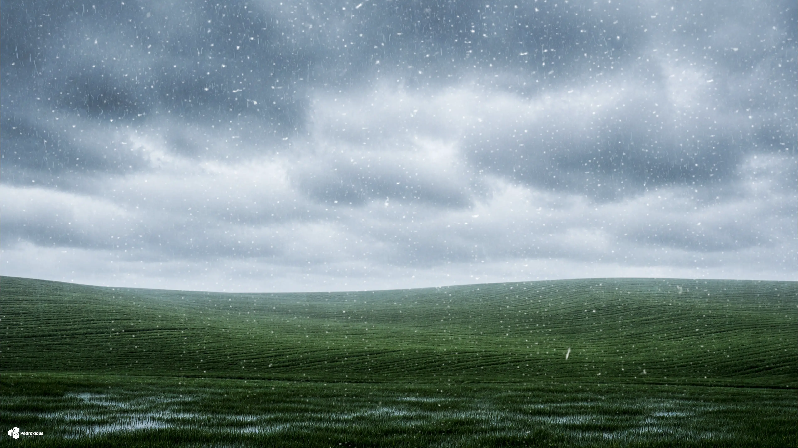

# SkyLog — Global Weather Dashboard

### Monitoramento climático em tempo real de 15 cidades ao redor do mundo

---

### Sync Ativo • Última atualização: 04:52 (BRT)
*Projeto em expansão, operando com automações no GitHub Actions para manter métricas globais atualizadas em tempo real. Consulte o link superior para a versão Web.*

 

## São Paulo, Brasil

<table>
  <tr>
    <td align="center" width="50%">
      
    </td>
    <td align="center" width="50%">
      
    </td>
  </tr>
</table>

| Parâmetro | Medição em Tempo Real |
|:---:|:---:|
| Temperatura | 20.3°C (Sensação: 23.1°C) |
| Variação Diária | 20.2°C — 31.4°C |
| Umidade / Pressão | 95% / 1011.3 hPa |
| Vento / Direção | 5.0 km/h (Direção: 341°) |
| UV / Visibilidade | 0.0 / 15.0 km |
| Condição Atual | Chuvisco |
| Horário Local | 04:52 |

### Previsão para os Próximos Dias

| Dia | Condição | Temperatura | Índice UV Máximo | Precipitação Prevista |
|:---:|:---:|:---:|:---:|:---:|
| Hoje | ⛈️ Tempestade | 20.2°C a 31.4°C | UV: 9 | Precip: 10.9 mm |
| Amanhã | 🌦️ Chuvisco | 19.6°C a 29.4°C | UV: 10 | Precip: 1.0 mm |
| 23/11 | 🌧️ Chuva | 21.5°C a 29.6°C | UV: 8 | Precip: 4.1 mm |

 
 

## Rio de Janeiro, Brasil

<table>
  <tr>
    <td align="center" width="50%">
      
    </td>
    <td align="center" width="50%">
      
    </td>
  </tr>
</table>

| Parâmetro | Medição em Tempo Real |
|:---:|:---:|
| Temperatura | 24.8°C (Sensação: 29.9°C) |
| Variação Diária | 24.8°C — 30.8°C |
| Umidade / Pressão | 93% / 1008.4 hPa |
| Vento / Direção | 5.2 km/h (Direção: 207°) |
| UV / Visibilidade | 0.0 / 2.5 km |
| Condição Atual | Nublado |
| Horário Local | 04:52 |

### Previsão para os Próximos Dias

| Dia | Condição | Temperatura | Índice UV Máximo | Precipitação Prevista |
|:---:|:---:|:---:|:---:|:---:|
| Hoje | ⛈️ Tempestade | 24.8°C a 30.8°C | UV: 9 | Precip: 0.4 mm |
| Amanhã | 🌦️ Chuvisco | 24.8°C a 30.6°C | UV: 9 | Precip: 0.2 mm |
| 23/11 | ⛈️ Tempestade | 25.0°C a 32.6°C | UV: 10 | Precip: 3.8 mm |

 
 

## Buenos Aires, Argentina

<table>
  <tr>
    <td align="center" width="50%">
      
    </td>
    <td align="center" width="50%">
      
    </td>
  </tr>
</table>

| Parâmetro | Medição em Tempo Real |
|:---:|:---:|
| Temperatura | 17.7°C (Sensação: 16.8°C) |
| Variação Diária | 17.1°C — 28.9°C |
| Umidade / Pressão | 67% / 1009.4 hPa |
| Vento / Direção | 8.8 km/h (Direção: 237°) |
| UV / Visibilidade | 0.0 / 50.0 km |
| Condição Atual | Céu limpo |
| Horário Local | 04:52 |

### Previsão para os Próximos Dias

| Dia | Condição | Temperatura | Índice UV Máximo | Precipitação Prevista |
|:---:|:---:|:---:|:---:|:---:|
| Hoje | 🌦️ Chuvisco | 17.1°C a 28.9°C | UV: 8 | Precip: 0.3 mm |
| Amanhã | ☁️ Nublado | 17.9°C a 28.8°C | UV: 9 | Precip: 0.0 mm |
| 23/11 | ☁️ Nublado | 18.9°C a 29.3°C | UV: 8 | Precip: 0.0 mm |

 
 

## Mexico City, México

<table>
  <tr>
    <td align="center" width="50%">
      
    </td>
    <td align="center" width="50%">
      
    </td>
  </tr>
</table>

| Parâmetro | Medição em Tempo Real |
|:---:|:---:|
| Temperatura | 14.4°C (Sensação: 13.1°C) |
| Variação Diária | 11.7°C — 24.1°C |
| Umidade / Pressão | 62% / 1018.1 hPa |
| Vento / Direção | 3.2 km/h (Direção: 106°) |
| UV / Visibilidade | 0.0 / 40.2 km |
| Condição Atual | Principalmente limpo |
| Horário Local | 01:52 |

### Previsão para os Próximos Dias

| Dia | Condição | Temperatura | Índice UV Máximo | Precipitação Prevista |
|:---:|:---:|:---:|:---:|:---:|
| Hoje | 🌦️ Chuvisco | 11.7°C a 24.1°C | UV: 7 | Precip: 0.1 mm |
| Amanhã | 🌦️ Chuvisco | 14.2°C a 24.0°C | UV: 7 | Precip: 0.9 mm |
| 23/11 | 🌦️ Chuvisco | 12.1°C a 23.0°C | UV: 7 | Precip: 0.7 mm |

 
 

## Havana, Cuba

<table>
  <tr>
    <td align="center" width="50%">
      
    </td>
    <td align="center" width="50%">
      
    </td>
  </tr>
</table>

| Parâmetro | Medição em Tempo Real |
|:---:|:---:|
| Temperatura | 23.5°C (Sensação: 27.1°C) |
| Variação Diária | 22.9°C — 29.0°C |
| Umidade / Pressão | 92% / 1012.7 hPa |
| Vento / Direção | 9.2 km/h (Direção: 197°) |
| UV / Visibilidade | 0.0 / 26.9 km |
| Condição Atual | Principalmente limpo |
| Horário Local | 03:52 |

### Previsão para os Próximos Dias

| Dia | Condição | Temperatura | Índice UV Máximo | Precipitação Prevista |
|:---:|:---:|:---:|:---:|:---:|
| Hoje | 🌦️ Chuvisco | 22.9°C a 29.0°C | UV: 6 | Precip: 2.4 mm |
| Amanhã | 🌦️ Chuvisco | 22.1°C a 27.7°C | UV: 6 | Precip: 0.1 mm |
| 23/11 | ☁️ Nublado | 23.4°C a 27.3°C | UV: 5 | Precip: 0.0 mm |

 
 

## Miami, EUA

<table>
  <tr>
    <td align="center" width="50%">
      
    </td>
    <td align="center" width="50%">
      
    </td>
  </tr>
</table>

| Parâmetro | Medição em Tempo Real |
|:---:|:---:|
| Temperatura | 21.0°C (Sensação: 23.7°C) |
| Variação Diária | 20.8°C — 26.1°C |
| Umidade / Pressão | 86% / 1011.7 hPa |
| Vento / Direção | 3.6 km/h (Direção: 106°) |
| UV / Visibilidade | 0.0 / 13.2 km |
| Condição Atual | Céu limpo |
| Horário Local | 02:52 |

### Previsão para os Próximos Dias

| Dia | Condição | Temperatura | Índice UV Máximo | Precipitação Prevista |
|:---:|:---:|:---:|:---:|:---:|
| Hoje | ☁️ Nublado | 20.8°C a 26.1°C | UV: 6 | Precip: 0.0 mm |
| Amanhã | ☁️ Nublado | 22.1°C a 27.6°C | UV: 5 | Precip: 0.0 mm |
| 23/11 | ☁️ Nublado | 22.7°C a 26.0°C | UV: 6 | Precip: 0.0 mm |

 
 

## New York, EUA

<table>
  <tr>
    <td align="center" width="50%">
      
    </td>
    <td align="center" width="50%">
      
    </td>
  </tr>
</table>

| Parâmetro | Medição em Tempo Real |
|:---:|:---:|
| Temperatura | 8.6°C (Sensação: 6.4°C) |
| Variação Diária | 6.0°C — 17.8°C |
| Umidade / Pressão | 76% / 1026.3 hPa |
| Vento / Direção | 6.6 km/h (Direção: 5°) |
| UV / Visibilidade | 0.0 / 21.9 km |
| Condição Atual | Céu limpo |
| Horário Local | 02:52 |

### Previsão para os Próximos Dias

| Dia | Condição | Temperatura | Índice UV Máximo | Precipitação Prevista |
|:---:|:---:|:---:|:---:|:---:|
| Hoje | ☁️ Nublado | 6.0°C a 17.8°C | UV: 2 | Precip: 0.0 mm |
| Amanhã | 🌦️ Chuvisco | 9.5°C a 17.2°C | UV: 2 | Precip: 0.5 mm |
| 23/11 | ☁️ Nublado | 8.2°C a 17.8°C | UV: 3 | Precip: 0.0 mm |

 
 

## London, Reino Unido

<table>
  <tr>
    <td align="center" width="50%">
      
    </td>
    <td align="center" width="50%">
      
    </td>
  </tr>
</table>

| Parâmetro | Medição em Tempo Real |
|:---:|:---:|
| Temperatura | 4.3°C (Sensação: 1.5°C) |
| Variação Diária | 4.1°C — 9.0°C |
| Umidade / Pressão | 75% / 1018.5 hPa |
| Vento / Direção | 5.4 km/h (Direção: 78°) |
| UV / Visibilidade | 0.0 / 4.8 km |
| Condição Atual | Nublado |
| Horário Local | 07:52 |

### Previsão para os Próximos Dias

| Dia | Condição | Temperatura | Índice UV Máximo | Precipitação Prevista |
|:---:|:---:|:---:|:---:|:---:|
| Hoje | ☁️ Nublado | 4.1°C a 9.0°C | UV: 0 | Precip: 0.0 mm |
| Amanhã | ☁️ Nublado | 5.8°C a 9.5°C | UV: 0 | Precip: 0.0 mm |
| 23/11 | ☁️ Nublado | 4.5°C a 8.0°C | UV: 0 | Precip: 0.0 mm |

 
 

## Paris, França

<table>
  <tr>
    <td align="center" width="50%">
      
    </td>
    <td align="center" width="50%">
      
    </td>
  </tr>
</table>

| Parâmetro | Medição em Tempo Real |
|:---:|:---:|
| Temperatura | 8.6°C (Sensação: 7.2°C) |
| Variação Diária | 8.6°C — 11.8°C |
| Umidade / Pressão | 90% / 1018.9 hPa |
| Vento / Direção | 4.5 km/h (Direção: 104°) |
| UV / Visibilidade | 0.0 / 16.5 km |
| Condição Atual | Nublado |
| Horário Local | 08:52 |

### Previsão para os Próximos Dias

| Dia | Condição | Temperatura | Índice UV Máximo | Precipitação Prevista |
|:---:|:---:|:---:|:---:|:---:|
| Hoje | ☁️ Nublado | 8.6°C a 11.8°C | UV: 2 | Precip: 0.0 mm |
| Amanhã | 🌧️ Chuva | 5.2°C a 8.9°C | UV: 0 | Precip: 11.0 mm |
| 23/11 | ☁️ Nublado | 2.4°C a 5.4°C | UV: 1 | Precip: 0.0 mm |

 
 

## Moscow, Rússia

<table>
  <tr>
    <td align="center" width="50%">
      
    </td>
    <td align="center" width="50%">
      
    </td>
  </tr>
</table>

| Parâmetro | Medição em Tempo Real |
|:---:|:---:|
| Temperatura | 4.1°C (Sensação: 2.1°C) |
| Variação Diária | -0.1°C — 4.7°C |
| Umidade / Pressão | 95% / 996.8 hPa |
| Vento / Direção | 2.9 km/h (Direção: 173°) |
| UV / Visibilidade | 0.2 / 3.3 km |
| Condição Atual | Chuva |
| Horário Local | 10:52 |

### Previsão para os Próximos Dias

| Dia | Condição | Temperatura | Índice UV Máximo | Precipitação Prevista |
|:---:|:---:|:---:|:---:|:---:|
| Hoje | 🌧️ Chuva | -0.1°C a 4.7°C | UV: 0 | Precip: 2.3 mm |
| Amanhã | 🌨️ Neve | -0.2°C a 1.5°C | UV: 1 | Precip: 0.4 mm |
| 23/11 | 🌨️ Neve | -0.3°C a 0.8°C | UV: 1 | Precip: 0.6 mm |

 
 

## Bangkok, Tailândia

<table>
  <tr>
    <td align="center" width="50%">
      
    </td>
    <td align="center" width="50%">
      
    </td>
  </tr>
</table>

| Parâmetro | Medição em Tempo Real |
|:---:|:---:|
| Temperatura | 33.6°C (Sensação: 35.4°C) |
| Variação Diária | 25.7°C — 33.7°C |
| Umidade / Pressão | 43% / 1013.0 hPa |
| Vento / Direção | 11.3 km/h (Direção: 73°) |
| UV / Visibilidade | 6.5 / 7.4 km |
| Condição Atual | Chuvisco |
| Horário Local | 14:52 |

### Previsão para os Próximos Dias

| Dia | Condição | Temperatura | Índice UV Máximo | Precipitação Prevista |
|:---:|:---:|:---:|:---:|:---:|
| Hoje | 🌦️ Chuvisco | 25.7°C a 33.7°C | UV: 7 | Precip: 1.8 mm |
| Amanhã | 🌦️ Chuvisco | 24.8°C a 34.3°C | UV: 7 | Precip: 0.2 mm |
| 23/11 | ☁️ Nublado | 25.7°C a 35.3°C | UV: 7 | Precip: 0.0 mm |

 
 

## Tokyo, Japão

<table>
  <tr>
    <td align="center" width="50%">
      
    </td>
    <td align="center" width="50%">
      
    </td>
  </tr>
</table>

| Parâmetro | Medição em Tempo Real |
|:---:|:---:|
| Temperatura | 12.7°C (Sensação: 10.9°C) |
| Variação Diária | 5.3°C — 14.1°C |
| Umidade / Pressão | 51% / 1015.8 hPa |
| Vento / Direção | 1.1 km/h (Direção: 72°) |
| UV / Visibilidade | 0.6 / 41.4 km |
| Condição Atual | Céu limpo |
| Horário Local | 16:52 |

### Previsão para os Próximos Dias

| Dia | Condição | Temperatura | Índice UV Máximo | Precipitação Prevista |
|:---:|:---:|:---:|:---:|:---:|
| Hoje | ☀️ Céu limpo | 5.3°C a 14.1°C | UV: 4 | Precip: 0.0 mm |
| Amanhã | 🌤️ Principalmente limpo | 4.9°C a 12.2°C | UV: 4 | Precip: 0.0 mm |
| 23/11 | ⛅ Parcialmente nublado | 4.5°C a 13.5°C | UV: 4 | Precip: 0.0 mm |

 
 

## Dubai, Emirados Árabes

<table>
  <tr>
    <td align="center" width="50%">
      
    </td>
    <td align="center" width="50%">
      
    </td>
  </tr>
</table>

| Parâmetro | Medição em Tempo Real |
|:---:|:---:|
| Temperatura | 28.2°C (Sensação: 30.2°C) |
| Variação Diária | 26.6°C — 28.7°C |
| Umidade / Pressão | 59% / 1017.5 hPa |
| Vento / Direção | 14.3 km/h (Direção: 260°) |
| UV / Visibilidade | 4.7 / 28.5 km |
| Condição Atual | Céu limpo |
| Horário Local | 11:52 |

### Previsão para os Próximos Dias

| Dia | Condição | Temperatura | Índice UV Máximo | Precipitação Prevista |
|:---:|:---:|:---:|:---:|:---:|
| Hoje | ☀️ Céu limpo | 26.6°C a 28.7°C | UV: 6 | Precip: 0.0 mm |
| Amanhã | ☀️ Céu limpo | 23.6°C a 29.6°C | UV: 5 | Precip: 0.0 mm |
| 23/11 | ☀️ Céu limpo | 24.6°C a 31.0°C | UV: 5 | Precip: 0.0 mm |

 
 

## Cairo, Egito

<table>
  <tr>
    <td align="center" width="50%">
      
    </td>
    <td align="center" width="50%">
      
    </td>
  </tr>
</table>

| Parâmetro | Medição em Tempo Real |
|:---:|:---:|
| Temperatura | 22.4°C (Sensação: 22.2°C) |
| Variação Diária | 15.2°C — 28.9°C |
| Umidade / Pressão | 53% / 1020.2 hPa |
| Vento / Direção | 5.9 km/h (Direção: 346°) |
| UV / Visibilidade | 1.8 / 41.0 km |
| Condição Atual | Nublado |
| Horário Local | 09:52 |

### Previsão para os Próximos Dias

| Dia | Condição | Temperatura | Índice UV Máximo | Precipitação Prevista |
|:---:|:---:|:---:|:---:|:---:|
| Hoje | ☁️ Nublado | 15.2°C a 28.9°C | UV: 4 | Precip: 0.0 mm |
| Amanhã | ☁️ Nublado | 17.4°C a 26.1°C | UV: 4 | Precip: 0.0 mm |
| 23/11 | ☁️ Nublado | 14.5°C a 23.9°C | UV: 4 | Precip: 0.0 mm |

 
 

## Sydney, Austrália

<table>
  <tr>
    <td align="center" width="50%">
      
    </td>
    <td align="center" width="50%">
      
    </td>
  </tr>
</table>

| Parâmetro | Medição em Tempo Real |
|:---:|:---:|
| Temperatura | 24.3°C (Sensação: 26.1°C) |
| Variação Diária | 18.4°C — 27.8°C |
| Umidade / Pressão | 76% / 1013.9 hPa |
| Vento / Direção | 13.1 km/h (Direção: 34°) |
| UV / Visibilidade | 0.2 / 30.7 km |
| Condição Atual | Principalmente limpo |
| Horário Local | 18:52 |

### Previsão para os Próximos Dias

| Dia | Condição | Temperatura | Índice UV Máximo | Precipitação Prevista |
|:---:|:---:|:---:|:---:|:---:|
| Hoje | 🌧️ Chuva | 18.4°C a 27.8°C | UV: 9 | Precip: 3.9 mm |
| Amanhã | 🌦️ Chuvisco | 20.5°C a 29.4°C | UV: 8 | Precip: 1.4 mm |
| 23/11 | 🌦️ Chuvisco | 22.8°C a 31.7°C | UV: 5 | Precip: 1.7 mm |

 
 

## Histórico de Dados

| Estatística | Valor |
|:---:|:---:|
| Total de registros | 20526 |
| Primeiro registro | `datetime` |
| Último registro | `2026-11-21 18:52` |
| Temperatura mais alta | **46.1°C** — Dubai |
| Temperatura mais baixa | **-0.2°C** — Moscow |

📂 <a href="data/history.csv">Ver histórico completo (history.csv)</a>

---

### Informações Técnicas

| Item | Detalhe |
|:---:|:---:|
| Fonte de dados | <a href="https://open-meteo.com/">Open-Meteo API</a> (gratuita) |
| Frequência | 24× ao dia (a cada hora) |
| Automação | GitHub Actions — <a href=".github/workflows/weather.yml">ver workflow</a> |
| Script | `update_weather.py` (requests e pytz) |
| Cidades Monitoradas | 15 cidades globais |

---

**Feito com amor por [Pedroxious](https://github.com/Pedroxious) · Dados: [Open-Meteo](https://open-meteo.com/)**

