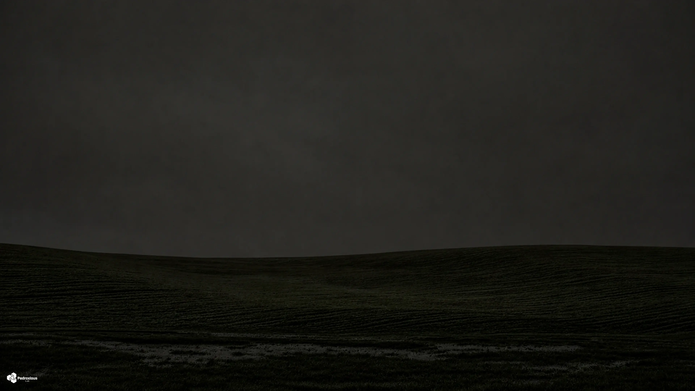
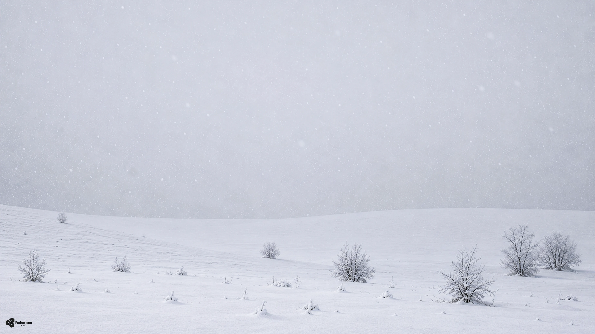

# SkyLog — Global Weather Dashboard

### Monitoramento climático em tempo real de 15 cidades ao redor do mundo

---

### Sync Ativo • Última atualização: 03:03 (BRT)
*Projeto em expansão, operando com automações no GitHub Actions para manter métricas globais atualizadas em tempo real. Consulte o link superior para a versão Web.*

 

## São Paulo, Brasil

<table>
  <tr>
    <td align="center" width="50%">
      
    </td>
    <td align="center" width="50%">
      
    </td>
  </tr>
</table>

| Parâmetro | Medição em Tempo Real |
|:---:|:---:|
| Temperatura | 20.2°C (Sensação: 22.8°C) |
| Variação Diária | 17.1°C — 20.9°C |
| Umidade / Pressão | 97% / 1016.3 hPa |
| Vento / Direção | 6.9 km/h (Direção: 186°) |
| UV / Visibilidade | 0.0 / 4.7 km |
| Condição Atual | Chuvisco |
| Horário Local | 03:03 |

### Previsão para os Próximos Dias

| Dia | Condição | Temperatura | Índice UV Máximo | Precipitação Prevista |
|:---:|:---:|:---:|:---:|:---:|
| Hoje | 🌧️ Chuva | 17.1°C a 20.9°C | UV: 7 | Precip: 6.3 mm |
| Amanhã | 🌧️ Chuva | 16.6°C a 23.4°C | UV: 5 | Precip: 5.7 mm |
| 28/11 | ⛈️ Tempestade | 16.5°C a 25.7°C | UV: 2 | Precip: 14.1 mm |

 
 

## Rio de Janeiro, Brasil

<table>
  <tr>
    <td align="center" width="50%">
      
    </td>
    <td align="center" width="50%">
      
    </td>
  </tr>
</table>

| Parâmetro | Medição em Tempo Real |
|:---:|:---:|
| Temperatura | 24.4°C (Sensação: 29.2°C) |
| Variação Diária | 22.9°C — 25.0°C |
| Umidade / Pressão | 99% / 1012.6 hPa |
| Vento / Direção | 9.9 km/h (Direção: 254°) |
| UV / Visibilidade | 0.0 / 3.0 km |
| Condição Atual | Chuvisco |
| Horário Local | 03:03 |

### Previsão para os Próximos Dias

| Dia | Condição | Temperatura | Índice UV Máximo | Precipitação Prevista |
|:---:|:---:|:---:|:---:|:---:|
| Hoje | ⛈️ Tempestade | 22.9°C a 25.0°C | UV: 1 | Precip: 22.7 mm |
| Amanhã | 🌦️ Chuvisco | 20.3°C a 25.2°C | UV: 7 | Precip: 1.7 mm |
| 28/11 | ⛈️ Tempestade | 20.2°C a 26.5°C | UV: 9 | Precip: 8.7 mm |

 
 

## Buenos Aires, Argentina

<table>
  <tr>
    <td align="center" width="50%">
      
    </td>
    <td align="center" width="50%">
      
    </td>
  </tr>
</table>

| Parâmetro | Medição em Tempo Real |
|:---:|:---:|
| Temperatura | 17.0°C (Sensação: 13.8°C) |
| Variação Diária | 15.0°C — 24.5°C |
| Umidade / Pressão | 47% / 1023.2 hPa |
| Vento / Direção | 14.8 km/h (Direção: 139°) |
| UV / Visibilidade | 0.0 / 58.1 km |
| Condição Atual | Céu limpo |
| Horário Local | 03:03 |

### Previsão para os Próximos Dias

| Dia | Condição | Temperatura | Índice UV Máximo | Precipitação Prevista |
|:---:|:---:|:---:|:---:|:---:|
| Hoje | ☁️ Nublado | 15.0°C a 24.5°C | UV: 9 | Precip: 0.0 mm |
| Amanhã | ☁️ Nublado | 19.2°C a 29.2°C | UV: 9 | Precip: 0.0 mm |
| 28/11 | ☁️ Nublado | 21.9°C a 31.3°C | UV: 9 | Precip: 0.0 mm |

 
 

## Mexico City, México

<table>
  <tr>
    <td align="center" width="50%">
      
    </td>
    <td align="center" width="50%">
      
    </td>
  </tr>
</table>

| Parâmetro | Medição em Tempo Real |
|:---:|:---:|
| Temperatura | 11.3°C (Sensação: 10.4°C) |
| Variação Diária | 8.0°C — 17.1°C |
| Umidade / Pressão | 86% / 1021.2 hPa |
| Vento / Direção | 4.6 km/h (Direção: 21°) |
| UV / Visibilidade | 0.0 / 30.6 km |
| Condição Atual | Nublado |
| Horário Local | 00:03 |

### Previsão para os Próximos Dias

| Dia | Condição | Temperatura | Índice UV Máximo | Precipitação Prevista |
|:---:|:---:|:---:|:---:|:---:|
| Hoje | 🌦️ Chuvisco | 8.0°C a 17.1°C | UV: 6 | Precip: 2.4 mm |
| Amanhã | 🌧️ Chuva | 8.1°C a 14.4°C | UV: 4 | Precip: 11.8 mm |
| 28/11 | 🌨️ Neve | 2.9°C a 9.2°C | UV: 2 | Precip: 63.2 mm |

 
 

## Havana, Cuba

<table>
  <tr>
    <td align="center" width="50%">
      
    </td>
    <td align="center" width="50%">
      
    </td>
  </tr>
</table>

| Parâmetro | Medição em Tempo Real |
|:---:|:---:|
| Temperatura | 24.7°C (Sensação: 25.9°C) |
| Variação Diária | 22.6°C — 26.0°C |
| Umidade / Pressão | 78% / 1012.2 hPa |
| Vento / Direção | 20.2 km/h (Direção: 299°) |
| UV / Visibilidade | 0.0 / 35.8 km |
| Condição Atual | Céu limpo |
| Horário Local | 02:03 |

### Previsão para os Próximos Dias

| Dia | Condição | Temperatura | Índice UV Máximo | Precipitação Prevista |
|:---:|:---:|:---:|:---:|:---:|
| Hoje | 🌦️ Chuvisco | 22.6°C a 26.0°C | UV: 6 | Precip: 0.2 mm |
| Amanhã | 🌦️ Chuvisco | 21.5°C a 24.9°C | UV: 5 | Precip: 0.6 mm |
| 28/11 | ☁️ Nublado | 21.3°C a 25.7°C | UV: 4 | Precip: 0.0 mm |

 
 

## Miami, EUA

<table>
  <tr>
    <td align="center" width="50%">
      
    </td>
    <td align="center" width="50%">
      
    </td>
  </tr>
</table>

| Parâmetro | Medição em Tempo Real |
|:---:|:---:|
| Temperatura | 21.5°C (Sensação: 23.6°C) |
| Variação Diária | 18.7°C — 24.3°C |
| Umidade / Pressão | 92% / 1008.6 hPa |
| Vento / Direção | 13.2 km/h (Direção: 255°) |
| UV / Visibilidade | 0.0 / 12.3 km |
| Condição Atual | Céu limpo |
| Horário Local | 01:03 |

### Previsão para os Próximos Dias

| Dia | Condição | Temperatura | Índice UV Máximo | Precipitação Prevista |
|:---:|:---:|:---:|:---:|:---:|
| Hoje | 🌦️ Chuvisco | 18.7°C a 24.3°C | UV: 5 | Precip: 1.1 mm |
| Amanhã | ☁️ Nublado | 16.5°C a 23.3°C | UV: 5 | Precip: 0.0 mm |
| 28/11 | ☁️ Nublado | 19.1°C a 22.3°C | UV: 4 | Precip: 0.0 mm |

 
 

## New York, EUA

<table>
  <tr>
    <td align="center" width="50%">
      
    </td>
    <td align="center" width="50%">
      
    </td>
  </tr>
</table>

| Parâmetro | Medição em Tempo Real |
|:---:|:---:|
| Temperatura | 5.4°C (Sensação: 1.0°C) |
| Variação Diária | 5.4°C — 14.2°C |
| Umidade / Pressão | 80% / 1034.4 hPa |
| Vento / Direção | 17.8 km/h (Direção: 61°) |
| UV / Visibilidade | 0.0 / 17.5 km |
| Condição Atual | Nublado |
| Horário Local | 01:03 |

### Previsão para os Próximos Dias

| Dia | Condição | Temperatura | Índice UV Máximo | Precipitação Prevista |
|:---:|:---:|:---:|:---:|:---:|
| Hoje | 🌧️ Chuva | 5.4°C a 14.2°C | UV: 1 | Precip: 48.6 mm |
| Amanhã | 🌦️ Chuvisco | 6.7°C a 14.4°C | UV: 1 | Precip: 3.3 mm |
| 28/11 | 🌦️ Chuvisco | 6.2°C a 9.5°C | UV: 1 | Precip: 0.2 mm |

 
 

## London, Reino Unido

<table>
  <tr>
    <td align="center" width="50%">
      
    </td>
    <td align="center" width="50%">
      
    </td>
  </tr>
</table>

| Parâmetro | Medição em Tempo Real |
|:---:|:---:|
| Temperatura | 5.0°C (Sensação: 1.2°C) |
| Variação Diária | 2.6°C — 6.2°C |
| Umidade / Pressão | 74% / 1017.7 hPa |
| Vento / Direção | 13.0 km/h (Direção: 62°) |
| UV / Visibilidade | 0.0 / 17.4 km |
| Condição Atual | Nublado |
| Horário Local | 06:03 |

### Previsão para os Próximos Dias

| Dia | Condição | Temperatura | Índice UV Máximo | Precipitação Prevista |
|:---:|:---:|:---:|:---:|:---:|
| Hoje | ☁️ Nublado | 2.6°C a 6.2°C | UV: 0 | Precip: 0.0 mm |
| Amanhã | 🌦️ Chuvisco | 2.1°C a 6.7°C | UV: 0 | Precip: 0.2 mm |
| 28/11 | 🌦️ Chuvisco | 4.0°C a 10.6°C | UV: 0 | Precip: 3.8 mm |

 
 

## Paris, França

<table>
  <tr>
    <td align="center" width="50%">
      
    </td>
    <td align="center" width="50%">
      
    </td>
  </tr>
</table>

| Parâmetro | Medição em Tempo Real |
|:---:|:---:|
| Temperatura | 4.7°C (Sensação: 2.0°C) |
| Variação Diária | 2.0°C — 5.8°C |
| Umidade / Pressão | 89% / 1013.9 hPa |
| Vento / Direção | 7.7 km/h (Direção: 37°) |
| UV / Visibilidade | 0.0 / 18.6 km |
| Condição Atual | Nublado |
| Horário Local | 07:03 |

### Previsão para os Próximos Dias

| Dia | Condição | Temperatura | Índice UV Máximo | Precipitação Prevista |
|:---:|:---:|:---:|:---:|:---:|
| Hoje | 🌧️ Chuva | 2.0°C a 5.8°C | UV: 2 | Precip: 0.5 mm |
| Amanhã | ⛅ Parcialmente nublado | -0.4°C a 3.9°C | UV: 2 | Precip: 0.0 mm |
| 28/11 | ☁️ Nublado | -0.8°C a 4.6°C | UV: 2 | Precip: 0.0 mm |

 
 

## Moscow, Rússia

<table>
  <tr>
    <td align="center" width="50%">
      
    </td>
    <td align="center" width="50%">
      
    </td>
  </tr>
</table>

| Parâmetro | Medição em Tempo Real |
|:---:|:---:|
| Temperatura | -2.4°C (Sensação: -7.0°C) |
| Variação Diária | -4.0°C — -0.8°C |
| Umidade / Pressão | 90% / 1008.4 hPa |
| Vento / Direção | 13.5 km/h (Direção: 286°) |
| UV / Visibilidade | 0.0 / 5.1 km |
| Condição Atual | Neve |
| Horário Local | 09:03 |

### Previsão para os Próximos Dias

| Dia | Condição | Temperatura | Índice UV Máximo | Precipitação Prevista |
|:---:|:---:|:---:|:---:|:---:|
| Hoje | 🌨️ Neve | -4.0°C a -0.8°C | UV: 1 | Precip: 1.0 mm |
| Amanhã | 🌨️ Neve | -4.1°C a -2.3°C | UV: 1 | Precip: 0.1 mm |
| 28/11 | 🌨️ Neve | -6.0°C a -2.5°C | UV: 1 | Precip: 0.1 mm |

 
 

## Bangkok, Tailândia

<table>
  <tr>
    <td align="center" width="50%">
      
    </td>
    <td align="center" width="50%">
      
    </td>
  </tr>
</table>

| Parâmetro | Medição em Tempo Real |
|:---:|:---:|
| Temperatura | 33.1°C (Sensação: 37.2°C) |
| Variação Diária | 26.1°C — 33.4°C |
| Umidade / Pressão | 45% / 1012.1 hPa |
| Vento / Direção | 6.8 km/h (Direção: 61°) |
| UV / Visibilidade | 7.2 / 28.8 km |
| Condição Atual | Nublado |
| Horário Local | 13:03 |

### Previsão para os Próximos Dias

| Dia | Condição | Temperatura | Índice UV Máximo | Precipitação Prevista |
|:---:|:---:|:---:|:---:|:---:|
| Hoje | 🌦️ Chuvisco | 26.1°C a 33.4°C | UV: 7 | Precip: 0.1 mm |
| Amanhã | 🌦️ Chuvisco | 24.8°C a 34.2°C | UV: 7 | Precip: 1.2 mm |
| 28/11 | 🌦️ Chuvisco | 25.3°C a 33.4°C | UV: 7 | Precip: 1.1 mm |

 
 

## Tokyo, Japão

<table>
  <tr>
    <td align="center" width="50%">
      
    </td>
    <td align="center" width="50%">
      
    </td>
  </tr>
</table>

| Parâmetro | Medição em Tempo Real |
|:---:|:---:|
| Temperatura | 14.1°C (Sensação: 12.0°C) |
| Variação Diária | 4.2°C — 14.2°C |
| Umidade / Pressão | 44% / 1021.2 hPa |
| Vento / Direção | 2.5 km/h (Direção: 172°) |
| UV / Visibilidade | 1.3 / 44.3 km |
| Condição Atual | Parcialmente nublado |
| Horário Local | 15:03 |

### Previsão para os Próximos Dias

| Dia | Condição | Temperatura | Índice UV Máximo | Precipitação Prevista |
|:---:|:---:|:---:|:---:|:---:|
| Hoje | ⛅ Parcialmente nublado | 4.2°C a 14.2°C | UV: 3 | Precip: 0.0 mm |
| Amanhã | ⛅ Parcialmente nublado | 6.1°C a 16.3°C | UV: 4 | Precip: 0.0 mm |
| 28/11 | 🌧️ Chuva | 8.6°C a 15.5°C | UV: 4 | Precip: 15.4 mm |

 
 

## Dubai, Emirados Árabes

<table>
  <tr>
    <td align="center" width="50%">
      
    </td>
    <td align="center" width="50%">
      
    </td>
  </tr>
</table>

| Parâmetro | Medição em Tempo Real |
|:---:|:---:|
| Temperatura | 25.9°C (Sensação: 29.2°C) |
| Variação Diária | 25.0°C — 28.2°C |
| Umidade / Pressão | 76% / 1018.9 hPa |
| Vento / Direção | 8.4 km/h (Direção: 187°) |
| UV / Visibilidade | 3.2 / 25.3 km |
| Condição Atual | Céu limpo |
| Horário Local | 10:03 |

### Previsão para os Próximos Dias

| Dia | Condição | Temperatura | Índice UV Máximo | Precipitação Prevista |
|:---:|:---:|:---:|:---:|:---:|
| Hoje | ☀️ Céu limpo | 25.0°C a 28.2°C | UV: 5 | Precip: 0.0 mm |
| Amanhã | ☀️ Céu limpo | 24.7°C a 27.5°C | UV: 5 | Precip: 0.0 mm |
| 28/11 | ☀️ Céu limpo | 22.8°C a 27.3°C | UV: 5 | Precip: 0.0 mm |

 
 

## Cairo, Egito

<table>
  <tr>
    <td align="center" width="50%">
      
    </td>
    <td align="center" width="50%">
      
    </td>
  </tr>
</table>

| Parâmetro | Medição em Tempo Real |
|:---:|:---:|
| Temperatura | 14.8°C (Sensação: 14.0°C) |
| Variação Diária | 13.7°C — 24.2°C |
| Umidade / Pressão | 80% / 1021.5 hPa |
| Vento / Direção | 8.3 km/h (Direção: 355°) |
| UV / Visibilidade | 0.6 / 29.7 km |
| Condição Atual | Nublado |
| Horário Local | 08:03 |

### Previsão para os Próximos Dias

| Dia | Condição | Temperatura | Índice UV Máximo | Precipitação Prevista |
|:---:|:---:|:---:|:---:|:---:|
| Hoje | ☁️ Nublado | 13.7°C a 24.2°C | UV: 4 | Precip: 0.0 mm |
| Amanhã | ☁️ Nublado | 14.3°C a 25.2°C | UV: 4 | Precip: 0.0 mm |
| 28/11 | 🌫️ Neblina | 14.4°C a 23.0°C | UV: 2 | Precip: 0.0 mm |

 
 

## Sydney, Austrália

<table>
  <tr>
    <td align="center" width="50%">
      
    </td>
    <td align="center" width="50%">
      
    </td>
  </tr>
</table>

| Parâmetro | Medição em Tempo Real |
|:---:|:---:|
| Temperatura | 22.9°C (Sensação: 23.2°C) |
| Variação Diária | 16.5°C — 24.3°C |
| Umidade / Pressão | 70% / 1022.6 hPa |
| Vento / Direção | 14.9 km/h (Direção: 67°) |
| UV / Visibilidade | 4.6 / 24.2 km |
| Condição Atual | Principalmente limpo |
| Horário Local | 17:03 |

### Previsão para os Próximos Dias

| Dia | Condição | Temperatura | Índice UV Máximo | Precipitação Prevista |
|:---:|:---:|:---:|:---:|:---:|
| Hoje | 🌦️ Chuvisco | 16.5°C a 24.3°C | UV: 8 | Precip: 0.1 mm |
| Amanhã | ☁️ Nublado | 19.1°C a 24.9°C | UV: 9 | Precip: 0.0 mm |
| 28/11 | 🌨️ Granizo | 20.3°C a 28.1°C | UV: 9 | Precip: 9.6 mm |

 
 

## Histórico de Dados

| Estatística | Valor |
|:---:|:---:|
| Total de registros | 20689 |
| Primeiro registro | `datetime` |
| Último registro | `2026-11-26 17:03` |
| Temperatura mais alta | **46.1°C** — Dubai |
| Temperatura mais baixa | **-4.1°C** — Moscow |

📂 <a href="data/history.csv">Ver histórico completo (history.csv)</a>

---

### Informações Técnicas

| Item | Detalhe |
|:---:|:---:|
| Fonte de dados | <a href="https://open-meteo.com/">Open-Meteo API</a> (gratuita) |
| Frequência | 24× ao dia (a cada hora) |
| Automação | GitHub Actions — <a href=".github/workflows/weather.yml">ver workflow</a> |
| Script | `update_weather.py` (requests e pytz) |
| Cidades Monitoradas | 15 cidades globais |

---

**Feito com amor por [Pedroxious](https://github.com/Pedroxious) · Dados: [Open-Meteo](https://open-meteo.com/)**

