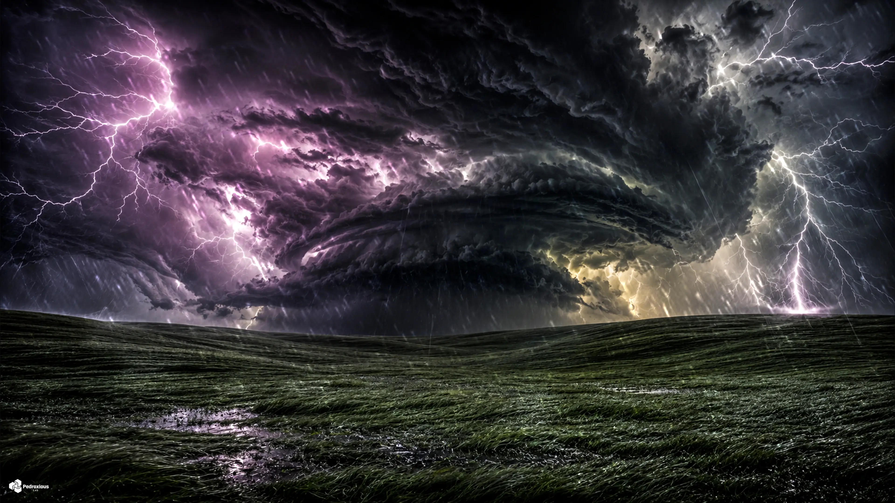

# SkyLog — Global Weather Dashboard

### Monitoramento climático em tempo real de 15 cidades ao redor do mundo

---

### Sync Ativo • Última atualização: 00:31 (BRT)
*Projeto em expansão, operando com automações no GitHub Actions para manter métricas globais atualizadas em tempo real. Consulte o link superior para a versão Web.*

 

## São Paulo, Brasil

<table>
  <tr>
    <td align="center" width="50%">
      
    </td>
    <td align="center" width="50%">
      
    </td>
  </tr>
</table>

| Parâmetro | Medição em Tempo Real |
|:---:|:---:|
| Temperatura | 19.8°C (Sensação: 22.1°C) |
| Variação Diária | 13.7°C — 19.9°C |
| Umidade / Pressão | 96% / 1012.3 hPa |
| Vento / Direção | 7.1 km/h (Direção: 285°) |
| UV / Visibilidade | 0.0 / 8.8 km |
| Condição Atual | Nublado |
| Horário Local | 00:30 |

### Previsão para os Próximos Dias

| Dia | Condição | Temperatura | Índice UV Máximo | Precipitação Prevista |
|:---:|:---:|:---:|:---:|:---:|
| Hoje | ⛈️ Tempestade | 13.7°C a 19.9°C | UV: 1 | Precip: 10.0 mm |
| Amanhã | 🌦️ Chuvisco | 12.9°C a 16.2°C | UV: 2 | Precip: 0.1 mm |
| 10/11 | 🌦️ Chuvisco | 12.9°C a 21.1°C | UV: 6 | Precip: 0.8 mm |

 
 

## Rio de Janeiro, Brasil

<table>
  <tr>
    <td align="center" width="50%">
      
    </td>
    <td align="center" width="50%">
      
    </td>
  </tr>
</table>

| Parâmetro | Medição em Tempo Real |
|:---:|:---:|
| Temperatura | 23.6°C (Sensação: 26.9°C) |
| Variação Diária | 19.2°C — 25.8°C |
| Umidade / Pressão | 96% / 1007.8 hPa |
| Vento / Direção | 14.8 km/h (Direção: 354°) |
| UV / Visibilidade | 0.0 / 14.7 km |
| Condição Atual | Parcialmente nublado |
| Horário Local | 00:30 |

### Previsão para os Próximos Dias

| Dia | Condição | Temperatura | Índice UV Máximo | Precipitação Prevista |
|:---:|:---:|:---:|:---:|:---:|
| Hoje | 🌧️ Chuva | 19.2°C a 25.8°C | UV: 1 | Precip: 8.5 mm |
| Amanhã | 🌧️ Chuva | 18.7°C a 21.8°C | UV: 1 | Precip: 6.9 mm |
| 10/11 | 🌦️ Chuvisco | 18.7°C a 23.2°C | UV: 9 | Precip: 0.5 mm |

 
 

## Buenos Aires, Argentina

<table>
  <tr>
    <td align="center" width="50%">
      
    </td>
    <td align="center" width="50%">
      
    </td>
  </tr>
</table>

| Parâmetro | Medição em Tempo Real |
|:---:|:---:|
| Temperatura | 13.0°C (Sensação: 11.1°C) |
| Variação Diária | 10.5°C — 19.8°C |
| Umidade / Pressão | 65% / 1026.3 hPa |
| Vento / Direção | 7.3 km/h (Direção: 149°) |
| UV / Visibilidade | 0.0 / 50.7 km |
| Condição Atual | Céu limpo |
| Horário Local | 00:30 |

### Previsão para os Próximos Dias

| Dia | Condição | Temperatura | Índice UV Máximo | Precipitação Prevista |
|:---:|:---:|:---:|:---:|:---:|
| Hoje | ☀️ Céu limpo | 10.5°C a 19.8°C | UV: 9 | Precip: 0.0 mm |
| Amanhã | ☀️ Céu limpo | 14.4°C a 23.0°C | UV: 9 | Precip: 0.0 mm |
| 10/11 | ☁️ Nublado | 17.2°C a 25.6°C | UV: 9 | Precip: 0.0 mm |

 
 

## Mexico City, México

<table>
  <tr>
    <td align="center" width="50%">
      
    </td>
    <td align="center" width="50%">
      
    </td>
  </tr>
</table>

| Parâmetro | Medição em Tempo Real |
|:---:|:---:|
| Temperatura | 16.9°C (Sensação: 15.3°C) |
| Variação Diária | 12.2°C — 23.8°C |
| Umidade / Pressão | 64% / 1017.3 hPa |
| Vento / Direção | 10.6 km/h (Direção: 328°) |
| UV / Visibilidade | 0.0 / 40.8 km |
| Condição Atual | Principalmente limpo |
| Horário Local | 21:30 |

### Previsão para os Próximos Dias

| Dia | Condição | Temperatura | Índice UV Máximo | Precipitação Prevista |
|:---:|:---:|:---:|:---:|:---:|
| Hoje | ☁️ Nublado | 12.2°C a 23.8°C | UV: 8 | Precip: 0.0 mm |
| Amanhã | 🌧️ Chuva | 12.8°C a 23.7°C | UV: 8 | Precip: 2.4 mm |
| 09/11 | 🌦️ Chuvisco | 12.6°C a 23.6°C | UV: 8 | Precip: 0.5 mm |

 
 

## Havana, Cuba

<table>
  <tr>
    <td align="center" width="50%">
      
    </td>
    <td align="center" width="50%">
      
    </td>
  </tr>
</table>

| Parâmetro | Medição em Tempo Real |
|:---:|:---:|
| Temperatura | 24.9°C (Sensação: 28.5°C) |
| Variação Diária | 23.2°C — 28.8°C |
| Umidade / Pressão | 83% / 1014.7 hPa |
| Vento / Direção | 8.1 km/h (Direção: 62°) |
| UV / Visibilidade | 0.0 / 23.6 km |
| Condição Atual | Céu limpo |
| Horário Local | 23:30 |

### Previsão para os Próximos Dias

| Dia | Condição | Temperatura | Índice UV Máximo | Precipitação Prevista |
|:---:|:---:|:---:|:---:|:---:|
| Hoje | 🌦️ Chuvisco | 23.2°C a 28.8°C | UV: 6 | Precip: 0.5 mm |
| Amanhã | 🌦️ Chuvisco | 23.6°C a 28.7°C | UV: 6 | Precip: 0.1 mm |
| 09/11 | 🌦️ Chuvisco | 23.1°C a 29.0°C | UV: 6 | Precip: 3.2 mm |

 
 

## Miami, EUA

<table>
  <tr>
    <td align="center" width="50%">
      
    </td>
    <td align="center" width="50%">
      
    </td>
  </tr>
</table>

| Parâmetro | Medição em Tempo Real |
|:---:|:---:|
| Temperatura | 23.9°C (Sensação: 27.7°C) |
| Variação Diária | 21.2°C — 29.5°C |
| Umidade / Pressão | 89% / 1013.8 hPa |
| Vento / Direção | 7.7 km/h (Direção: 39°) |
| UV / Visibilidade | 0.0 / 2.0 km |
| Condição Atual | Tempestade |
| Horário Local | 22:30 |

### Previsão para os Próximos Dias

| Dia | Condição | Temperatura | Índice UV Máximo | Precipitação Prevista |
|:---:|:---:|:---:|:---:|:---:|
| Hoje | 🌧️ Chuva | 21.2°C a 29.5°C | UV: 6 | Precip: 6.3 mm |
| Amanhã | ☁️ Nublado | 21.2°C a 28.0°C | UV: 6 | Precip: 0.0 mm |
| 09/11 | 🌧️ Chuva | 21.1°C a 26.9°C | UV: 6 | Precip: 5.2 mm |

 
 

## New York, EUA

<table>
  <tr>
    <td align="center" width="50%">
      
    </td>
    <td align="center" width="50%">
      
    </td>
  </tr>
</table>

| Parâmetro | Medição em Tempo Real |
|:---:|:---:|
| Temperatura | 8.0°C (Sensação: 4.0°C) |
| Variação Diária | 7.8°C — 16.0°C |
| Umidade / Pressão | 71% / 1010.3 hPa |
| Vento / Direção | 16.3 km/h (Direção: 280°) |
| UV / Visibilidade | 0.0 / 23.6 km |
| Condição Atual | Nublado |
| Horário Local | 22:30 |

### Previsão para os Próximos Dias

| Dia | Condição | Temperatura | Índice UV Máximo | Precipitação Prevista |
|:---:|:---:|:---:|:---:|:---:|
| Hoje | 🌦️ Chuvisco | 7.8°C a 16.0°C | UV: 4 | Precip: 0.4 mm |
| Amanhã | ☁️ Nublado | 7.1°C a 15.2°C | UV: 3 | Precip: 0.0 mm |
| 09/11 | ☁️ Nublado | 6.4°C a 13.3°C | UV: 3 | Precip: 0.0 mm |

 
 

## London, Reino Unido

<table>
  <tr>
    <td align="center" width="50%">
      
    </td>
    <td align="center" width="50%">
      
    </td>
  </tr>
</table>

| Parâmetro | Medição em Tempo Real |
|:---:|:---:|
| Temperatura | 9.5°C (Sensação: 8.3°C) |
| Variação Diária | 7.8°C — 11.4°C |
| Umidade / Pressão | 84% / 1020.8 hPa |
| Vento / Direção | 2.9 km/h (Direção: 182°) |
| UV / Visibilidade | 0.0 / 3.3 km |
| Condição Atual | Nublado |
| Horário Local | 03:30 |

### Previsão para os Próximos Dias

| Dia | Condição | Temperatura | Índice UV Máximo | Precipitação Prevista |
|:---:|:---:|:---:|:---:|:---:|
| Hoje | 🌦️ Chuvisco | 7.8°C a 11.4°C | UV: 1 | Precip: 0.1 mm |
| Amanhã | ☁️ Nublado | 7.4°C a 11.0°C | UV: 1 | Precip: 0.0 mm |
| 10/11 | 🌦️ Chuvisco | 7.7°C a 11.0°C | UV: 1 | Precip: 1.6 mm |

 
 

## Paris, França

<table>
  <tr>
    <td align="center" width="50%">
      
    </td>
    <td align="center" width="50%">
      
    </td>
  </tr>
</table>

| Parâmetro | Medição em Tempo Real |
|:---:|:---:|
| Temperatura | 4.6°C (Sensação: 2.6°C) |
| Variação Diária | 4.6°C — 8.9°C |
| Umidade / Pressão | 100% / 1023.4 hPa |
| Vento / Direção | 5.0 km/h (Direção: 180°) |
| UV / Visibilidade | 0.0 / 0.1 km |
| Condição Atual | Neblina |
| Horário Local | 04:30 |

### Previsão para os Próximos Dias

| Dia | Condição | Temperatura | Índice UV Máximo | Precipitação Prevista |
|:---:|:---:|:---:|:---:|:---:|
| Hoje | 🌧️ Chuva | 4.6°C a 8.9°C | UV: 2 | Precip: 0.0 mm |
| Amanhã | 🌧️ Chuva | 4.9°C a 9.8°C | UV: 2 | Precip: 0.2 mm |
| 10/11 | 🌧️ Chuva | 8.9°C a 13.7°C | UV: 0 | Precip: 12.1 mm |

 
 

## Moscow, Rússia

<table>
  <tr>
    <td align="center" width="50%">
      
    </td>
    <td align="center" width="50%">
      
    </td>
  </tr>
</table>

| Parâmetro | Medição em Tempo Real |
|:---:|:---:|
| Temperatura | 0.9°C (Sensação: -2.1°C) |
| Variação Diária | 0.4°C — 3.8°C |
| Umidade / Pressão | 94% / 1018.3 hPa |
| Vento / Direção | 5.9 km/h (Direção: 259°) |
| UV / Visibilidade | 0.0 / 14.4 km |
| Condição Atual | Nublado |
| Horário Local | 06:30 |

### Previsão para os Próximos Dias

| Dia | Condição | Temperatura | Índice UV Máximo | Precipitação Prevista |
|:---:|:---:|:---:|:---:|:---:|
| Hoje | 🌧️ Chuva | 0.4°C a 3.8°C | UV: 0 | Precip: 0.3 mm |
| Amanhã | ☁️ Nublado | 2.7°C a 4.6°C | UV: 1 | Precip: 0.0 mm |
| 10/11 | ☁️ Nublado | 2.0°C a 4.7°C | UV: 1 | Precip: 0.0 mm |

 
 

## Bangkok, Tailândia

<table>
  <tr>
    <td align="center" width="50%">
      
    </td>
    <td align="center" width="50%">
      
    </td>
  </tr>
</table>

| Parâmetro | Medição em Tempo Real |
|:---:|:---:|
| Temperatura | 30.5°C (Sensação: 35.6°C) |
| Variação Diária | 23.9°C — 32.6°C |
| Umidade / Pressão | 61% / 1015.3 hPa |
| Vento / Direção | 7.6 km/h (Direção: 5°) |
| UV / Visibilidade | 5.2 / 14.7 km |
| Condição Atual | Principalmente limpo |
| Horário Local | 10:30 |

### Previsão para os Próximos Dias

| Dia | Condição | Temperatura | Índice UV Máximo | Precipitação Prevista |
|:---:|:---:|:---:|:---:|:---:|
| Hoje | 🌦️ Chuvisco | 23.9°C a 32.6°C | UV: 8 | Precip: 6.5 mm |
| Amanhã | 🌦️ Chuvisco | 24.2°C a 33.4°C | UV: 8 | Precip: 0.8 mm |
| 10/11 | 🌦️ Chuvisco | 24.6°C a 31.8°C | UV: 7 | Precip: 0.1 mm |

 
 

## Tokyo, Japão

<table>
  <tr>
    <td align="center" width="50%">
      
    </td>
    <td align="center" width="50%">
      
    </td>
  </tr>
</table>

| Parâmetro | Medição em Tempo Real |
|:---:|:---:|
| Temperatura | 16.2°C (Sensação: 14.1°C) |
| Variação Diária | 8.8°C — 16.8°C |
| Umidade / Pressão | 44% / 1029.4 hPa |
| Vento / Direção | 6.6 km/h (Direção: 351°) |
| UV / Visibilidade | 4.3 / 46.1 km |
| Condição Atual | Céu limpo |
| Horário Local | 12:30 |

### Previsão para os Próximos Dias

| Dia | Condição | Temperatura | Índice UV Máximo | Precipitação Prevista |
|:---:|:---:|:---:|:---:|:---:|
| Hoje | ⛅ Parcialmente nublado | 8.8°C a 16.8°C | UV: 4 | Precip: 0.0 mm |
| Amanhã | 🌧️ Chuva | 7.8°C a 10.6°C | UV: 1 | Precip: 8.6 mm |
| 10/11 | ☁️ Nublado | 7.5°C a 14.0°C | UV: 1 | Precip: 0.0 mm |

 
 

## Dubai, Emirados Árabes

<table>
  <tr>
    <td align="center" width="50%">
      
    </td>
    <td align="center" width="50%">
      
    </td>
  </tr>
</table>

| Parâmetro | Medição em Tempo Real |
|:---:|:---:|
| Temperatura | 26.2°C (Sensação: 29.1°C) |
| Variação Diária | 26.0°C — 32.7°C |
| Umidade / Pressão | 67% / 1016.0 hPa |
| Vento / Direção | 4.9 km/h (Direção: 126°) |
| UV / Visibilidade | 0.1 / 23.1 km |
| Condição Atual | Céu limpo |
| Horário Local | 07:30 |

### Previsão para os Próximos Dias

| Dia | Condição | Temperatura | Índice UV Máximo | Precipitação Prevista |
|:---:|:---:|:---:|:---:|:---:|
| Hoje | ☀️ Céu limpo | 26.0°C a 32.7°C | UV: 6 | Precip: 0.0 mm |
| Amanhã | ☀️ Céu limpo | 26.4°C a 33.0°C | UV: 6 | Precip: 0.0 mm |
| 10/11 | ☀️ Céu limpo | 29.0°C a 31.7°C | UV: 6 | Precip: 0.0 mm |

 
 

## Cairo, Egito

<table>
  <tr>
    <td align="center" width="50%">
      
    </td>
    <td align="center" width="50%">
      
    </td>
  </tr>
</table>

| Parâmetro | Medição em Tempo Real |
|:---:|:---:|
| Temperatura | 15.6°C (Sensação: 15.8°C) |
| Variação Diária | 15.2°C — 24.2°C |
| Umidade / Pressão | 77% / 1020.4 hPa |
| Vento / Direção | 2.1 km/h (Direção: 239°) |
| UV / Visibilidade | 0.0 / 35.0 km |
| Condição Atual | Céu limpo |
| Horário Local | 05:30 |

### Previsão para os Próximos Dias

| Dia | Condição | Temperatura | Índice UV Máximo | Precipitação Prevista |
|:---:|:---:|:---:|:---:|:---:|
| Hoje | ☁️ Nublado | 15.2°C a 24.2°C | UV: 5 | Precip: 0.0 mm |
| Amanhã | ☁️ Nublado | 12.9°C a 24.5°C | UV: 5 | Precip: 0.0 mm |
| 10/11 | ⛅ Parcialmente nublado | 12.5°C a 24.1°C | UV: 5 | Precip: 0.0 mm |

 
 

## Histórico de Dados

| Estatística | Valor |
|:---:|:---:|
| Total de registros | 19945 |
| Primeiro registro | `datetime` |
| Último registro | `2026-11-08 05:30` |
| Temperatura mais alta | **46.1°C** — Dubai |
| Temperatura mais baixa | **-0.2°C** — Moscow |

📂 <a href="data/history.csv">Ver histórico completo (history.csv)</a>

---

### Informações Técnicas

| Item | Detalhe |
|:---:|:---:|
| Fonte de dados | <a href="https://open-meteo.com/">Open-Meteo API</a> (gratuita) |
| Frequência | 24× ao dia (a cada hora) |
| Automação | GitHub Actions — <a href=".github/workflows/weather.yml">ver workflow</a> |
| Script | `update_weather.py` (requests e pytz) |
| Cidades Monitoradas | 15 cidades globais |

---

**Feito com amor por [Pedroxious](https://github.com/Pedroxious) · Dados: [Open-Meteo](https://open-meteo.com/)**

