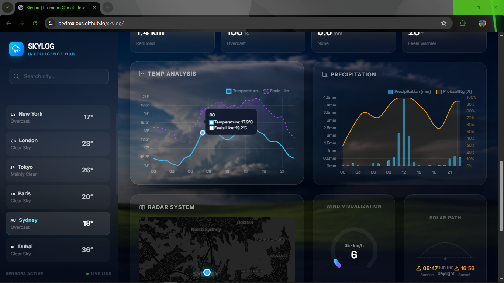

# SkyLog — Global Weather Dashboard

### Monitoramento climático em tempo real de 15 cidades ao redor do mundo

---

### Sync Ativo • Última atualização: 17:54 (BRT)
*Projeto em expansão, operando com automações no GitHub Actions para manter métricas globais atualizadas em tempo real. Consulte o link superior para a versão Web.*

 

## São Paulo, Brasil

<table>
  <tr>
    <td align="center" width="50%">
      
    </td>
    <td align="center" width="50%">
      
    </td>
  </tr>
</table>

| Parâmetro | Medição em Tempo Real |
|:---:|:---:|
| Temperatura | 15.2°C (Sensação: 14.5°C) |
| Variação Diária | 14.0°C — 19.4°C |
| Umidade / Pressão | 88% / 1019.3 hPa |
| Vento / Direção | 11.6 km/h (Direção: 141°) |
| UV / Visibilidade | 0.5 / 11.7 km |
| Condição Atual | Nublado |
| Horário Local | 17:53 |

### Previsão para os Próximos Dias

| Dia | Condição | Temperatura | Índice UV Máximo | Precipitação Prevista |
|:---:|:---:|:---:|:---:|:---:|
| Hoje | 🌦️ Chuvisco | 14.0°C a 19.4°C | UV: 2 | Precip: 8.3 mm |
| Amanhã | 🌦️ Chuvisco | 12.9°C a 17.2°C | UV: 2 | Precip: 0.8 mm |
| 10/11 | 🌦️ Chuvisco | 12.7°C a 20.2°C | UV: 6 | Precip: 1.0 mm |

 
 

## Rio de Janeiro, Brasil

<table>
  <tr>
    <td align="center" width="50%">
      
    </td>
    <td align="center" width="50%">
      
    </td>
  </tr>
</table>

| Parâmetro | Medição em Tempo Real |
|:---:|:---:|
| Temperatura | 20.0°C (Sensação: 20.5°C) |
| Variação Diária | 19.3°C — 26.3°C |
| Umidade / Pressão | 87% / 1018.3 hPa |
| Vento / Direção | 15.2 km/h (Direção: 194°) |
| UV / Visibilidade | 0.1 / 10.3 km |
| Condição Atual | Nublado |
| Horário Local | 17:53 |

### Previsão para os Próximos Dias

| Dia | Condição | Temperatura | Índice UV Máximo | Precipitação Prevista |
|:---:|:---:|:---:|:---:|:---:|
| Hoje | 🌧️ Chuva | 19.3°C a 26.3°C | UV: 1 | Precip: 9.9 mm |
| Amanhã | 🌦️ Chuvisco | 18.9°C a 21.7°C | UV: 1 | Precip: 3.0 mm |
| 10/11 | 🌦️ Chuvisco | 18.8°C a 23.3°C | UV: 7 | Precip: 0.2 mm |

 
 

## Buenos Aires, Argentina

<table>
  <tr>
    <td align="center" width="50%">
      
    </td>
    <td align="center" width="50%">
      
    </td>
  </tr>
</table>

| Parâmetro | Medição em Tempo Real |
|:---:|:---:|
| Temperatura | 18.9°C (Sensação: 15.6°C) |
| Variação Diária | 9.8°C — 19.4°C |
| Umidade / Pressão | 35% / 1023.6 hPa |
| Vento / Direção | 11.8 km/h (Direção: 71°) |
| UV / Visibilidade | 4.0 / 65.0 km |
| Condição Atual | Céu limpo |
| Horário Local | 17:53 |

### Previsão para os Próximos Dias

| Dia | Condição | Temperatura | Índice UV Máximo | Precipitação Prevista |
|:---:|:---:|:---:|:---:|:---:|
| Hoje | ☀️ Céu limpo | 9.8°C a 19.4°C | UV: 9 | Precip: 0.0 mm |
| Amanhã | ☀️ Céu limpo | 14.2°C a 23.3°C | UV: 9 | Precip: 0.0 mm |
| 10/11 | ☁️ Nublado | 17.2°C a 25.9°C | UV: 8 | Precip: 0.0 mm |

 
 

## Mexico City, México

<table>
  <tr>
    <td align="center" width="50%">
      
    </td>
    <td align="center" width="50%">
      
    </td>
  </tr>
</table>

| Parâmetro | Medição em Tempo Real |
|:---:|:---:|
| Temperatura | 23.2°C (Sensação: 21.9°C) |
| Variação Diária | 13.9°C — 23.2°C |
| Umidade / Pressão | 36% / 1011.7 hPa |
| Vento / Direção | 4.8 km/h (Direção: 211°) |
| UV / Visibilidade | 7.0 / 19.9 km |
| Condição Atual | Parcialmente nublado |
| Horário Local | 14:53 |

### Previsão para os Próximos Dias

| Dia | Condição | Temperatura | Índice UV Máximo | Precipitação Prevista |
|:---:|:---:|:---:|:---:|:---:|
| Hoje | 🌦️ Chuvisco | 13.9°C a 23.2°C | UV: 8 | Precip: 0.5 mm |
| Amanhã | 🌧️ Chuva | 13.3°C a 23.9°C | UV: 8 | Precip: 2.6 mm |
| 10/11 | 🌦️ Chuvisco | 14.2°C a 23.6°C | UV: 7 | Precip: 0.2 mm |

 
 

## Havana, Cuba

<table>
  <tr>
    <td align="center" width="50%">
      
    </td>
    <td align="center" width="50%">
      
    </td>
  </tr>
</table>

| Parâmetro | Medição em Tempo Real |
|:---:|:---:|
| Temperatura | 28.0°C (Sensação: 30.8°C) |
| Variação Diária | 23.2°C — 29.0°C |
| Umidade / Pressão | 69% / 1012.8 hPa |
| Vento / Direção | 13.1 km/h (Direção: 43°) |
| UV / Visibilidade | 2.6 / 50.7 km |
| Condição Atual | Nublado |
| Horário Local | 16:53 |

### Previsão para os Próximos Dias

| Dia | Condição | Temperatura | Índice UV Máximo | Precipitação Prevista |
|:---:|:---:|:---:|:---:|:---:|
| Hoje | 🌦️ Chuvisco | 23.2°C a 29.0°C | UV: 6 | Precip: 0.1 mm |
| Amanhã | 🌧️ Chuva | 23.4°C a 29.3°C | UV: 6 | Precip: 5.0 mm |
| 10/11 | 🌦️ Chuvisco | 23.2°C a 30.0°C | UV: 6 | Precip: 1.0 mm |

 
 

## Miami, EUA

<table>
  <tr>
    <td align="center" width="50%">
      
    </td>
    <td align="center" width="50%">
      
    </td>
  </tr>
</table>

| Parâmetro | Medição em Tempo Real |
|:---:|:---:|
| Temperatura | 26.8°C (Sensação: 30.6°C) |
| Variação Diária | 22.0°C — 28.0°C |
| Umidade / Pressão | 75% / 1014.3 hPa |
| Vento / Direção | 7.7 km/h (Direção: 112°) |
| UV / Visibilidade | 4.0 / 21.1 km |
| Condição Atual | Parcialmente nublado |
| Horário Local | 15:53 |

### Previsão para os Próximos Dias

| Dia | Condição | Temperatura | Índice UV Máximo | Precipitação Prevista |
|:---:|:---:|:---:|:---:|:---:|
| Hoje | ☁️ Nublado | 22.0°C a 28.0°C | UV: 6 | Precip: 0.0 mm |
| Amanhã | ⛈️ Tempestade | 22.1°C a 27.4°C | UV: 5 | Precip: 13.2 mm |
| 10/11 | ☁️ Nublado | 22.6°C a 27.6°C | UV: 6 | Precip: 0.0 mm |

 
 

## New York, EUA

<table>
  <tr>
    <td align="center" width="50%">
      
    </td>
    <td align="center" width="50%">
      
    </td>
  </tr>
</table>

| Parâmetro | Medição em Tempo Real |
|:---:|:---:|
| Temperatura | 15.4°C (Sensação: 10.8°C) |
| Variação Diária | 7.7°C — 16.0°C |
| Umidade / Pressão | 39% / 1008.9 hPa |
| Vento / Direção | 18.3 km/h (Direção: 263°) |
| UV / Visibilidade | 1.8 / 50.4 km |
| Condição Atual | Céu limpo |
| Horário Local | 15:53 |

### Previsão para os Próximos Dias

| Dia | Condição | Temperatura | Índice UV Máximo | Precipitação Prevista |
|:---:|:---:|:---:|:---:|:---:|
| Hoje | 🌦️ Chuvisco | 7.7°C a 16.0°C | UV: 3 | Precip: 0.1 mm |
| Amanhã | ☁️ Nublado | 6.5°C a 13.2°C | UV: 3 | Precip: 0.0 mm |
| 10/11 | ☁️ Nublado | 5.5°C a 16.0°C | UV: 3 | Precip: 0.0 mm |

 
 

## London, Reino Unido

<table>
  <tr>
    <td align="center" width="50%">
      
    </td>
    <td align="center" width="50%">
      
    </td>
  </tr>
</table>

| Parâmetro | Medição em Tempo Real |
|:---:|:---:|
| Temperatura | 8.7°C (Sensação: 7.0°C) |
| Variação Diária | 7.7°C — 10.7°C |
| Umidade / Pressão | 85% / 1020.9 hPa |
| Vento / Direção | 5.0 km/h (Direção: 52°) |
| UV / Visibilidade | 0.0 / 4.6 km |
| Condição Atual | Céu limpo |
| Horário Local | 20:53 |

### Previsão para os Próximos Dias

| Dia | Condição | Temperatura | Índice UV Máximo | Precipitação Prevista |
|:---:|:---:|:---:|:---:|:---:|
| Hoje | 🌦️ Chuvisco | 7.7°C a 10.7°C | UV: 1 | Precip: 0.1 mm |
| Amanhã | ☁️ Nublado | 6.8°C a 11.4°C | UV: 1 | Precip: 0.0 mm |
| 10/11 | 🌦️ Chuvisco | 6.6°C a 11.0°C | UV: 0 | Precip: 1.7 mm |

 
 

## Paris, França

<table>
  <tr>
    <td align="center" width="50%">
      
    </td>
    <td align="center" width="50%">
      
    </td>
  </tr>
</table>

| Parâmetro | Medição em Tempo Real |
|:---:|:---:|
| Temperatura | 7.2°C (Sensação: 5.0°C) |
| Variação Diária | 3.9°C — 7.2°C |
| Umidade / Pressão | 84% / 1021.8 hPa |
| Vento / Direção | 6.6 km/h (Direção: 99°) |
| UV / Visibilidade | 0.0 / 25.8 km |
| Condição Atual | Nublado |
| Horário Local | 21:53 |

### Previsão para os Próximos Dias

| Dia | Condição | Temperatura | Índice UV Máximo | Precipitação Prevista |
|:---:|:---:|:---:|:---:|:---:|
| Hoje | 🌧️ Chuva | 3.9°C a 7.2°C | UV: 2 | Precip: 0.0 mm |
| Amanhã | 🌧️ Chuva | 4.9°C a 8.9°C | UV: 2 | Precip: 0.6 mm |
| 10/11 | 🌧️ Chuva | 8.8°C a 14.4°C | UV: 1 | Precip: 9.4 mm |

 
 

## Moscow, Rússia

<table>
  <tr>
    <td align="center" width="50%">
      
    </td>
    <td align="center" width="50%">
      
    </td>
  </tr>
</table>

| Parâmetro | Medição em Tempo Real |
|:---:|:---:|
| Temperatura | 3.6°C (Sensação: 0.9°C) |
| Variação Diária | 0.4°C — 3.9°C |
| Umidade / Pressão | 93% / 1021.4 hPa |
| Vento / Direção | 6.6 km/h (Direção: 283°) |
| UV / Visibilidade | 0.0 / 15.7 km |
| Condição Atual | Nublado |
| Horário Local | 23:53 |

### Previsão para os Próximos Dias

| Dia | Condição | Temperatura | Índice UV Máximo | Precipitação Prevista |
|:---:|:---:|:---:|:---:|:---:|
| Hoje | ☁️ Nublado | 0.4°C a 3.9°C | UV: 0 | Precip: 0.0 mm |
| Amanhã | ☁️ Nublado | 3.1°C a 4.9°C | UV: 1 | Precip: 0.0 mm |
| 10/11 | 🌧️ Chuva | 2.7°C a 4.4°C | UV: 0 | Precip: 0.1 mm |

 
 

## Bangkok, Tailândia

<table>
  <tr>
    <td align="center" width="50%">
      
    </td>
    <td align="center" width="50%">
      
    </td>
  </tr>
</table>

| Parâmetro | Medição em Tempo Real |
|:---:|:---:|
| Temperatura | 25.4°C (Sensação: 30.0°C) |
| Variação Diária | 24.9°C — 34.1°C |
| Umidade / Pressão | 90% / 1013.3 hPa |
| Vento / Direção | 8.3 km/h (Direção: 338°) |
| UV / Visibilidade | 0.0 / 8.0 km |
| Condição Atual | Chuvisco |
| Horário Local | 03:53 |

### Previsão para os Próximos Dias

| Dia | Condição | Temperatura | Índice UV Máximo | Precipitação Prevista |
|:---:|:---:|:---:|:---:|:---:|
| Hoje | 🌦️ Chuvisco | 24.9°C a 34.1°C | UV: 8 | Precip: 2.8 mm |
| Amanhã | ☁️ Nublado | 24.9°C a 31.7°C | UV: 8 | Precip: 0.0 mm |
| 11/11 | 🌦️ Chuvisco | 23.3°C a 32.5°C | UV: 7 | Precip: 0.8 mm |

 
 

## Tokyo, Japão

<table>
  <tr>
    <td align="center" width="50%">
      
    </td>
    <td align="center" width="50%">
      
    </td>
  </tr>
</table>

| Parâmetro | Medição em Tempo Real |
|:---:|:---:|
| Temperatura | 8.9°C (Sensação: 6.9°C) |
| Variação Diária | 7.8°C — 10.6°C |
| Umidade / Pressão | 77% / 1027.4 hPa |
| Vento / Direção | 6.0 km/h (Direção: 335°) |
| UV / Visibilidade | 0.0 / 5.8 km |
| Condição Atual | Chuvisco |
| Horário Local | 05:53 |

### Previsão para os Próximos Dias

| Dia | Condição | Temperatura | Índice UV Máximo | Precipitação Prevista |
|:---:|:---:|:---:|:---:|:---:|
| Hoje | 🌧️ Chuva | 7.8°C a 10.6°C | UV: 1 | Precip: 8.6 mm |
| Amanhã | ☁️ Nublado | 6.4°C a 14.0°C | UV: 1 | Precip: 0.0 mm |
| 11/11 | ⛅ Parcialmente nublado | 4.6°C a 12.9°C | UV: 4 | Precip: 0.0 mm |

 
 

## Histórico de Dados

| Estatística | Valor |
|:---:|:---:|
| Total de registros | 19982 |
| Primeiro registro | `datetime` |
| Último registro | `2026-11-09 05:53` |
| Temperatura mais alta | **46.1°C** — Dubai |
| Temperatura mais baixa | **-0.2°C** — Moscow |

📂 <a href="data/history.csv">Ver histórico completo (history.csv)</a>

---

### Informações Técnicas

| Item | Detalhe |
|:---:|:---:|
| Fonte de dados | <a href="https://open-meteo.com/">Open-Meteo API</a> (gratuita) |
| Frequência | 24× ao dia (a cada hora) |
| Automação | GitHub Actions — <a href=".github/workflows/weather.yml">ver workflow</a> |
| Script | `update_weather.py` (requests e pytz) |
| Cidades Monitoradas | 15 cidades globais |

---

**Feito com amor por [Pedroxious](https://github.com/Pedroxious) · Dados: [Open-Meteo](https://open-meteo.com/)**

