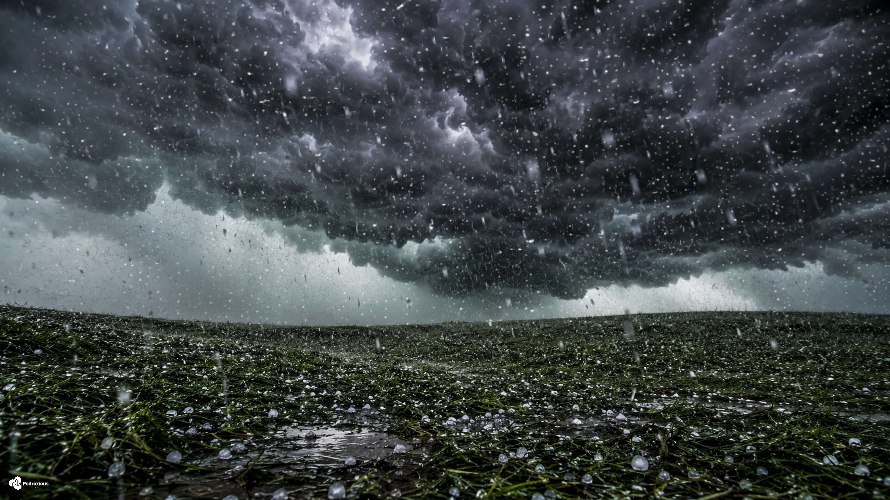

# SkyLog — Global Weather Dashboard

### Monitoramento climático em tempo real de 15 cidades ao redor do mundo

---

### Sync Ativo • Última atualização: 12:36 (BRT)
*Projeto em expansão, operando com automações no GitHub Actions para manter métricas globais atualizadas em tempo real. Consulte o link superior para a versão Web.*

 

## São Paulo, Brasil

<table>
  <tr>
    <td align="center" width="50%">
      
    </td>
    <td align="center" width="50%">
      
    </td>
  </tr>
</table>

| Parâmetro | Medição em Tempo Real |
|:---:|:---:|
| Temperatura | 24.8°C (Sensação: 27.6°C) |
| Variação Diária | 16.3°C — 26.7°C |
| Umidade / Pressão | 68% / 1014.8 hPa |
| Vento / Direção | 8.0 km/h (Direção: 337°) |
| UV / Visibilidade | 9.1 / 4.9 km |
| Condição Atual | Granizo |
| Horário Local | 12:36 |

### Previsão para os Próximos Dias

| Dia | Condição | Temperatura | Índice UV Máximo | Precipitação Prevista |
|:---:|:---:|:---:|:---:|:---:|
| Hoje | ⛈️ Tempestade | 16.3°C a 26.7°C | UV: 9 | Precip: 9.9 mm |
| Amanhã | ⛈️ Tempestade | 18.2°C a 28.0°C | UV: 3 | Precip: 10.3 mm |
| 03/11 | 🌦️ Chuvisco | 18.7°C a 29.0°C | UV: 9 | Precip: 0.5 mm |

 
 

## Rio de Janeiro, Brasil

<table>
  <tr>
    <td align="center" width="50%">
      
    </td>
    <td align="center" width="50%">
      
    </td>
  </tr>
</table>

| Parâmetro | Medição em Tempo Real |
|:---:|:---:|
| Temperatura | 24.9°C (Sensação: 28.2°C) |
| Variação Diária | 21.3°C — 26.2°C |
| Umidade / Pressão | 80% / 1015.7 hPa |
| Vento / Direção | 17.4 km/h (Direção: 129°) |
| UV / Visibilidade | 8.0 / 27.4 km |
| Condição Atual | Principalmente limpo |
| Horário Local | 12:36 |

### Previsão para os Próximos Dias

| Dia | Condição | Temperatura | Índice UV Máximo | Precipitação Prevista |
|:---:|:---:|:---:|:---:|:---:|
| Hoje | 🌦️ Chuvisco | 21.3°C a 26.2°C | UV: 8 | Precip: 0.1 mm |
| Amanhã | 🌧️ Chuva | 21.9°C a 28.7°C | UV: 9 | Precip: 3.4 mm |
| 03/11 | ☁️ Nublado | 22.7°C a 28.5°C | UV: 9 | Precip: 0.0 mm |

 
 

## Buenos Aires, Argentina

<table>
  <tr>
    <td align="center" width="50%">
      
    </td>
    <td align="center" width="50%">
      
    </td>
  </tr>
</table>

| Parâmetro | Medição em Tempo Real |
|:---:|:---:|
| Temperatura | 20.6°C (Sensação: 21.1°C) |
| Variação Diária | 17.6°C — 23.1°C |
| Umidade / Pressão | 74% / 1011.6 hPa |
| Vento / Direção | 9.7 km/h (Direção: 274°) |
| UV / Visibilidade | 2.1 / 18.4 km |
| Condição Atual | Nublado |
| Horário Local | 12:36 |

### Previsão para os Próximos Dias

| Dia | Condição | Temperatura | Índice UV Máximo | Precipitação Prevista |
|:---:|:---:|:---:|:---:|:---:|
| Hoje | 🌦️ Chuvisco | 17.6°C a 23.1°C | UV: 5 | Precip: 1.0 mm |
| Amanhã | 🌦️ Chuvisco | 16.4°C a 25.7°C | UV: 8 | Precip: 0.4 mm |
| 03/11 | 🌦️ Chuvisco | 17.6°C a 21.0°C | UV: 5 | Precip: 0.4 mm |

 
 

## Mexico City, México

<table>
  <tr>
    <td align="center" width="50%">
      
    </td>
    <td align="center" width="50%">
      
    </td>
  </tr>
</table>

| Parâmetro | Medição em Tempo Real |
|:---:|:---:|
| Temperatura | 18.2°C (Sensação: 17.3°C) |
| Variação Diária | 12.8°C — 26.0°C |
| Umidade / Pressão | 52% / 1022.7 hPa |
| Vento / Direção | 2.2 km/h (Direção: 14°) |
| UV / Visibilidade | 2.5 / 45.3 km |
| Condição Atual | Parcialmente nublado |
| Horário Local | 09:36 |

### Previsão para os Próximos Dias

| Dia | Condição | Temperatura | Índice UV Máximo | Precipitação Prevista |
|:---:|:---:|:---:|:---:|:---:|
| Hoje | ☁️ Nublado | 12.8°C a 26.0°C | UV: 8 | Precip: 0.0 mm |
| Amanhã | ☁️ Nublado | 14.2°C a 27.0°C | UV: 8 | Precip: 0.0 mm |
| 03/11 | ☁️ Nublado | 12.0°C a 28.0°C | UV: 8 | Precip: 0.0 mm |

 
 

## Havana, Cuba

<table>
  <tr>
    <td align="center" width="50%">
      
    </td>
    <td align="center" width="50%">
      
    </td>
  </tr>
</table>

| Parâmetro | Medição em Tempo Real |
|:---:|:---:|
| Temperatura | 28.3°C (Sensação: 34.1°C) |
| Variação Diária | 22.1°C — 28.9°C |
| Umidade / Pressão | 75% / 1017.2 hPa |
| Vento / Direção | 4.5 km/h (Direção: 23°) |
| UV / Visibilidade | 5.0 / 31.8 km |
| Condição Atual | Céu limpo |
| Horário Local | 11:36 |

### Previsão para os Próximos Dias

| Dia | Condição | Temperatura | Índice UV Máximo | Precipitação Prevista |
|:---:|:---:|:---:|:---:|:---:|
| Hoje | ⛈️ Tempestade | 22.1°C a 28.9°C | UV: 6 | Precip: 5.0 mm |
| Amanhã | ⛈️ Tempestade | 21.7°C a 27.5°C | UV: 7 | Precip: 6.1 mm |
| 03/11 | ⛈️ Tempestade | 22.6°C a 29.7°C | UV: 7 | Precip: 0.6 mm |

 
 

## Miami, EUA

<table>
  <tr>
    <td align="center" width="50%">
      
    </td>
    <td align="center" width="50%">
      
    </td>
  </tr>
</table>

| Parâmetro | Medição em Tempo Real |
|:---:|:---:|
| Temperatura | 26.3°C (Sensação: 28.8°C) |
| Variação Diária | 24.0°C — 27.3°C |
| Umidade / Pressão | 82% / 1017.4 hPa |
| Vento / Direção | 20.0 km/h (Direção: 92°) |
| UV / Visibilidade | 0.8 / 17.4 km |
| Condição Atual | Nublado |
| Horário Local | 10:36 |

### Previsão para os Próximos Dias

| Dia | Condição | Temperatura | Índice UV Máximo | Precipitação Prevista |
|:---:|:---:|:---:|:---:|:---:|
| Hoje | 🌧️ Chuva | 24.0°C a 27.3°C | UV: 3 | Precip: 3.2 mm |
| Amanhã | ⛈️ Tempestade | 23.1°C a 24.8°C | UV: 5 | Precip: 21.1 mm |
| 03/11 | ⛈️ Tempestade | 22.8°C a 28.1°C | UV: 6 | Precip: 2.6 mm |

 
 

## New York, EUA

<table>
  <tr>
    <td align="center" width="50%">
      
    </td>
    <td align="center" width="50%">
      
    </td>
  </tr>
</table>

| Parâmetro | Medição em Tempo Real |
|:---:|:---:|
| Temperatura | 12.1°C (Sensação: 10.8°C) |
| Variação Diária | 4.7°C — 15.6°C |
| Umidade / Pressão | 64% / 1033.6 hPa |
| Vento / Direção | 1.5 km/h (Direção: 271°) |
| UV / Visibilidade | 2.6 / 30.6 km |
| Condição Atual | Principalmente limpo |
| Horário Local | 10:36 |

### Previsão para os Próximos Dias

| Dia | Condição | Temperatura | Índice UV Máximo | Precipitação Prevista |
|:---:|:---:|:---:|:---:|:---:|
| Hoje | 🌤️ Principalmente limpo | 4.7°C a 15.6°C | UV: 4 | Precip: 0.0 mm |
| Amanhã | ☁️ Nublado | 7.0°C a 17.6°C | UV: 3 | Precip: 0.0 mm |
| 03/11 | ☁️ Nublado | 8.1°C a 19.2°C | UV: 4 | Precip: 0.0 mm |

 
 

## London, Reino Unido

<table>
  <tr>
    <td align="center" width="50%">
      
    </td>
    <td align="center" width="50%">
      
    </td>
  </tr>
</table>

| Parâmetro | Medição em Tempo Real |
|:---:|:---:|
| Temperatura | 11.8°C (Sensação: 9.6°C) |
| Variação Diária | 9.0°C — 12.0°C |
| Umidade / Pressão | 73% / 1032.9 hPa |
| Vento / Direção | 10.1 km/h (Direção: 13°) |
| UV / Visibilidade | 0.1 / 5.8 km |
| Condição Atual | Nublado |
| Horário Local | 15:36 |

### Previsão para os Próximos Dias

| Dia | Condição | Temperatura | Índice UV Máximo | Precipitação Prevista |
|:---:|:---:|:---:|:---:|:---:|
| Hoje | 🌦️ Chuvisco | 9.0°C a 12.0°C | UV: 1 | Precip: 0.1 mm |
| Amanhã | 🌦️ Chuvisco | 9.3°C a 12.3°C | UV: 1 | Precip: 0.2 mm |
| 03/11 | ☁️ Nublado | 8.8°C a 12.7°C | UV: 1 | Precip: 0.0 mm |

 
 

## Paris, França

<table>
  <tr>
    <td align="center" width="50%">
      
    </td>
    <td align="center" width="50%">
      
    </td>
  </tr>
</table>

| Parâmetro | Medição em Tempo Real |
|:---:|:---:|
| Temperatura | 13.3°C (Sensação: 10.3°C) |
| Variação Diária | 6.5°C — 13.8°C |
| Umidade / Pressão | 55% / 1029.5 hPa |
| Vento / Direção | 11.0 km/h (Direção: 23°) |
| UV / Visibilidade | 1.2 / 40.5 km |
| Condição Atual | Céu limpo |
| Horário Local | 16:36 |

### Previsão para os Próximos Dias

| Dia | Condição | Temperatura | Índice UV Máximo | Precipitação Prevista |
|:---:|:---:|:---:|:---:|:---:|
| Hoje | ☁️ Nublado | 6.5°C a 13.8°C | UV: 3 | Precip: 0.0 mm |
| Amanhã | 🌧️ Chuva | 7.8°C a 11.9°C | UV: 2 | Precip: 0.0 mm |
| 03/11 | 🌧️ Chuva | 4.5°C a 11.0°C | UV: 2 | Precip: 0.1 mm |

 
 

## Moscow, Rússia

<table>
  <tr>
    <td align="center" width="50%">
      
    </td>
    <td align="center" width="50%">
      
    </td>
  </tr>
</table>

| Parâmetro | Medição em Tempo Real |
|:---:|:---:|
| Temperatura | 2.2°C (Sensação: -0.5°C) |
| Variação Diária | 0.2°C — 8.8°C |
| Umidade / Pressão | 95% / 1030.3 hPa |
| Vento / Direção | 6.0 km/h (Direção: 17°) |
| UV / Visibilidade | 0.0 / 18.5 km |
| Condição Atual | Principalmente limpo |
| Horário Local | 18:36 |

### Previsão para os Próximos Dias

| Dia | Condição | Temperatura | Índice UV Máximo | Precipitação Prevista |
|:---:|:---:|:---:|:---:|:---:|
| Hoje | ☁️ Nublado | 0.2°C a 8.8°C | UV: 2 | Precip: 0.0 mm |
| Amanhã | 🌫️ Neblina | -1.5°C a 1.4°C | UV: 2 | Precip: 0.0 mm |
| 03/11 | 🌨️ Granizo | -2.0°C a 0.3°C | UV: 1 | Precip: 0.6 mm |

 
 

## Bangkok, Tailândia

<table>
  <tr>
    <td align="center" width="50%">
      
    </td>
    <td align="center" width="50%">
      
    </td>
  </tr>
</table>

| Parâmetro | Medição em Tempo Real |
|:---:|:---:|
| Temperatura | 28.8°C (Sensação: 34.2°C) |
| Variação Diária | 24.8°C — 34.7°C |
| Umidade / Pressão | 76% / 1014.7 hPa |
| Vento / Direção | 5.1 km/h (Direção: 132°) |
| UV / Visibilidade | 0.0 / 20.4 km |
| Condição Atual | Céu limpo |
| Horário Local | 22:36 |

### Previsão para os Próximos Dias

| Dia | Condição | Temperatura | Índice UV Máximo | Precipitação Prevista |
|:---:|:---:|:---:|:---:|:---:|
| Hoje | ⛈️ Tempestade | 24.8°C a 34.7°C | UV: 8 | Precip: 12.6 mm |
| Amanhã | 🌦️ Chuvisco | 26.8°C a 35.7°C | UV: 8 | Precip: 1.4 mm |
| 03/11 | 🌦️ Chuvisco | 25.5°C a 34.8°C | UV: 8 | Precip: 2.3 mm |

 
 

## Tokyo, Japão

<table>
  <tr>
    <td align="center" width="50%">
      
    </td>
    <td align="center" width="50%">
      
    </td>
  </tr>
</table>

| Parâmetro | Medição em Tempo Real |
|:---:|:---:|
| Temperatura | 13.6°C (Sensação: 13.6°C) |
| Variação Diária | 11.7°C — 22.1°C |
| Umidade / Pressão | 87% / 1015.7 hPa |
| Vento / Direção | 3.8 km/h (Direção: 319°) |
| UV / Visibilidade | 0.0 / 27.9 km |
| Condição Atual | Principalmente limpo |
| Horário Local | 00:36 |

### Previsão para os Próximos Dias

| Dia | Condição | Temperatura | Índice UV Máximo | Precipitação Prevista |
|:---:|:---:|:---:|:---:|:---:|
| Hoje | 🌧️ Chuva | 11.7°C a 22.1°C | UV: 4 | Precip: 7.2 mm |
| Amanhã | ⛅ Parcialmente nublado | 12.3°C a 18.8°C | UV: 4 | Precip: 0.0 mm |
| 04/11 | 🌦️ Chuvisco | 12.2°C a 16.6°C | UV: 0 | Precip: 0.4 mm |

 
 

## Dubai, Emirados Árabes

<table>
  <tr>
    <td align="center" width="50%">
      
    </td>
    <td align="center" width="50%">
      
    </td>
  </tr>
</table>

| Parâmetro | Medição em Tempo Real |
|:---:|:---:|
| Temperatura | 30.3°C (Sensação: 34.4°C) |
| Variação Diária | 26.7°C — 35.3°C |
| Umidade / Pressão | 66% / 1016.0 hPa |
| Vento / Direção | 10.9 km/h (Direção: 343°) |
| UV / Visibilidade | 0.0 / 24.1 km |
| Condição Atual | Céu limpo |
| Horário Local | 19:36 |

### Previsão para os Próximos Dias

| Dia | Condição | Temperatura | Índice UV Máximo | Precipitação Prevista |
|:---:|:---:|:---:|:---:|:---:|
| Hoje | ☀️ Céu limpo | 26.7°C a 35.3°C | UV: 6 | Precip: 0.0 mm |
| Amanhã | ☀️ Céu limpo | 26.0°C a 31.2°C | UV: 6 | Precip: 0.0 mm |
| 03/11 | ☀️ Céu limpo | 26.5°C a 31.5°C | UV: 6 | Precip: 0.0 mm |

 
 

## Cairo, Egito

<table>
  <tr>
    <td align="center" width="50%">
      
    </td>
    <td align="center" width="50%">
      
    </td>
  </tr>
</table>

| Parâmetro | Medição em Tempo Real |
|:---:|:---:|
| Temperatura | 27.8°C (Sensação: 27.8°C) |
| Variação Diária | 16.0°C — 29.3°C |
| Umidade / Pressão | 35% / 1015.6 hPa |
| Vento / Direção | 2.3 km/h (Direção: 18°) |
| UV / Visibilidade | 0.3 / 46.4 km |
| Condição Atual | Parcialmente nublado |
| Horário Local | 17:36 |

### Previsão para os Próximos Dias

| Dia | Condição | Temperatura | Índice UV Máximo | Precipitação Prevista |
|:---:|:---:|:---:|:---:|:---:|
| Hoje | ☁️ Nublado | 16.0°C a 29.3°C | UV: 4 | Precip: 0.0 mm |
| Amanhã | ☁️ Nublado | 18.6°C a 31.5°C | UV: 5 | Precip: 0.0 mm |
| 03/11 | ☁️ Nublado | 18.4°C a 30.3°C | UV: 5 | Precip: 0.0 mm |

 
 

## Sydney, Austrália

<table>
  <tr>
    <td align="center" width="50%">
      
    </td>
    <td align="center" width="50%">
      
    </td>
  </tr>
</table>

| Parâmetro | Medição em Tempo Real |
|:---:|:---:|
| Temperatura | 17.4°C (Sensação: 19.3°C) |
| Variação Diária | 16.1°C — 22.9°C |
| Umidade / Pressão | 90% / 1016.4 hPa |
| Vento / Direção | 0.3 km/h (Direção: 45°) |
| UV / Visibilidade | 0.0 / 19.1 km |
| Condição Atual | Céu limpo |
| Horário Local | 02:36 |

### Previsão para os Próximos Dias

| Dia | Condição | Temperatura | Índice UV Máximo | Precipitação Prevista |
|:---:|:---:|:---:|:---:|:---:|
| Hoje | 🌦️ Chuvisco | 16.1°C a 22.9°C | UV: 8 | Precip: 1.7 mm |
| Amanhã | ⛈️ Tempestade | 17.0°C a 23.5°C | UV: 9 | Precip: 10.0 mm |
| 04/11 | 🌦️ Chuvisco | 17.2°C a 22.2°C | UV: 8 | Precip: 1.9 mm |

 
 

## Histórico de Dados

| Estatística | Valor |
|:---:|:---:|
| Total de registros | 19569 |
| Primeiro registro | `datetime` |
| Último registro | `2026-11-02 02:36` |
| Temperatura mais alta | **46.1°C** — Dubai |
| Temperatura mais baixa | **0.7°C** — Buenos Aires |

📂 <a href="data/history.csv">Ver histórico completo (history.csv)</a>

---

### Informações Técnicas

| Item | Detalhe |
|:---:|:---:|
| Fonte de dados | <a href="https://open-meteo.com/">Open-Meteo API</a> (gratuita) |
| Frequência | 24× ao dia (a cada hora) |
| Automação | GitHub Actions — <a href=".github/workflows/weather.yml">ver workflow</a> |
| Script | `update_weather.py` (requests e pytz) |
| Cidades Monitoradas | 15 cidades globais |

---

**Feito com amor por [Pedroxious](https://github.com/Pedroxious) · Dados: [Open-Meteo](https://open-meteo.com/)**

